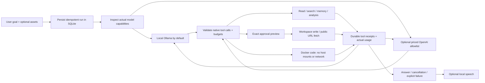

# Integrated local agent: design and evidence

Chandra supplies the server, SQLite run ledger and policy boundary.
MyAIPartner supplies the conversation, attachments, approvals and voice controls.
fraymus-voice supplies Windows speech output, offline WAV transcription and local
SQLite voice memory.
These are three sibling repositories. The local launcher composes their server,
interface and voice services; each repository keeps its own source and tests.

## Execution whiteboard



The model proposes actions. The runtime enforces schemas, file policies,
approvals and limits independently of the model. It never executes a code block
merely because an answer contains one. Known schema errors get one correction
opportunity; no tools in an invalid round execute. Unknown/malformed calls fail.
All attempted calls consume budgets. The second invalid round ends the run.

The client keeps request/run identities across reloads and transient failures.
It resumes durable event cursors, exposes Cancel, and blocks duplicate new
submissions while a request is unresolved. A lost creation receipt is recovered
explicitly using its original idempotency key. Completed conversation turns are
retained within a bounded context; attachment data belongs to the current turn.

## Capability ledger

| Area | Implemented | Boundary |
|---|---|---|
| Language/reasoning | Installed Ollama chat models; optional OpenAI Responses adapter | Quality depends on model weights and prompt; installing tools does not train a frontier model |
| Files | Bounded list/read/literal search; hash-checked writes | Workspace only; no links, traversal, secret/key paths or binary text reads |
| Coding | Bounded tree map, eight-file exact batch read, compact literal edits and one exact approval for a 2–8-file patch, with per-file observed readback and progress | Sequential in-place writes, no crash-atomic multi-file transaction, AST, automatic partial/unknown retry or sandboxed repo runner. See [coding tools](docs/coding.md) |
| Code | Docker Node/Python execution with resource limits, policy verification and cleanup | Default fails closed until the Linux engine/images are ready; no host mounts/network. Host execution needs two explicit operator flags and exact approval |
| Web | Public source discovery with query disclosure; text snapshots, numbered reads, literal search, stable link IDs and linked-page retrieval | Exact provider/query approval for search and exact URL approval for fetch/follow, DNS pinning and quotas; inert text only, no rendered browser/login. See [search](docs/web-search.md) and [web research](docs/web-research.md) |
| Windows desktop | Selected-window UIA observations; separate text, invoke and scroll plans; exact action approvals and durable outcomes; human-only window previews | User-session permissions, no OS sandbox. Deployment allowlists only the owned test fixture. Local-only conversation history; no global keys/pointer, no self-approval, no verified ChatGPT account workflow. Model image input remains disabled after failed perception probes. See [desktop boundaries](docs/desktop.md) |
| Memory | Conversation-scoped agent notes, bounded chat context, local voice SQLite | Local storage; no weight updates or automatic external memory service |
| Images | Direct PNG/JPEG vision input or explicitly selected local Gemma3 helper with a tool-capable text primary; source hashes and shared input/output accounting | Four files, 4 MiB each; bounded PNG expansion, JPEG framing checks. Helper sees pixels while primary sees references and fallible observations; exact OCR and desktop image control remain unverified. See [local vision](docs/local-vision.md) |
| Semantic retrieval | Attached-source local embeddings, exact scope/model hashes, resumable complete indexes and actual embedding token accounting | Float32 production vectors; no partial ranked search, OCR, cloud embeddings or automatic downloads. Small-corpus RGBA quantization results do not establish general accuracy. See [retrieval](docs/semantic-retrieval.md) |
| Document assets | UTF-8 text/Markdown/JSON, PDF text by page, ZIP text members; bounded previews/search/chunks and fallible local OCR of images or selected PDF pages | 4 MiB uploads; native text by default, explicit English OCR with source/render/engine receipts, no figure understanding or accuracy guarantee. ZIP CRC checks, no extraction/execution. See [document limits](docs/documents.md) and [local OCR](docs/local-ocr.md) |
| Voice | Windows System.Speech WAV output; offline CPU Whisper transcription of uploaded PCM16 WAVs, with transcript review and draft-only insertion | English small.en model, 4 MiB / 60 seconds, 8–48 kHz mono/stereo; no microphone recording, full duplex or Windows voice cloning. See [audio limits](docs/audio.md) |
| Reliability | Durable runs/events, exact approvals, cancellation, queues, idempotency | Process must remain running; restart interrupts unfinished runs instead of replaying side effects |
| Scheduled tasks | Local once/interval/daily/weekly runs, previews, revisions, durable occurrence/provenance ledger and lifetime token/run caps | App must stay running. No cloud, desktop grants, recursive scheduling or inherited approvals; uncertain work is not replayed. See [task policies](docs/tasks.md) |
| Costs | Actual primary/auxiliary input/output, durable unresolved holds, cumulative tokens/time/tools, optional per-run USD ceiling | Local API cost excludes electricity; cloud prices are server-configured and must remain accurate. Partial known usage is charged while only missing dimensions retain holds |
| Reasoning controls | Advertised typed local reasoning choices, private bounded tool-loop continuation, explicit interactive input/output/total/time limits | No automatic escalation or guaranteed quality/cost improvement. Raw traces are not persisted; metadata races remain best effort. See [controls](docs/reasoning-and-budgets.md) |
| RGBA/XYZW | Lossless bytes in original PNG, hashes/CRC, one-erasure XOR parity; explicit synthetic vector study | No extra information capacity, tokenizer replacement, hidden radio channel or intelligence gain established |
| Future extensions | Provider/tool descriptors documented | Unattended rendered browser work and model training remain incomplete; live container isolation awaits the host prerequisite below |

## Run and inspect

See [validation and remaining gates](docs/validation.md) for the current test
baseline and the distinction between implemented features and live isolation.

On Windows, from Chandra:

```powershell
.\scripts\start-local.ps1 -Build
```

Open `http://127.0.0.1:8787/`. The full-screen MyAIPartner interface is served
directly, with Chat, History, Tasks and Settings. `/partner/` remains an equivalent
entry URL. There is no enclosing dashboard or iframe, and the Transport lab,
Legacy mesh and Simulations pages are removed. Their backend APIs, research
modules and stored data remain available independently of the interface.
The launcher uses ports 8787/9099; logs and
owned process records are under ignored `data/`. Run `stop-local.ps1` to stop
only workers whose executable and full script still match their recorded IDs.

For manual startup, install the locked dependencies in Chandra, Chandra/client
and MyAIPartner, then run `npm run build` from Chandra. That builds the canonical
companion and the minimal development handoff, once each. Start
`python bin/local-voice-server.py` from fraymus-voice, and run `npm start` from
Chandra. `npm start` sets production mode portably. A missing companion build
returns HTTP 503; the old dashboard is never served as a fallback.

`GET /api/agent/capabilities` reports actual model metadata and policy. Unsupported
embedding/non-completion models are unavailable for chat. A `tools` advertisement
means the model supports native calls, not that it passes every task. Local
inference freshly checks model metadata so a retargeted cloud alias cannot bypass
the local policy. The development proxies rewrite Host to the backend origin.

The partner uses a 16k context budget for general runs and 32k for three or four
images (64k cumulative tokens). Output defaults to 2048 cumulative generated tokens.
The core and companion default to a 16k context cap; the byte-based estimate deliberately
overestimates ordinary text token counts and can reject large inputs early.
Original goals and current tool context are never silently truncated.
Document previews reserve room for subsequent retrieval tool results rather than
filling the initial context window. Full document text remains in the local index.
Optional document/web/transport schemas load only when relevant or enabled through
`tools.enable`; activation never changes approvals, permissions or budgets.
Task creation/update schemas are split by schedule kind to fit ordinary input
budgets. The canonical data directory has one OS-backed process owner before DB
recovery, regardless of HTTP port. Scheduled work records its own local provenance
and never inherits an earlier creation run's tool approvals. See [tasks](docs/tasks.md).

## Sandbox readiness on this computer

Docker is now the default code executor. Verified available containers can run
code without a per-call approval; workspace writes and public URL requests retain
their approval gates. Missing configuration, engine failures, policy mismatch or
unconfirmed cleanup disable code execution. There is no automatic host fallback.

The current machine is an ASUS PRIME Z390-A with an Intel Core i9-9900K. Windows
reports WSL and Virtual Machine Platform enabled, but firmware virtualization
disabled and no running hypervisor. Docker's Linux engine reports
`HCS_E_HYPERV_NOT_INSTALLED`. Live sandbox success has **not** been established.
Chat, file tools and voice remain available while code execution is disabled.

Enable Intel Virtualization Technology in UEFI and restart Windows, then start
Docker Desktop, run `npm run sandbox:setup`, restart Chandra and run
`npm run sandbox:verify`. The setup command explicitly downloads only the official
Node/Python images and records immutable IDs. Runtime/model requests never pull
images. See [sandbox design and operator steps](docs/sandbox.md) and
[ASUS's official firmware instructions](https://www.asus.com/us/support/faq/1043786/).

Containers use a nonroot UID, read-only root, small temporary filesystem, no
network or host mounts, dropped capabilities, seccomp, fixed namespaces/runtime,
memory/CPU/PID/deadline/output limits, and independently verified cleanup. Tests
currently validate policy and lifecycle using injected Docker process responses.
Actual isolation/resource probes must pass on a functioning local engine before
relying on this for unattended work. Containers still share the Linux engine
kernel; they are not a proof against kernel/container-runtime vulnerabilities.

## Optional cloud configuration

Cloud is off by default. Enabling it needs all of the following server variables:

```text
FRAYMUS_CLOUD_ENABLED=1
OPENAI_API_KEY=<server-owned secret, never a browser field>
FRAYMUS_CLOUD_MAX_RUN_USD=1
FRAYMUS_CLOUD_MODELS_JSON=<JSON model allowlist with verified positive rates>
```

Each model entry contains `inputUsdPerMillion`, `outputUsdPerMillion`, and
explicit `tools`/`vision` flags. Do not invent or copy stale rates. The user must
also enable cloud in the UI, select that provider/model, and enter a positive
per-run dollar limit no greater than the server ceiling. There is no automatic
fallback or paid retry. The Responses adapter counts input tokens, reserves an
affordable maximum output before generation, uses `store:false`, and records
actual usage. Uncertain charges retain their reservation. The cap applies per
run, not per account/month. Uploaded content and goals go to the selected cloud
provider when the user explicitly chooses a cloud run.

Cloud validation used mocked HTTP only; no paid API call was made. Implementation
references: [OpenAI function calling](https://developers.openai.com/api/docs/guides/function-calling),
[input token counting](https://developers.openai.com/api/reference/python/resources/responses/subresources/input_tokens/methods/count),
and [Ollama tool calling](https://docs.ollama.com/capabilities/tool-calling).

## Transport experiment and interpretation

`npm run benchmark` emits repeatable JSON; the live lab reads `/api/lab/transport`.
Fixtures include repeated UTF-8 text, seeded high-entropy bytes and float32 bytes.
Every original payload is decoded and compared byte for byte. Parity tests erase
one data shard in each group and compare the recovered logical payload. CRC is
an accidental-corruption check; SHA-256 checks logical content. Neither proves
the sender's identity.

The measured default repeated fixture is 16,362 bytes raw, 78 bytes in ordinary
Brotli and 202 bytes in PNG. The 16,384-byte high-entropy fixture becomes 16,577 bytes
in PNG. Carrier overhead and data distribution matter. Parity wire totals include
JSON, base64, frames and manifest, rather than only decoded shard payloads.
Elapsed time is combined local work, not an isolated codec throughput benchmark.

Four float32 XYZW values occupy 128 bits (16 bytes), requiring four 8-bit RGBA
pixels before compression. A single RGBA pixel can instead carry four quantized
8-bit coordinates with lost precision. The vector study measures that tradeoff
on synthetic 4D data. It does not establish recognition gains on real tasks.

Use original PNG bytes; screenshots, canvas alpha premultiplication, color
conversion and JPEG can change the carrier. [PNG's lossless representation](https://www.w3.org/TR/png-3/)
preserves bytes within its format; a physical light/audio channel still requires
hardware, noise measurements and an actual modulation/receiver experiment.
No secret unused computer frequency has been demonstrated here.

Native model tokenizers stay unchanged: their token IDs are tied to trained
embeddings. Encoding text as pixels is not proof of cheaper or more accurate
model input. Actual model token receipts and measured task success must decide.

## Verification and next engineering gates

Run `npm test` in Chandra, `npm test` in MyAIPartner, and
`python -m unittest discover -s tests` in fraymus-voice. Build both interfaces.
Backend tests include actual filesystem/process work with mocked model HTTP,
real HTTP routing/uploads, malformed image/transport inputs and budget/approval
failures. Live receipts are separate from mocked tests.

Live model attempts deliberately tested hidden-in-file random values and actual
file creation. Initial PROTOCOL/llama3.2 calls exposed invalid argument types;
Mistral sometimes described calls without issuing them. GPT-OSS 20B retrieved the
exact nonce. These failures motivated strict validation feedback and clearer
tool/approval instructions. A successful text response alone is not evidence of
an executed action. Inspect durable tool receipts and the resulting file.

Before relying on unattended execution, enable the host prerequisite and pass
the live sandbox probes, then expand adversarial end-to-end action evaluation.
Before changing compression/tokenization, measure
task accuracy, end-to-end cost, latency and failure rate against standard native
inputs. Before physical-channel claims, specify hardware and reproduce measured
bit-error rate and recovery under controlled path loss. Offline WAV transcription
is now configured and verified on synthetic speech; human-speech quality remains
unmeasured. Microphone input, full duplex and Windows voice cloning remain separate
extensions requiring appropriate engines and explicit microphone/data consent.
