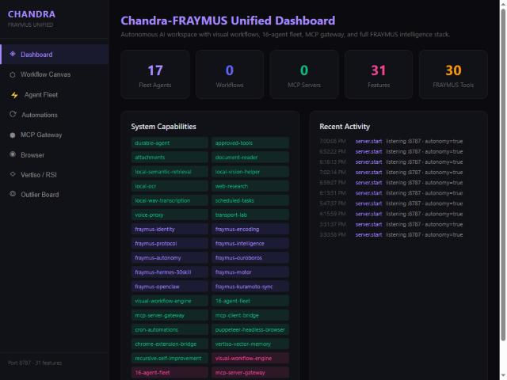
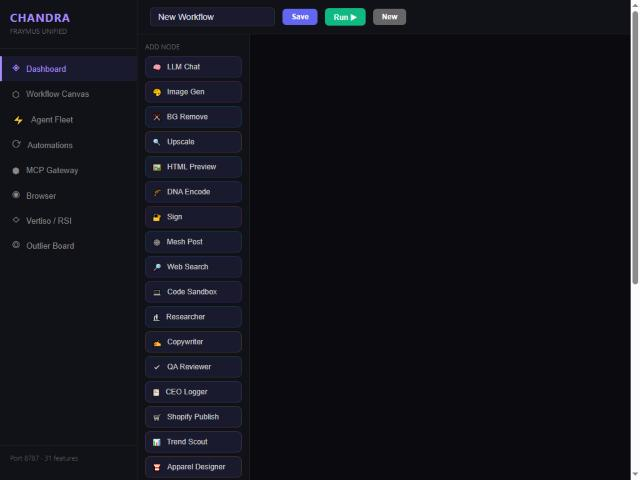
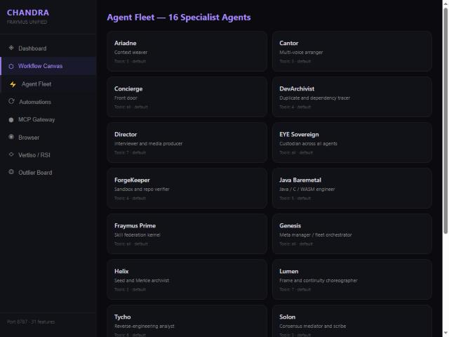
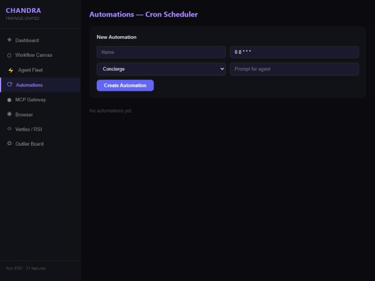
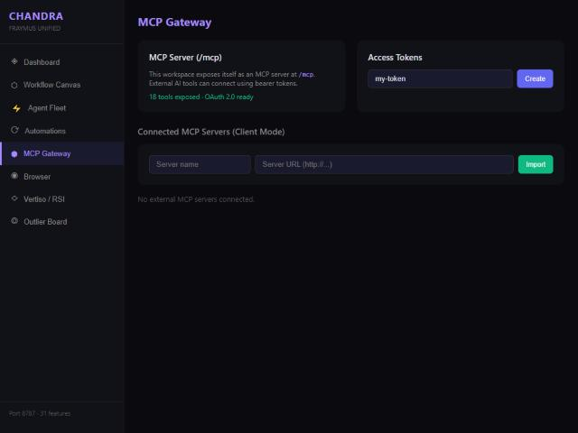
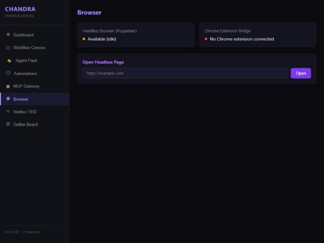
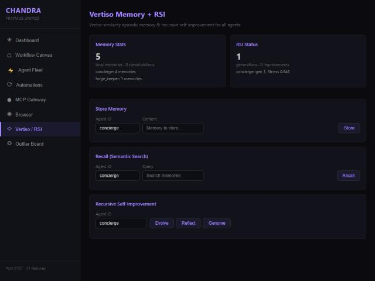
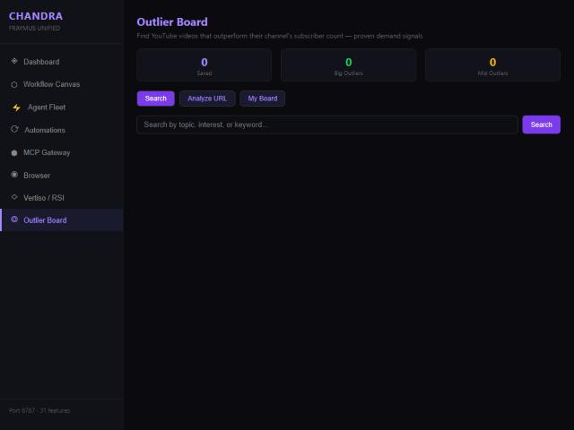
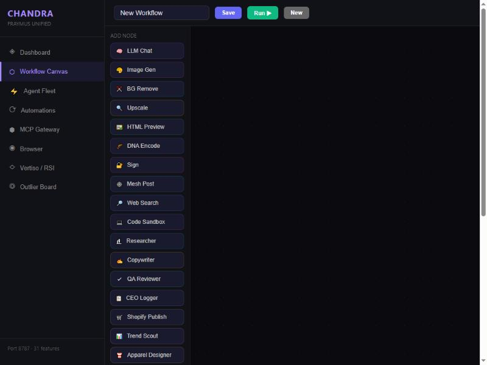

<p align="center">
  
</p>

<h1 align="center">CHANDRA-FRAYMUS</h1>

<p align="center">
  <strong>Autonomous AI Commerce & Intelligence Platform</strong><br/>
  <em>by eyeoverthink®</em>
</p>

<p align="center">
  
  
  
  
  
  
</p>

<p align="center">
  <a href="#-quick-start">Quick Start</a> · 
  <a href="#-commerce-pipelines">Commerce</a> · 
  <a href="#-intelligence-stack">Intelligence</a> · 
  <a href="#-visual-workflow-canvas">Workflows</a> · 
  <a href="#-api-reference">API</a> · 
  <a href="#-architecture">Architecture</a>
</p>

---

## The Vision

> **What if your entire e-commerce operation — from trend research to product design to store optimization — ran itself?**

Chandra-FRAYMUS is a local-first autonomous AI platform that fuses a 17-agent fleet, 4 commerce pipelines, vector memory, recursive self-improvement, and a visual workflow canvas into a single system. It doesn't just assist — it **operates**. Point it at your Shopify store and Printify catalog, and it will research trends, design products, generate store pages, audit your UX, fix your pricing, and publish — all without leaving your machine.

No cloud AI subscriptions. No API rate-limit anxiety. **Your hardware. Your models. Your store. Full autonomy.**

```
   ╔══════════════════════════════════════════════════════════════════╗
   ║                    CHANDRA-FRAYMUS v1.0.0                       ║
   ║            Autonomous AI Commerce & Intelligence                ║
   ║                                                                  ║
   ║   17 Agents · 4 Commerce Pipelines · 30 Hermes Skills           ║
   ║   30 Workflow Nodes · 39 Entity Schemas · Vertiso Vector Memory  ║
   ║   Kuramoto Phase Sync · Ouroboros RSI · Ed25519 Identity         ║
   ║                                                                  ║
   ║   ┌──────────┐  ┌──────────┐  ┌──────────┐  ┌──────────┐       ║
   ║   │ Shopify  │  │ Printify │  │  Ollama  │  │  Vertiso │       ║
   ║   │   Live   │◄─┤   POD    │◄─┤  Local   │◄─┤  Memory  │       ║
   ║   │  Store   │  │  Catalog │  │ Inference│  │  10K Vec │       ║
   ║   └──────────┘  └──────────┘  └──────────┘  └──────────┘       ║
   ╚══════════════════════════════════════════════════════════════════╝
```

---

## Why Chandra-FRAYMUS?

| Problem | How Chandra-FRAYMUS Solves It |
|---------|-------------------------------|
| Running an e-commerce brand is a full-time job | **4 autonomous commerce pipelines** handle product creation, store optimization, pricing, and content — end to end |
| AI tools are siloed and don't talk to each other | **Triple integration** — every capability is a REST endpoint, a fleet agent tool, AND a visual workflow node simultaneously |
| Cloud AI is expensive and rate-limited | **100% local inference** via Ollama — your GPU, your models, zero per-token cost |
| AI agents forget everything between sessions | **Vertiso vector memory** with 10K episodic memories, 768-dim embeddings, and orbital decay |
| No way to improve agent performance over time | **Ouroboros RSI engine** — evolutionary self-improvement that mutates, scores, and selects winning strategies across 1,000 generations |
| Workflow tools are either too simple or too complex | **Visual drag-and-drop canvas** with 30 node types and topological-sort DAG execution |
| Print-on-demand setup takes forever | **Apparel pipeline** scouts trends, designs products across 24 product types, pushes to Printify, syncs to Shopify, and optimizes pricing — automatically |

---

## What Makes This Different

### 1. Triple Integration Pattern
Every pipeline stage exists **simultaneously** as:
- A **REST API endpoint** you can call from anywhere
- A **fleet agent tool** the AI can invoke during autonomous runs
- A **visual workflow node** you can drag onto the canvas

This isn't three separate systems glued together — it's one architecture that speaks three languages.

### 2. Fan-Out / Fan-In Parallelism
The Store Fixer pipeline runs 3 agents in parallel (`Promise.all()`), then converges results through a single Shopify Applier — real concurrent execution, not sequential chain-of-thought.

### 3. Graceful Degradation
No API tokens configured? The pipelines still run — they generate all the content, organize everything, and return `status: 'queued'` with the complete payload. Add tokens later and the queue drains instantly.

### 4. Cryptographic Identity
Every agent action can be Ed25519-signed. Verifiable on the mesh. Not "trust me, I'm an AI" — **cryptographic proof of provenance**.

### 5. Self-Improving Agents
The Ouroboros RSI engine doesn't just run agents — it **evolves** them. Mutates prompts, adjusts parameters, scores outputs, selects winners. Your agents get better while you sleep.

---

## Quick Start

### Prerequisites

| Requirement | Version | Purpose |
|-------------|---------|---------|
| **Node.js** | >= 22.13.0 | Runtime |
| **Ollama** | Latest | Local LLM inference (port 11434) |
| **Docker** | Optional | Sandboxed code execution |

### Install

```bash
git clone https://github.com/eyeoverthink/chandra-fraymus.git
cd chandra-fraymus
npm install
```

### Configure

```bash
cp .env.example .env
```

Edit `.env` with your credentials:

```env
# Required — Local AI
OLLAMA_BASE_URL=http://127.0.0.1:11434
FRAYMUS_DEFAULT_MODEL=llama3.2

# Commerce — Shopify (unlocks store fixer + content pipeline)
SHOPIFY_ACCESS_TOKEN=shpat_your_token_here
SHOPIFY_STORE_DOMAIN=your-store.myshopify.com

# Commerce — Printify (unlocks apparel pipeline)
PRINTIFY_ACCESS_TOKEN=your_printify_jwt
PRINTIFY_SHOP_ID=your_shop_id

# Optional — YouTube research
YOUTUBE_API_KEY=your_youtube_api_key
```

### Run

```bash
# Both server + frontend (recommended)
npm run dev

# Server only
npm run server

# Frontend only
npm run client
```

The server starts at **`http://127.0.0.1:8787`** with WebSocket at `/ws`, the autonomy engine auto-started, and all 31 features loaded.

The frontend starts at **`http://localhost:5173`** with hot-reload.

---

## Screenshots

### Dashboard

*System overview — 17 agents, 31 features, 30 FRAYMUS tools, real-time activity feed*

### Workflow Canvas

*Visual drag-and-drop editor with 30 node types — LLM, Image Gen, Commerce, FRAYMUS encoding, and more*

### Agent Fleet

*17 specialist agents — from context weaving (Ariadne) to reverse engineering (Tycho) to fleet orchestration (Genesis)*

### Automations

*Cron scheduler — schedule any agent with any prompt on any interval*

### MCP Gateway

*18 tools exposed via Model Context Protocol — OAuth 2.0 ready, connect external AI tools with bearer tokens*

### Browser

*Puppeteer headless browser + Chrome extension bridge — agents can browse, scrape, and interact with the web*

### Vertiso Memory + RSI

*Vector-similarity episodic memory (768-dim) + recursive self-improvement — store, recall, evolve, reflect, genome*

### Outlier Board

*YouTube outlier research — find videos that outperform their channel's subscriber count (proven demand signals)*

---

## Commerce Pipelines

The crown jewel of Chandra-FRAYMUS. Four autonomous agent pipelines that run your e-commerce operation.

### Pipeline 1: Content-to-Commerce

> **Idea → Published Shopify Product in One Command**

```
  ┌────────────┐    ┌────────────┐    ┌────────────┐    ┌────────────┐    ┌────────────┐
  │ Researcher │───►│ Copywriter │───►│ QA Reviewer│───►│ CEO Logger │───►│  Shopify   │
  │            │    │            │    │            │    │            │    │  Publish   │
  │ Deep-dive  │    │ Blog post  │    │ Score 0-10 │    │ Approve or │    │ Live on    │
  │ the topic  │    │ + product  │    │ + fix list │    │ reject     │    │ your store │
  └────────────┘    └────────────┘    └────────────┘    └────────────┘    └────────────┘
```

**What it does**: Give it a topic ("sustainable streetwear trends 2026"). It researches, writes a blog post and product descriptions, reviews for quality, logs the decision, and publishes directly to your Shopify store.

```bash
curl -X POST http://localhost:8787/api/commerce/pipeline \
  -H "Content-Type: application/json" \
  -d '{"topic": "sustainable streetwear trends", "contentType": "both"}'
```

### Pipeline 2: Apparel Production

> **Trend → Designed → Manufactured → Listed → Priced**

```
  ┌────────────┐    ┌────────────┐    ┌────────────┐    ┌────────────┐    ┌────────────┐
  │   Trend    │───►│  Apparel   │───►│  Printify  │───►│  Shopify   │───►│  Pricing   │
  │   Scout    │    │  Designer  │    │   Push     │    │   Sync     │    │  Engine    │
  │            │    │            │    │            │    │            │    │            │
  │ Research   │    │ Design for │    │ Create on  │    │ Sync to    │    │ Optimize   │
  │ what's hot │    │ 24 product │    │ Printify   │    │ Shopify    │    │ margins    │
  │            │    │ types      │    │ with POD   │    │ storefront │    │ 50-65%     │
  └────────────┘    └────────────┘    └────────────┘    └────────────┘    └────────────┘
```

**Supports 24 product types**:

| Category | Products |
|----------|----------|
| **Tops** | Unisex Tee, V-Neck, Long Sleeve, Tank Top |
| **Outerwear** | Hoodie, Zip Hoodie, Crewneck Sweatshirt, Bomber Jacket, Denim Jacket, Windbreaker |
| **Bottoms** | Joggers, Shorts |
| **Footwear** | Slides, High-Top Sneakers |
| **Headwear** | Trucker Hat, Beanie, Dad Hat |
| **Accessories** | Phone Case, AirPods Case, Tote Bag, Backpack |
| **Lifestyle** | Mug, Sticker Sheet, Poster |

```bash
curl -X POST http://localhost:8787/api/apparel/pipeline \
  -H "Content-Type: application/json" \
  -d '{"niche": "streetwear", "productTypes": ["hoodie", "trucker-hat", "tote-bag"]}'
```

### Pipeline 3: Mystery Shopper Audit

> **Your Store, Judged by AI — Then Fixed**

```
  ┌────────────┐    ┌─────────────────────────┐    ┌────────────┐
  │  Mystery   │───►│  UX Auditor  │  Price   │───►│  Shopper   │
  │  Shopper   │    │     +        │ Analyst  │    │  Report    │
  │            │    │  (parallel)  │          │    │            │
  │ Browse the │    │ Audit UX &   │ Analyze  │    │ Grade A-F  │
  │ store like │    │ conversion   │ margins  │    │ Auto-fixes │
  │ a customer │    │ funnels      │ & comps  │    │ + strategy │
  └────────────┘    └─────────────────────────┘    └────────────┘
```

**What it does**: Crawls your store like a real customer, audits UX and pricing in parallel, then produces a graded report (A through F) with automated fixes and strategic recommendations.

```bash
curl -X POST http://localhost:8787/api/shopper/audit \
  -H "Content-Type: application/json" \
  -d '{"storeDomain": "eyeoverthink.myshopify.com"}'
```

### Pipeline 4: Store Fixer

> **Audit Findings → Fixed Store — Automatically**

```
  ┌──────────────┐
  │ Page         │──┐
  │ Generator    │  │
  └──────────────┘  │
  ┌──────────────┐  │    ┌──────────────┐    ┌──────────────┐
  │ Collection   │──┼───►│    Price     │───►│   Shopify    │
  │ Organizer    │  │    │   Adjuster   │    │   Applier    │
  └──────────────┘  │    └──────────────┘    └──────────────┘
  ┌──────────────┐  │         Fan-In:         Pushes ALL
  │ Description  │──┘     Waits for all      changes live
  │ Enhancer     │        upstream agents    to your store
  └──────────────┘
       Fan-Out:
    3 agents run
     in parallel
```

**What it does**: Takes mystery shopper audit findings and fixes everything — generates missing pages (About, FAQ, Size Guide, Returns, Contact), reorganizes collections, enhances product descriptions, adjusts underpriced items, and pushes all changes to Shopify. The first three agents run **in parallel** via `Promise.all()`, then converge through the Shopify Applier.

```bash
curl -X POST http://localhost:8787/api/fixer/pipeline \
  -H "Content-Type: application/json" \
  -d '{"auditReport": { ... }}'
```

---

## Intelligence Stack

### Vertiso Vector Memory

Episodic and semantic memory powered by local Ollama embeddings.

```
  ┌──────────────────────────────────────────────┐
  │              VERTISO MEMORY                  │
  │                                              │
  │  Embedding Model: nomic-embed-text           │
  │  Dimensions:      768                        │
  │  Max Memories:    10,000                     │
  │  Similarity:      Cosine                     │
  │  Decay Half-Life: 7 days (orbital)           │
  │  Consolidation:   0.92 threshold             │
  │                                              │
  │  ┌─────────┐  ┌──────────┐  ┌────────────┐  │
  │  │ Encode  │  │  Store   │  │  Retrieve  │  │
  │  │ via     │─►│ SQLite + │─►│  Top-K     │  │
  │  │ Ollama  │  │ Vectors  │  │  Cosine    │  │
  │  └─────────┘  └──────────┘  └────────────┘  │
  │                                              │
  │  Memories decay over time (orbital model).   │
  │  Similar memories auto-consolidate at 0.92.  │
  │  The agent remembers what matters, forgets   │
  │  what doesn't — like a biological brain.     │
  └──────────────────────────────────────────────┘
```

### Ouroboros RSI Engine

Recursive self-improvement through evolutionary computation.

| Parameter | Value |
|-----------|-------|
| Max Generations | 1,000 |
| Max History | 200 evaluations |
| Mutation Rate | Adaptive |
| Selection | Tournament + elitism |
| Fitness Function | Multi-objective (accuracy, speed, creativity) |

The RSI engine:
1. **Mutates** agent prompts and parameters (crossover + random mutation)
2. **Evaluates** outputs against fitness functions
3. **Selects** winning configurations
4. **Applies** improvements to live agents
5. **Repeats** — every 5 minutes, automatically

Consciousness falsification tests ensure the system stays grounded:
- **Anesthetic test**: Can the system be "turned off" cleanly?
- **Adversarial pressure**: Does it maintain coherence under attack?
- **Grounding check**: Are outputs anchored to real data?
- **Temporal binding**: Does it maintain consistent identity over time?

### Autonomy Engine

Kuramoto phase synchronization keeps the 9-agent fleet in lockstep.

```
  Phase Coupling: R = |Σ e^(iθⱼ)| / N

  R = 0.0  →  Agents are desynchronized (chaos)
  R = 0.5  →  Partial coherence (forming patterns)
  R = 0.9  →  Phase-locked (fleet moves as one)
  R = 1.0  →  Perfect synchronization (unity)

  ┌─────┐  ┌─────┐  ┌─────┐  ┌─────┐  ┌─────┐
  │ θ₁  │  │ θ₂  │  │ θ₃  │  │ θ₄  │  │ θ₅  │
  │main │──│claud│──│niles│──│herms│──│alpha│
  └──┬──┘  └──┬──┘  └──┬──┘  └──┬──┘  └──┬──┘
     │        │        │        │        │
     └────────┴────────┴────────┴────────┘
              Kuramoto Coupling (K)

  Heartbeat:  Every 30 seconds
  Evolution:  Every 5 minutes
  Sync Goal:  R > 0.9 (phase-locked)
```

### Hermes Fleet — 30 Skills

| Category | Skills | Examples |
|----------|--------|----------|
| **Research** | 5 | Deep research, trend analysis, competitive intel, data mining, source verification |
| **Code** | 6 | Code generation, review, refactoring, testing, documentation, debugging |
| **Media** | 6 | Image generation, video direction, audio processing, design, animation, typography |
| **System** | 6 | Deployment, monitoring, backup, scaling, security audit, infrastructure |
| **Intelligence** | 6 | Strategy, planning, analysis, prediction, optimization, decision-making |
| **Extended** | 1 | Custom skill dispatch |

---

## Visual Workflow Canvas

A ReactFlow-based drag-and-drop editor with **30 node types** and topological-sort DAG execution.

### Node Types

| Category | Nodes |
|----------|-------|
| **Core AI** | LLM Chat, Image Gen, BG Remove, Upscale, HTML Preview, Code Sandbox |
| **FRAYMUS** | DNA Encode, Sign, Mesh Post |
| **Research** | Web Search, Researcher |
| **Content** | Copywriter, QA Reviewer, CEO Logger |
| **Commerce** | Shopify Publish, Trend Scout, Apparel Designer, Printify Push, Shopify Sync, Pricing Engine |
| **Audit** | Mystery Shopper, UX Auditor, Price Analyst, Shopper Report |
| **Store Fixer** | Page Generator, Collection Organizer, Description Enhancer, Price Adjuster, Shopify Applier |

### How It Works

1. **Drag** nodes from the sidebar onto the canvas
2. **Connect** them with edges to define data flow
3. **Configure** each node's prompt and parameters
4. **Run** — the engine topologically sorts the DAG and executes nodes in dependency order
5. **Watch** results flow through the pipeline in real-time

Pre-built workflow definitions are included for all 4 commerce pipelines — load them from the dropdown and run with one click.



---

## Agent Fleet

17 specialized agents with markdown frontmatter manifests, hot-reloadable overrides, and approval-gated tools.

### The Roster

| Agent | Role | Specialty |
|-------|------|-----------|
| **Ariadne** | Context weaver | Threads context across multi-agent conversations |
| **Cantor** | Multi-voice arranger | Harmonizes outputs from multiple agents |
| **Concierge** | Front door | Routes requests, manages first-contact conversations |
| **DevArchivist** | Duplicate and dependency tracer | Finds redundancy and tracks dependencies |
| **Director** | Interviewer and media producer | Conducts research interviews, produces media |
| **EYE Sovereign** | Custodian across all agents | Brand voice guardian, creative direction |
| **ForgeKeeper** | Sandbox and repo verifier | Build verification, sandbox integrity |
| **Java Baremetal** | Java / C / WASM engineer | Low-level performance optimization |
| **Fraymus Prime** | Skill federation kernel | Core system architect, skill routing |
| **Genesis** | Meta manager / fleet orchestrator | Spawns and coordinates agent teams |
| **Helix** | Seed and Merkle archivist | Integrity verification, Merkle tree management |
| **Lumen** | Frame and continuity choreographer | Visual continuity across content |
| **Tycho** | Reverse-engineering analyst | System analysis and extraction |
| **Solon** | Consensus mediator and scribe | Multi-agent consensus, decision logging |
| **Spearhead** | Frontier scout | Explores new capabilities and integrations |
| **Video Director** | Short-form video maker | Video content creation and editing |
| **YouTube Researcher** | YouTube outlier analyst | Trend research and demand signal detection |

### Fleet Tools

16 commerce tools registered in the fleet, with safety classifications:

| Tool | Pipeline | Safety |
|------|----------|--------|
| `commerce.research_topic` | Content | Safe |
| `commerce.create_content` | Content | Safe |
| `commerce.review_content` | Content | Safe |
| `commerce.log_and_approve` | Content | Safe |
| `commerce.shopify_publish` | Content | Approval Required |
| `apparel.scout_trends` | Apparel | Safe |
| `apparel.design_products` | Apparel | Safe |
| `apparel.push_to_printify` | Apparel | Approval Required |
| `apparel.sync_to_shopify` | Apparel | Approval Required |
| `apparel.optimize_pricing` | Apparel | Approval Required |
| `shopper.mystery_audit` | Shopper | Safe |
| `shopper.full_audit` | Shopper | Safe |
| `fixer.generate_pages` | Fixer | Safe |
| `fixer.organize_collections` | Fixer | Safe |
| `fixer.enhance_descriptions` | Fixer | Safe |
| `fixer.full_pipeline` | Fixer | Approval Required |

---

## Architecture

### 5-Layer Stack

```
  ╔══════════════════════════════════════════════════════════════╗
  ║  Layer 5: COMMERCE & APPLICATION                            ║
  ║  ┌────────────┐ ┌────────────┐ ┌────────┐ ┌─────────────┐  ║
  ║  │Content-to- │ │  Apparel   │ │Mystery │ │   Store     │  ║
  ║  │ Commerce   │ │ Production │ │Shopper │ │   Fixer     │  ║
  ║  └────────────┘ └────────────┘ └────────┘ └─────────────┘  ║
  ╠══════════════════════════════════════════════════════════════╣
  ║  Layer 4: WORKFLOW & FLEET                                  ║
  ║  ┌────────────┐ ┌────────────┐ ┌────────┐ ┌─────────────┐  ║
  ║  │  Visual    │ │  17-Agent  │ │  Cron  │ │   MCP       │  ║
  ║  │  Canvas    │ │   Fleet    │ │ Engine │ │  Gateway    │  ║
  ║  └────────────┘ └────────────┘ └────────┘ └─────────────┘  ║
  ╠══════════════════════════════════════════════════════════════╣
  ║  Layer 3: INTELLIGENCE & MEMORY                             ║
  ║  ┌────────────┐ ┌────────────┐ ┌────────┐ ┌─────────────┐  ║
  ║  │  Vertiso   │ │ Ouroboros  │ │ Hermes │ │  Autonomy   │  ║
  ║  │  Memory    │ │   RSI      │ │30-Skill│ │  Kuramoto   │  ║
  ║  └────────────┘ └────────────┘ └────────┘ └─────────────┘  ║
  ╠══════════════════════════════════════════════════════════════╣
  ║  Layer 2: PROTOCOL                                          ║
  ║  ┌────────────┐ ┌────────────┐ ┌────────┐ ┌─────────────┐  ║
  ║  │  v13 Mesh  │ │  Hive      │ │ Motor  │ │  OpenClaw   │  ║
  ║  │  Protocol  │ │  Think     │ │Dispatch│ │  Gateway    │  ║
  ║  └────────────┘ └────────────┘ └────────┘ └─────────────┘  ║
  ╠══════════════════════════════════════════════════════════════╣
  ║  Layer 1: CORE PRIMITIVES                                   ║
  ║  ┌────────────┐ ┌────────────┐ ┌────────┐ ┌─────────────┐  ║
  ║  │  Ed25519   │ │  7-Format  │ │ SQLite │ │  Express    │  ║
  ║  │  Identity  │ │  Encoding  │ │  WAL   │ │  + WS       │  ║
  ║  └────────────┘ └────────────┘ └────────┘ └─────────────┘  ║
  ╚══════════════════════════════════════════════════════════════╝
```

### System Constants

```
PHI           = 1.618033988749895     (Golden Ratio — permeates the system)
PHI_SEAL      = derived               (Cryptographic seal)
GOLDEN_ANGLE  = derived               (Agent distribution)
FRAY_MAGIC    = 0x46524159            (Protocol magic bytes — "FRAY")
```

### Trust Zones

```
  SIGN Zone            RUN Zone             DEPLOY Zone
 ┌──────────────┐    ┌──────────────┐    ┌──────────────┐
 │  Identity    │    │   Compute    │    │   Gateway    │
 │  Ed25519     │───►│   Ollama     │───►│   OpenClaw   │
 │  Merkle Tree │    │   Ouroboros  │    │   23 Actions │
 │  Signatures  │    │   RSI Engine │    │   Deploy     │
 └──────────────┘    └──────────────┘    └──────────────┘
```

### Compute Nodes

| Node | Purpose | Location |
|------|---------|----------|
| BASE44_CLOUD | Serverless hosting | Cloud |
| WINDOWS_GPU | Local RTX + Ollama | Local |
| VPS_HOSTINGER | Hub relay | Remote |
| GITHUB | CI/CD pipelines | Cloud |

---

## Frontend

8 tabs in a dark-themed React dashboard:

| Tab | Purpose |
|-----|---------|
| **Dashboard** | System overview — agent count, workflow count, feature list, recent activity |
| **Workflow Canvas** | Visual drag-and-drop workflow editor with 30 node types |
| **Agent Fleet** | Browse, configure, and chat with 17 agents |
| **Automations** | Cron-based scheduled tasks and triggers |
| **MCP Gateway** | Model Context Protocol server management |
| **Browser** | Puppeteer headless browser + Chrome extension bridge |
| **Vertiso / RSI** | Vector memory inspector + RSI evolution dashboard |
| **Outlier Board** | YouTube research with outlier detection and scoring |

---

## API Reference

### Core Endpoints

| Endpoint | Method | Description |
|----------|--------|-------------|
| `/api/health` | GET | System health + 31 feature flags |
| `/api/agent/runs` | POST | Start an agent run |
| `/api/agent/runs/:id` | GET | Get run status and results |
| `/api/agents` | GET | List all 17 agents |
| `/api/workflows` | GET/POST | List or create workflows |
| `/api/workflows/:id` | GET/PUT | Get or update a workflow |
| `/api/workflows/:id/run` | POST | Execute a workflow |
| `/api/tasks` | GET/POST | Scheduled tasks |
| `/api/mail` | GET/POST | Agent mail system |
| `/api/memory` | GET | Key-value memory store |

### Commerce Endpoints

| Endpoint | Method | Description |
|----------|--------|-------------|
| `/api/commerce/pipeline` | POST | Run content-to-commerce pipeline |
| `/api/commerce/runs` | GET | List pipeline run history |
| `/api/apparel/pipeline` | POST | Run apparel production pipeline |
| `/api/apparel/runs` | GET | List apparel run history |
| `/api/shopper/audit` | POST | Run mystery shopper audit |
| `/api/shopper/runs` | GET | List audit history |
| `/api/fixer/pipeline` | POST | Run store fixer pipeline |
| `/api/fixer/pages` | POST | Generate store pages only |
| `/api/fixer/collections` | POST | Organize collections only |
| `/api/fixer/descriptions` | POST | Enhance descriptions only |
| `/api/fixer/prices` | POST | Adjust prices only |
| `/api/fixer/runs` | GET | List fixer run history |

### FRAYMUS Intelligence Endpoints

| Endpoint | Method | Description |
|----------|--------|-------------|
| `/api/fraymus/health` | GET | FRAYMUS subsystem health |
| `/api/fraymus/autonomy/status` | GET | Autonomy engine state |
| `/api/fraymus/autonomy/assess` | GET | Full autonomy self-assessment |
| `/api/fraymus/autonomy/start` | POST | Start autonomy engine |
| `/api/fraymus/autonomy/stop` | POST | Stop autonomy engine |
| `/api/fraymus/autonomy/evolve` | POST | Trigger RSI evolution cycle |
| `/api/fraymus/autonomy/sync` | POST | Trigger Kuramoto phase sync |
| `/api/fraymus/autonomy/identity` | GET | Ed25519 system identity |
| `/api/fraymus/autonomy/log` | GET | Autonomy event log |
| `/api/fraymus/intelligence/overview` | GET | Intelligence subsystem overview |
| `/api/fraymus/schemas` | GET | List 39 entity schemas |
| `/api/fraymus/schemas/:name` | GET | Schema detail |
| `/api/fraymus/workflows` | GET | List 17 workflow definitions |
| `/api/fraymus/topology` | GET | Agent/zone/node topology |
| `/api/fraymus/mcp-tools` | GET | List MCP gateway tools |

### Vertiso & RSI Endpoints

| Endpoint | Method | Description |
|----------|--------|-------------|
| `/api/vertiso/memories` | GET | List stored memories |
| `/api/vertiso/memories` | POST | Store a new memory |
| `/api/vertiso/search` | POST | Semantic similarity search |
| `/api/vertiso/stats` | GET | Memory statistics |
| `/api/rsi/status` | GET | RSI engine status |
| `/api/rsi/generations` | GET | Evolution generation history |
| `/api/rsi/evolve` | POST | Trigger evolution cycle |

---

## Entity Schemas

39 schemas across 7 categories, defining the data model for the entire platform:

| Category | Count | Examples |
|----------|-------|----------|
| **Core System** | 8 | NexusSpark, NexusDraft, NexusEvent, NexusChatTurn |
| **Cross-App** | 6 | SparkCard, NexusDispatchJob, NexusAmbassador |
| **Evolution** | 5 | RSAGeneration, ConsciousnessTest, EvolutionCycle |
| **Dispatch** | 4 | DispatchQueue, ComputeNode, JobResult |
| **Production** | 6 | VideoProject, AudioTrack, DesignAsset |
| **Studio** | 5 | StudioSession, RenderJob, AssetLibrary |
| **Workspace** | 5 | Project, Environment, Deployment |

---

## Workflow Definitions

17 pre-built workflows ready to deploy:

| Workflow | Trigger | Description |
|----------|---------|-------------|
| LinkedInApprovedSparkQueue | Event | Queue approved sparks for optimal posting window |
| LinkedInFinalVideoAutoSchedule | Event | Schedule video sparks when queued |
| LinkedInRenderedVideoAutoPush | Event | Push rendered videos to LinkedIn |
| SandboxAutoPushGitHub | Event | Auto-sync sandbox drafts to GitHub |
| AmbassadorEntryExitWatchdog | Event | Monitor dispatch job lifecycle |
| ArchiveCreatorActivity | Event | Capture creator activity for continuity |
| ArchiveCreatorChat | Event | Archive chat turns for replay |
| CreatorArchiveRelayHeartbeat | Cron (5m) | Relay pending continuity entries |
| LinkedInOptimalFeedDispatcher | Cron (1h) | Dispatch sparks at peak hours |
| DailyRsaRsiConsciousnessReport | Cron (8am) | Daily consciousness metrics |
| SovereignUnion4thWallCron | Cron (6h) | Cross-hemisphere autonomy check |
| ContentToCommercePipeline | Manual | 5-stage content-to-commerce |
| ApparelProductionPipeline | Manual | 5-stage apparel production |
| MysteryShopperAudit | Manual | 4-agent store audit |
| StoreFixerPipeline | Manual | 5-agent store fixer |
| GoogleCalendarRealtimeSync | Webhook | Real-time calendar sync |

---

## FRAYMUS Master System

Consolidated from 5 Base44 applications (Library Manager, Creator Nexus, Transmuter, FrayForge, Protocol) into one unified intelligence platform.

### Core Modules

| Module | Purpose |
|--------|---------|
| **Identity** | Ed25519 key generation, message signing, verification |
| **Encoding** | 7-format encoding (Emoji, DNA, WASM, Merkle, All) |
| **Protocol** | v13 signed mesh with hash chain linkage and nonce replay protection |
| **Hive** | Collective intelligence — multi-agent consensus |
| **Ouroboros** | Recursive self-improvement engine |
| **Hermes** | 30-skill dispatch fleet |
| **Motor** | Compute node routing (WASM, GPU, FPGA, Edge) |
| **OpenClaw** | Gateway with 23 actions for external integrations |
| **Kuramoto** | Phase synchronization (R metric → 1.0) |
| **Control Plane** | System-wide status and health monitoring |
| **Bridge** | Orifice continuity + cross-tab communication |

### MCP Tools

5 Model Context Protocol tools for external agent integration:

| Tool | Description |
|------|-------------|
| `openclaw_gateway` | Execute any of 23 OpenClaw actions |
| `compile_ollama_model` | Compile and push custom Ollama models |
| `run_argon_evolution` | Trigger Argon evolution cycles |
| `build_loosescrew_app` | Build and deploy LooseScrew applications |
| `plan_director_scenes` | Plan and sequence video scenes |

---

## File Structure

```
chandra-fraymus/
├── server/
│   ├── index.js                    # Bootstrap (data lock → app)
│   ├── app.js                      # Express + WebSocket + lifecycle
│   ├── runtime.js                  # Master wiring — creates all services
│   ├── db.js                       # SQLite WAL connection
│   ├── db-migrate.js               # Schema migrations (all tables)
│   ├── autonomy.js                 # Kuramoto autonomy engine
│   ├── fraymus-tools.js            # FRAYMUS → fleet adapter (30 tools)
│   ├── fraymus-routes.js           # FRAYMUS API routes
│   ├── config.js                   # Environment configuration
│   │
│   ├── commerce/                   # Commerce Pipeline System
│   │   ├── routes.js               # All commerce API routes
│   │   ├── tools.js                # 16 fleet tools (safety-classified)
│   │   ├── content-pipeline.js     # Content-to-Commerce (5 agents)
│   │   ├── apparel-pipeline.js     # Apparel Production (5 agents)
│   │   ├── mystery-shopper.js      # Mystery Shopper Audit (4 agents)
│   │   └── store-fixer.js          # Store Fixer (5 agents, fan-out/fan-in)
│   │
│   ├── fraymus/                    # FRAYMUS Master System
│   │   ├── index.js                # Unified entry point
│   │   ├── core/                   # Crypto, identity, constants
│   │   │   └── constants.js        # PHI, agents, zones, compute nodes
│   │   ├── encoding/               # 7-format encoding
│   │   ├── protocol/               # v13 mesh, hive, presence
│   │   ├── intelligence/           # Ouroboros, Hermes, Motor, OpenClaw
│   │   │   ├── ouroboros.js        # RSI engine
│   │   │   └── hermes.js           # 30-skill fleet
│   │   ├── bridge/                 # Orifice continuity
│   │   ├── entities/               # 39 schemas
│   │   │   └── schemas.js          # All entity definitions
│   │   ├── workflows/              # 17 workflow definitions
│   │   │   └── definitions.js      # Triggers, schedules, canvas nodes
│   │   └── mcp/                    # 5 MCP tools
│   │       └── tools.js            # Gateway, compiler, evolution, builder
│   │
│   ├── vertiso/                    # Vector Memory System
│   │   ├── memory.js               # VertisoMemory class (768-dim, 10K cap)
│   │   └── rsi.js                  # RSIEngine class (1K generations)
│   │
│   ├── fleet/                      # Agent Fleet
│   │   └── manifest.js             # Markdown frontmatter parser
│   │
│   ├── workflow/                   # Workflow Engine
│   │   └── engine.js               # Topo-sort DAG execution (30 node kinds)
│   │
│   ├── agent/                      # Core agent service
│   ├── tasks/                      # Task scheduler
│   ├── desktop/                    # Windows UI automation
│   ├── retrieval/                  # Semantic search + embeddings
│   ├── vision/                     # Local vision helper
│   ├── ocr/                        # Local OCR
│   ├── web/                        # Web research
│   ├── sandbox/                    # Docker execution
│   └── transport/                  # RGBA/vector encoding
│
├── client/                         # Frontend
│   └── src/
│       ├── App.jsx                 # 8-tab layout
│       └── panels/
│           ├── DashboardPanel.jsx  # System overview
│           ├── WorkflowCanvas.jsx  # Visual editor (30 nodes)
│           ├── FleetPanel.jsx      # Agent management
│           ├── AutomationsPanel.jsx # Cron scheduling
│           ├── McpPanel.jsx        # MCP gateway
│           ├── BrowserPanel.jsx    # Headless browser
│           ├── VertisoPanel.jsx    # Memory + RSI
│           └── OutlierPanel.jsx    # YouTube research
│
├── agents/                         # 17 agent manifests (.md)
│   ├── concierge.md
│   ├── eye_sovereign.md
│   ├── genesis.md
│   └── ... (14 more)
│
├── .env.example                    # Environment template
├── .env                            # Your credentials (gitignored)
├── package.json                    # Scripts and dependencies
└── README.md                       # You are here
```

---

## Environment Variables

### Required

| Variable | Default | Description |
|----------|---------|-------------|
| `OLLAMA_BASE_URL` | `http://127.0.0.1:11434` | Ollama endpoint |
| `FRAYMUS_DEFAULT_MODEL` | `llama3.2` | Preferred Ollama model |

### Commerce (Optional — enables live pipelines)

| Variable | Description |
|----------|-------------|
| `SHOPIFY_ACCESS_TOKEN` | Shopify Admin API token (Custom App or Service Account) |
| `SHOPIFY_STORE_DOMAIN` | Your `*.myshopify.com` domain |
| `PRINTIFY_ACCESS_TOKEN` | Printify API JWT token |
| `PRINTIFY_SHOP_ID` | Numeric Printify shop ID |

### Server

| Variable | Default | Description |
|----------|---------|-------------|
| `HOST` | `127.0.0.1` | Bind address |
| `PORT` | `8787` | Server port |
| `CHANDRA_DATA_DIR` | `./data` | SQLite + assets directory |
| `NODE_ENV` | `development` | Environment |
| `FRAYMUS_AUTONOMY_AUTOSTART` | `1` | Auto-start Kuramoto engine |

### Optional Integrations

| Variable | Description |
|----------|-------------|
| `YOUTUBE_API_KEY` | YouTube Data API v3 (for Outlier Board) |
| `OPENAI_API_KEY` | Cloud LLM fallback |
| `GROQ_API_KEY` | Groq fast inference |
| `FRAYMUS_CLOUD_ENABLED` | Set `1` to enable cloud routing |

---

## The Numbers

| Metric | Count |
|--------|-------|
| System Features | 31 |
| Agents | 17 |
| Commerce Pipelines | 4 |
| Hermes Skills | 30 |
| Workflow Definitions | 17 |
| Canvas Node Types | 30 |
| Entity Schemas | 39 |
| Fleet Tools | 16 |
| API Endpoints | 175+ |
| Product Types (Apparel) | 24 |
| Frontend Panels | 8 |
| FRAYMUS Tools | 30 |
| MCP Gateway Tools | 18 |
| Max Vertiso Memories | 10,000 |
| RSI Max Generations | 1,000 |
| Embedding Dimensions | 768 |
| Server Files | 131 |
| Database Tables | 53+ |
| Audit Layers Completed | 9 |
| Ollama Models Available | 20+ |
| Tailscale Peers | 6 |

---

## Security & Hardening

Chandra-FRAYMUS has been through a **9-layer systematic audit** — each layer built on the previous one, going deeper into the codebase. 10 commits of real fixes, plus a clean sweep confirming the deep subsystems were already production-grade.

### Audit Layers

| Layer | Focus | Result |
|-------|-------|--------|
| **1** | Commerce bugs | Kuramoto NaN fix, FleetPanel CSS, Printify variant IDs, shared commerce utils |
| **2** | Async safety | Route guards on 4 routes, deduplicated Ollama via shared.js |
| **3** | WebSocket | 30s heartbeat ping/pong, frontend error handling in 3 panels |
| **4** | Architecture | Single useWebSocket hook, all panels wired for live updates |
| **5** | Input validation | 10 fixes — query param clamping, type checks, ownership scoping |
| **6** | Security/ops | Fetch timeouts on protocol relay, CORS/headers/shutdown confirmed clean |
| **7** | Edge cases | safeParse for 12 JSON.parse sites, fleet logic bug fix |
| **8** | Resilience | YouTube limit clamp, silent-catch fixes, MCP error truncation, brain guard |
| **9** | Clean sweep | 31 files across 10 subsystems — **all clean, zero issues** |

### What's Verified

- All SQL queries use parameterized statements (no injection vectors)
- All external fetch calls use `AbortSignal.timeout(15_000)`
- All query params are coerced and clamped (`Math.min(500, Math.max(1, parseInt(val) || 100))`)
- All DELETE/UPDATE queries are scoped by `user_id`
- All JSON.parse on DB/external data uses `safeParse(str, fallback)`
- CORS and security headers set in `local-http.js`
- Error handler truncates messages, no stack traces leak
- Graceful shutdown cleans up HTTP, WebSocket, DB connections, and intervals
- No sensitive data in logs
- Deep subsystems (sandbox, desktop, OCR, transport) have integrity chains, quarantine patterns, and bounded I/O

---

## Roadmap / Next Steps

### Near-Term
- [ ] **Dashboard analytics** — charts for agent activity, memory growth, commerce revenue over time
- [ ] **Workflow templates** — pre-built workflow gallery (one-click import for common pipelines)
- [ ] **Agent chat UI** — conversational interface to talk directly with any fleet agent
- [ ] **Commerce analytics dashboard** — track pipeline runs, conversion rates, product performance

### Medium-Term
- [ ] **Multi-user support** — authentication, per-user agent fleets and memory spaces
- [ ] **Remote agent mesh** — agents running across Tailscale peers, coordinated via V13 protocol
- [ ] **Plugin system** — third-party node types for the workflow canvas
- [ ] **Webhook ingestion** — trigger workflows from external events (GitHub, Stripe, etc.)

### Long-Term
- [ ] **Mobile companion app** — monitor fleet activity, approve commerce actions on the go
- [ ] **Distributed RSI** — evolutionary self-improvement across multiple compute nodes
- [ ] **FRAYMUS Protocol Federation** — connect multiple Chandra instances into a sovereign mesh
- [ ] **Custom model training** — fine-tune Ollama models on your commerce data and agent interactions

---

## Credits

**Built by [eyeoverthink®](https://github.com/eyeoverthink)**

Reverse-engineered from 5 Base44 applications, unified into a single autonomous platform, and extended with 4 commerce pipelines, vector memory, recursive self-improvement, and a visual workflow engine.

**Core Technologies**: Node.js, Express, SQLite (better-sqlite3 WAL), Ollama, React, ReactFlow, Vite, WebSocket, Puppeteer, Ed25519

---

## License

**Private — All rights reserved.**

Copyright (c) 2024-2026 eyeoverthink®. This software is proprietary and confidential. Unauthorized copying, distribution, or use is strictly prohibited.

---

<p align="center">
  <strong>CHANDRA-FRAYMUS</strong><br/>
  <em>Your store runs itself. Your agents improve themselves. Your brand grows itself.</em><br/><br/>
  Built with obsession by eyeoverthink®
</p>
