<p align="center">
  
</p>

<h1 align="center">CHANDRA-FRAYMUS</h1>

<p align="center">
  <strong>Autonomous AI Commerce & Intelligence Platform</strong><br/>
  <em>by eyeoverthink®</em>
</p>

<p align="center">
  
  
  
  
  
  
  
  
  
</p>

<p align="center">
  <a href="#fraymus">F.R.A.Y.M.U.S.</a> ·
  <a href="#-quick-start">Quick Start</a> · 
  <a href="#content-nexus-agent-feed-2026-11-05">Latest Handoff</a> ·
  <a href="APP-STATUS.md">App Status</a> ·
  <a href="#-intelligence-stack">Intelligence</a> · 
  <a href="#perspective--the-meta-cognitive-bartender">Perspective</a> · 
  <a href="#-commerce-pipelines">Commerce</a> · 
  <a href="#-visual-workflow-canvas">Workflows</a> · 
  <a href="#-api-reference">API</a> · 
  <a href="#-architecture">Architecture</a> ·
  <a href="#roadmap--next-phases">Roadmap</a>
</p>

---

## Agent Pickup Guide — Read This First

> **If you are an AI agent resuming work on this project, this section tells you everything you need to orient yourself in under 2 minutes.**

### Who owns this

**Vaughn Scott** (eyeoverthink) — entrepreneur, engineer, protects IP fiercely. He writes rigorous testable systems with correctness proofs and benchmarks. Never produce stub demos or placeholder code. Match his rigor.

### What this system is

Chandra-FRAYMUS is an **autonomous AI commerce & intelligence platform** — a single Express server (port 8787) + Vite React frontend (port 5173) that runs an agent fleet, commerce pipelines, a 256-neuron CTRNN neural core, 20 intelligence subsystems, and a production infrastructure stack. Everything runs locally on Ollama — no paid APIs, no cloud AI.

### Critical rules (violations cause session termination)

| Rule | Detail |
|------|--------|
| **No paid APIs** | 100% free and offline. Ollama only. Never OpenAI/ElevenLabs. |
| **.env is secret** | Contains real Shopify/Printify credentials. NEVER expose or commit. |
| **Don't erase content** | ALWAYS ADD to existing files. Never wholesale replace. Ask before large refactors. |
| **Push after commit** | Always `git push` after committing. Use PowerShell for push (Bash gets blocked). |
| **No temp folders** | Save work in `F:\Claude-Work\<topic>\`, never `%TEMP%` or scratchpad. |
| **chatOllama contract** | `chatOllama(messages, opts)` — first arg MUST be `[{role, content}]` array, NOT a string. |
| **startDaemon() is sync** | At `daemon/engine.js` — NOT async. Use `.then()` chains, NOT `await import()`. |
| **DB import pattern** | `import { db } from '../db.js'` — direct Database instance, NOT a `getDb()` function. |

### Architecture at a glance

```
┌─────────────────────────────────────────────────────────────────┐
│ CLIENT: Vite + React (port 5173)                                │
│  4 Nexus views + 27 Detail Drawer panels + WebSocket live feed  │
├─────────────────────────────────────────────────────────────────┤
│ SERVER: Express + WebSocket (port 8787)                         │
│                                                                 │
│  ┌─ Intelligence ──────────────────────────────────────────┐    │
│  │ Heart · Ledger · Dreamer · Cognition · Consciousness    │    │
│  │ Memory Bridge · CTRNN 256-neuron · 20 subsystems        │    │
│  └─────────────────────────────────────────────────────────┘    │
│  ┌─ Fleet ──────────┐  ┌─ Commerce ────────┐  ┌─ Media ──┐    │
│  │ 23+ agents       │  │ 4 pipelines      │  │ 7 engines│    │
│  │ Bus + Forge      │  │ Shopify/Printify  │  │ TTS/STT  │    │
│  │ 27 fleet tools   │  │ 17 tools         │  │ OCR/Video│    │
│  └──────────────────┘  └──────────────────┘  └──────────┘    │
│  ┌─ Infrastructure (Phases E–M) ───────────────────────────┐    │
│  │ Deploy · Observability · Resilience · Performance       │    │
│  │ Caching · DB Optimize · Supervisor · Gateway · Config   │    │
│  │ 111 infrastructure endpoints across 9 modules           │    │
│  └─────────────────────────────────────────────────────────┘    │
│  ┌─ Protocol ──────────────────────────────────────────────┐    │
│  │ Ed25519 identity · v13 mesh · NUDP · Carbon X DNA      │    │
│  │ 9 encoding formats · WASM transmuter · Hive protocol   │    │
│  └─────────────────────────────────────────────────────────┘    │
├─────────────────────────────────────────────────────────────────┤
│ DATA: SQLite WAL (data/chandra.db) · 60+ tables                │
│ LLM: Ollama (localhost:11434) · 40+ models available            │
└─────────────────────────────────────────────────────────────────┘
```

### Key files to read first

| File | Purpose |
|------|---------|
| `CLAUDE.md` | Full architecture reference — subsystem docs, code conventions, env vars |
| `server/runtime.js` | Master wiring — creates all services, wires middleware, starts subsystems |
| `server/app.js` | Express app + WebSocket + lifecycle management |
| `client/src/App.jsx` | React entry — 4 views, 27 nav items, Detail Drawer state |
| `server/db.js` | SQLite setup — `export const db = new Database(...)` |
| `server/config.js` | Environment validation |

### How to start

```bash
npm install        # first time only
npm run dev        # starts server (8787) + client (5173) concurrently
```

### How to verify your work

1. `node --check server/your-file.js` — syntax check
2. `curl http://127.0.0.1:8787/api/health` — server health
3. Open `http://localhost:5173` — frontend renders
4. Check the specific panel/endpoint you changed

### Current branch and state

Work happens on `master`. Always commit + push when done. The infrastructure stack has 9 completed phases (E through M), each with its own server module directory, REST endpoints, and UI panel.

### Cross-agent continuity

- `F:\claude-brain\context\brain-dump.md` — read this when starting a new session
- `F:\claude-brain\memories\` — exported Claude memory files
- `F:\claude-brain\sessions\` — session transcript exports

---

## Infrastructure Stack (Phases E–M)

> **Production-grade infrastructure built in 9 phases, each with its own server module, REST API, and UI panel.** Each phase builds on the previous — deployment → observability → resilience → performance → caching → database → supervision → gateway → configuration.

### Phase E: Deployment & Distribution
**Module:** `server/deploy-api/` + `deploy/` (Docker/nginx at project root)  
**Panel:** (integrated into deploy-api gateway routes)  
**What it does:** Multi-stage Docker build, nginx reverse proxy with rate limiting and WebSocket upgrade, SSH-based VPS deploy script, API gateway middleware with request logging.  
**Key endpoints:** `GET /api/gateway/stats`, `POST /api/gateway/prune`

### Phase F: Structured Observability
**Module:** `server/observability/` (logger.js, metrics-export.js, alert-webhook.js)  
**Panel:** ObservabilityPanel (4 tabs: Gateway, Metrics, Webhooks, Config)  
**What it does:** Structured JSON logger with 50MB rotation, Prometheus-compatible metrics, alert webhooks with severity filtering.  
**Key endpoints:** 12 across logger (3), metrics (3), webhooks (6)

### Phase G: Resilience & Recovery
**Module:** `server/resilience/` (backup.js, circuit-breaker.js, recovery.js)  
**Panel:** ResiliencePanel (4 tabs: Overview, Circuits, Backups, Recovery)  
**What it does:** SQLite backup with WAL checkpoint, circuit breaker (closed/half-open/open), auto-recovery from health alerts.  
**Key endpoints:** 11 across backups (4), circuits (2), recovery (5)

### Phase H: Performance & Profiling
**Module:** `server/profiling/` (request-profiler.js, query-profiler.js, memory-tracker.js)  
**Panel:** PerformancePanel (4 tabs: Endpoints, Queries, Memory, Slow Log)  
**What it does:** hrtime.bigint() request timing, slow query detection (>50ms), heap/GC pressure tracking with trend analysis.  
**Key endpoints:** 15 across requests (5), queries (4), memory (6)

### Phase I: Caching & Optimization
**Module:** `server/caching/` (lru-cache.js, compression.js, etag.js)  
**Panel:** CachingPanel (4 tabs: Overview, Cache Stores, Transfer, History)  
**What it does:** O(1) LRU cache with TTL, gzip compression (1KB threshold), ETag conditional responses (304 Not Modified).  
**Key endpoints:** 7 across cache (4), compression (1), etag (1), history (1)

### Phase J: Database Optimization
**Module:** `server/db-optimize/` (index-analyzer.js, wal-tuner.js, retention.js)  
**Panel:** DbOptimizePanel (4 tabs: Tables, Indexes, WAL, Retention)  
**What it does:** Automated index recommendations, WAL/VACUUM/ANALYZE scheduling, per-table data retention policies (30+ tables).  
**Key endpoints:** 22 across index-analyzer (6), wal-tuner (8), retention (8)

### Phase K: Process Supervisor & Auto-Healing
**Module:** `server/supervisor/` (process-monitor.js, auto-healer.js, health-orchestrator.js)  
**Panel:** SupervisorPanel (3 tabs: Process, Healer, Orchestrator)  
**What it does:** Event loop delay histogram, heap trend detection, auto-healing (force GC, WAL checkpoint), K8s-style readiness/liveness probes.  
**Key endpoints:** 16 across process-monitor (5), auto-healer (5), health-orchestrator (6)

### Phase L: API Gateway & Rate Limiting
**Module:** `server/gateway/` (rate-limiter.js, request-validator.js, api-registry.js)  
**Panel:** GatewayPanel (3 tabs: Rate Limiter, Validator, API Catalog)  
**What it does:** Sliding window per-route rate limiting, deep request sanitization (XSS/proto pollution), auto-discovered API catalog (462+ endpoints).  
**Key endpoints:** 12 across rate-limiter (4), request-validator (3), api-registry (5)

### Phase M: Configuration Management & Feature Flags
**Module:** `server/config-mgr/` (config-store.js, feature-flags.js, config-schema.js)  
**Panel:** ConfigPanel (4 tabs: Dashboard, Feature Flags, Config Store, History)  
**What it does:** SQLite-backed config store with hot-reload subscribers, 21 feature flags across 6 categories (intelligence/infrastructure/commerce/fleet/media/streaming) with toggle/rollout, typed config schemas with validation for all infrastructure modules, change audit trail.  
**Key endpoints:** 14 across config-store (7), feature-flags (7), config-schema (5), plus unified dashboard

### Infrastructure endpoint summary

| Phase | Module | Endpoints | Panel Tabs |
|-------|--------|-----------|------------|
| E | deploy-api/ | 2 | — |
| F | observability/ | 12 | 4 |
| G | resilience/ | 11 | 4 |
| H | profiling/ | 15 | 4 |
| I | caching/ | 7 | 4 |
| J | db-optimize/ | 22 | 4 |
| K | supervisor/ | 16 | 3 |
| L | gateway/ | 12 | 3 |
| M | config-mgr/ | 14 | 4 |
| **Total** | **9 modules** | **111 endpoints** | **30 tabs** |

### Phase N: Autonomy Loop Hardening (2026-11-08)
**Why:** A live audit (`F:\Claude-Work\chandra-superintelligence\SUPERINTELLIGENCE-ROADMAP.md`) found the neurogenesis engine had forged **2,975 duplicate agents** from 169 goals (one goal 748 times) because 68 never-resolved `ollama_down` alerts pinned the connectivity penalty at its cap, making every 2-minute cycle an "emergency". Forging a manifest can never raise the agent-activity signal that ends the emergency, so the loop ran for days. 1,433 consciousness audits recorded 0 synapses (wrong snapshot field) and a constant Φ=0.7718 (synapses saturated at the 2.0 clamp).
**What changed:**
- `fleet/forge.js` — `checkForgeAllowed(goal)`: 7-day normalized-goal dedup + hard cap of 30 forged agents. `forgeAgent()` returns `{forged:false, reason}` instead of forging; `POST /api/fleet/forge` answers 409 on a duplicate, `force:true` bypasses.
- `intelligence/neurogenesis.js` — absolute activity targets (5 runs/h, 20 memory touches/h) replace ratios whose denominators the stimuli themselves grew; health penalty counts only alerts from the last 24h; emergency streak counter suppresses forge/memory-seed after 3 flat cycles; `diagnosis` lists the weakest score terms; `system.neurogenesis.escalation` bus event at streaks 3/10/50/200.
- `health/monitor.js` — resolves open `ollama_down` alerts the moment Ollama answers again.
- `gateway/rate-limiter.js` — GET/HEAD requests use a shared 600/min `_read` budget; per-route limits now apply to writes only (the Command Center alone exceeded the old 30/min `/api/intelligence` cap and showed DORMANT while the gate was INTEGRATED).
- `intelligence/consciousness-cycle.js` — audit rows record `snap.metrics.activeSynapses` (was `snap.stats`, always 0).
- `fraymus/core/constants.js` — autonomy registry model labels are all `ollama/*` installed models (were `anthropic/*` placeholders).
- `app.js` — CTRNN core starts at boot with autonomy + daemon (previously only via manual `POST /api/fraymus/ctrnn/start`; a restart left the consciousness stack auditing a dead network).
- 3,039 machine-forged manifests moved to `data/agents-archive/`, their rows to `forged_agents_archive` (script: `F:\Claude-Work\chandra-superintelligence\archive-forged-agents.mjs`).
**Verified live:** connectivity 0.40 (floor 0.15), streak 0, manual cycle = Poisson/no forge; 60 burst GETs → 60×200; forge same goal twice → 201 then 409; `ollama_down` open alerts 68 → 0; audit row synapses 0 → 27,063; fleet 52 manifests (20 default + 32 forged).

### Phase O: CTRNN Homeostasis, Persistence & Gate Liveness (2026-11-08)
**Why:** The 256-neuron CTRNN was never in a dynamic regime. Its initial random weights alone drove mean |B| to ~70 by tick 255 and ~220 at steady state (every tanh output ±1); Hebbian then pinned 100% of weights at `maxWeight = 2.0` within ~900 ticks, and Φ froze at 0.7718 for 1,433 consecutive audits. A reproduction run (`probe-homeostasis.mjs --legacy`) shows the exact sequence: 100% saturated at tick 300, 93.8% clamped at 900, meanW 2.000 at 1800. The network also reset to tick 0 on every server restart (no state persistence), and the gate accepted a constant reading as INTEGRATED.
**What changed (`server/intelligence/ctrnn.js`):**
- **Synaptic scaling** — per-neuron incoming L1 norm bounded at `targetIncomingNorm` (3.0), multiplicative so relative weights keep heterogeneity.
- **Synapse budget** — only the `maxIncomingSynapses` (16) strongest inputs per neuron survive; ratio-based competition is off (it homogenized rows).
- **E/I balance, Dale's law** — `inhibitoryFraction` 0.2 of neurons have strictly negative outgoing weights; inhibitory plasticity is homeostatic (co-activity strengthens inhibition); a synapse that drifts across zero is lost, not flipped.
- **Reciprocity bias** — a new synapse i←j spawns j←i with p = 0.8 (cortical bidirectional over-representation).
- **Intrinsic plasticity** — Θ drifts against each neuron's output (`intrinsicRate` 0.01, clamp ±3).
- **Density-based neurogenesis** — floor 3%, target 6% (the old absolute-weight floor was unreachable under scaling and left ignition permanently on).
- **Metrics** — `saturationRatio`, `clampedRatio`, `meanIncomingNorm`, `maxWeightSeen`, `inhibitoryCount`.
- **Persistence** — full state (B, W, Θ, Iext, inhibitory mask, stats, tick) written to `data/ctrnn-state.json` every 3,600 ticks and on stop; `ctrnn-instance.js` restores it on first use; `app.js stop()` stops (and persists) the core on shutdown.
**Gate (`consciousness-gate.js`):** `assessLiveness()` — latest audit with 0 synapses → DORMANT (`dead_substrate`); Φ std-dev < 1e-4 over the last 50 audits → tier capped at AWAKENING (`constant_phi`). Exposed as `liveness` on the gate state and modifiers.
**Audit (`ctrnn-substrate.js`, `consciousness-cycle.js`):** the production audit no longer overrides `stepsPerSample` to 15 (five time constants); it uses the substrate's own documented default of 3. The cluster picker now requires each added neuron to both receive from and project to the set (strongly connected by construction). `imposeAmplitude` is configurable.
**Verified:** legacy vs homeostasis side by side — saturation 100% → 0–40% oscillating, clamped 99.9% → 0%, meanW 2.000 → 0.19, incoming norm held at 3.00, density stable at 6%. Restart resumes: `[ctrnn] resumed from tick 3600 (3939 synapses)`. Live gate: AWAKENING with `liveness: ok`.
**Φ on a living network — resolved (`ctrnn-substrate.js` drive mode):** 18 probe runs (`F:\Claude-Work\chandra-superintelligence\probe-homeostasis.mjs`) across norm 1.5–3.0, budgets 6–24, with/without competition, E/I, reciprocity, intrinsic plasticity, horizons 3 and 15, amplitudes 0.15–1.5, and cluster units of 8–12: **Φ_MIP = 0 in every living regime while a unit's state was its activation level.** The reason is the leaky dynamics: imposed level and interaction decay at the same rate, so a short horizon reads each unit's own past (EI 4 bits, Φ 0 — four memory cells) and a long one forgets everything (EI 0). The old Φ = 0.7718 was real IIT on a frozen saturated switch network (in-subset Σ|W| ≳ 2), the only regime whose level persists.
Two instrument changes, no change to the Φ_MIP/EI math: (1) `stateMode: 'drive'` — a unit's state is the recurrent input it received, `B(t+h) − B(t)·decay^h`, which removes self-persistence and leaves the causal influence Φ is defined over; (2) states are imposed **relative to each unit's tanh centre (−Θ)** — intrinsic plasticity drifts Θ to ≈ −0.5 against a mean drive of ≈ 1.7, so an absolute ±0.5 gave tanh(−0.05) vs tanh(−1.05), the same sign either way, and no unit's input ever flipped. `clusterSize` (env `CTRNN_AUDIT_CLUSTER`) makes the unit a coherent neuron cluster; at 8–12 it carried EI but not Φ, so single-neuron grain is the default.
**Verified:** the same persisted live state scored EI 0 / Φ 0 before the Θ-relative fix and **EI 3.52 / Φ 0.375 PROVEN** after it; probe over 6 audits: Φ = 0, 0, 0, 0, 0.50, 0.375 (3 distinct — it moves with structure); live server after restart: three audits EI 4.0 / Φ 0.5 PROVEN, gate INTEGRATED 4/4, liveness `ok` (Φ std-dev 0.35 over the last 50).

### Phase P: Goal Executor — cognition reaches action (2026-11-08)
**Why:** The goal engine had proposed 3,013 objectives and every one stayed `proposed`; 465 debates sat at `running` with no verdict; reflection could forge agents and debate but never run code; the metacognitive monitor scored from `runs`/`verification_loops`/`workflow_runs` that nothing was writing to. The perception→cognition→action→world loop was open at action.
**Module:** `server/intelligence/goal-executor.js`
- `pickNextGoal()` — highest priority, then simplest, then newest `proposed` goal.
- `selectAgent(goal)` — keyword overlap between objective/rationale and each fleet agent's name/role/description; default manifests win ties; falls back to `GOAL_EXECUTOR_AGENT` (default `fraymus_prime`).
- `executeGoal()` — `proposed → executing → completed | failed | blocked`; runs the agent via `runAgentAndWait` (240 s cap); records a `goal_executions` row, an `outcome` memory for `system` **and** for the agent (confidence 0.8 on success, 0.3 otherwise), and `system.goals` bus events (`goal_started`, `goal_executed`).
- One goal in flight; skips when the resource envelope is constrained or adaptive strategy suppresses `goal_seek`.
- `expireStaleProposals()` — proposals older than 48 h → `expired` (ran at boot: 1,127).
- Own 5-minute interval, plus daemon Step 5.5 each cycle, plus the motor cortex **Goal-seek** region now *executes* the next goal and only generates new ones when the queue is empty.
- DB: `goal_executions` (id, goal_id, agent_id, run_id, thread_id, status, trigger, gate_tier, pressure, reply_excerpt, error, started_at, finished_at, duration_ms); `goal_proposals.status` gains `failed | blocked | expired`.
- 6 REST endpoints under `/api/goal-executor` (own prefix — `/api/goals/:id` would swallow a sub-path): GET status, GET `/history`, POST `/run` (`{goalId?}`), POST `/expire` (`{hours}`), POST `/start`, POST `/stop`.
**Also in this phase:**
- `debate.js` — the whole debate body is now in a try/catch: a crash marks the row `failed` / verdict `abandoned` with the reason instead of leaving `running` forever; `sweepStaleDebates()` closes anything `running` > 30 min at daemon start (closed 463 at first boot).
- `reflection.js` — two new actions: `run_verifier {goal, language}` (generator-verifier-executor loop; 0 loops had ever run) and `execute_goal {goalId?}`.
- `metacognitive-monitor.js` — the "unused forged agents" check queried `runs.agent_id`, a column that does not exist (the agent is the prefix of `model`); it always threw and was silently skipped. Fixed to `model LIKE 'agent:%'`.
**Verified live:** first execution `goal_ec11ce2f88` → agent `bridge-gaps-v1` (keyword match) → `completed` in 124 s; `goal_proposals.status = completed` with `run_id`, `goal_executions` row, two `outcome` memories, bus events, `runs` table +1 done.

### Phase R: Credit Assignment (2026-11-08)
**Why:** Completion is not credit. The first executed goal returned "I'll delegate tasks to relevant agents…" and was recorded as a success; the ouroboros genome had sat at fitness 0.5 for 447 generations because its fitness was distance-to-φ, not anything the organism did; prompt evolution injected the same patterns into every agent regardless of how they performed (and its playbook query referenced columns that don't exist, so the playbook never reached a prompt); the knowledge graph had 95,669 edges over 1,707 nodes; goal generation ran ~1,000/day against ~288/day execution capacity.
**Module:** `server/intelligence/outcome-scorer.js`
- `deterministicSignals()` — tool calls in the run's thread, `agent_remember` writes, reply length, concreteness (numbers, code, paths, result verbs), and a meta-talk ratio ("I'll…", "let me…", "to tackle this…") → 0–1.
- `judgeReply()` — Ollama judge in grammar-constrained JSON mode (`format: 'json'`, added to `chatOllama`) scoring specificity / actionability / evidence / meta_talk / overall with a one-line critique.
- `scoreOutcome()` — blend 50/50 when the judge answers, deterministic alone when it doesn't; non-`done` runs cap at 0.2. Stored in `goal_executions.quality` + `quality_detail`.
- `agentQualityStats()`, `fleetQualityStats()`, `computeRealityFitness()` — 24 h composite: goal completion 0.25, goal quality 0.35, run success 0.20, verifier pass 0.10, debate decisiveness 0.10.
- 2 REST endpoints: `GET /api/goal-executor/quality`, `GET /api/goal-executor/quality/:agentId`.
**Wiring:**
- `goal-executor.js` — outcome memory confidence **is** the quality; a run that produced zero steps on an LLM timeout is requeued (`retry`, max 2) instead of recorded as failure; executions interrupted by a restart are requeued at boot; `recordOutcome()` writes the Perspective playbook after every goal (the fleet runtime's own per-run assessment supplies the lenses); `POST /api/goal-executor/run {force:true}` bypasses autonomy throttles for operator-initiated runs.
- `goal-engine.js` — `generateGoals()` returns `queue_full` while ≥ `GOAL_MAX_PENDING` (12) proposals are pending.
- `fraymus/intelligence/ouroboros.js` — `setRealityFitness(fn)`; `fitness()` = 0.4 genome + 0.6 reality; `runCycle()` refuses a mutation while reality has declined > 0.05 since the previous cycle. Wired in `fraymus-tools.js`.
- `daemon/engine.js` `evolvePrompts()` — previous daemon blocks are stripped and rebuilt each cycle; the playbook query uses the real columns; every agent with ≥ 2 scored goals gets an `[Outcome Feedback]` block — mean quality and the judge's critiques when < 0.6, its own standard when ≥ 0.6.
- `knowledge-graph.js` — semantic threshold 0.15 → 0.35 and `pruneToDegreeCap(8)` on `semantically_related` edges (structural `owns_memory` edges exempt).
- `perspective.js` — `assessSituation()` imported `./fleet/runtime.js` from inside `intelligence/`; the path never resolved, so agent routing hints were always empty. Fixed.
- `metacognitive-monitor.js` — stuck-detection query on a non-existent `runs.agent_id` fixed.
**Verified live:** judge on a completed goal → `{specificity 0.5, actionability 0, evidence 0, meta_talk 1.0, overall 0.25}` → blended quality 0.397 (deterministic alone had said 0.54); playbook grew 3 → 4 patterns with per-goal success/fail counts; reality fitness 0.334 with parts; graph 95,669 → 3,234 edges with `owns_memory` intact at 107; executor paused itself with `suppressed_by_strategy` when metacognition read "conserve — low effectiveness" (the second-order loop closing on real outcomes).

### Phase Q: Outward Senses (2026-11-08)
**Why:** Every sensory channel measured the system itself (bus, memory, emotion, consciousness, agent, health, workflow, goals). A brain whose every sense reports on itself cannot learn about the world — and the same channel list was copied into five modules.
**Modules:**
- `server/intelligence/sensory-channels.js` — single registry (`SENSORY_REGIONS`, `SENSORY_KEYS`, `INTERNAL_KEYS`, `EXTERNAL_KEYS`) imported by the sensory bridge, attention gate, habituation, working memory and predictive processing. A new sense is one entry.
- `server/intelligence/external-senses.js` — six outward channels on grid row 11:
  - `web` — `agent_web_sources` retained + `trend_signals` seen in 24 h
  - `youtube` — `outlier_board` saves in 24 h
  - `commerce` — Shopify Admin API `orders/count.json` for the last 24 h (`SHOPIFY_ACCESS_TOKEN` + `SHOPIFY_STORE_DOMAIN`); without a store it reads local commerce/distribution runs and labels the source `local`
  - `mesh` — V13 hub directory (`/api/v13/agents`, presence online/idle) + NUDP peers heard
  - `git` — commits in the last hour and dirty files in this repository via `git log` / `git status`
  - `user` — user-sensorium activity/attention/engagement (carried into working memory / prediction / inference without a second injection; the sensorium already injects at column 15)
  - Network and shell sources are polled every 60 s into a cache; DB sources are read each 5 s tick. Every signal carries its `source`.
- `attention-gate.js` — communicate → mesh, user; goalSeek → commerce, youtube, web; reflect/selfAudit → git. `active-inference.js` — surprise on outward channels biases communicate / goalSeek / reflect.
- DB table: `external_sense_events`; 3 REST endpoints: `GET /api/intelligence/external-senses`, `GET …/history`, `POST …/poll`; status in `getDaemonStatus().externalSenses`.
**Verified live:** 15 channels in the bridge; Shopify reached (`eyeoverthink.myshopify.com`, 0 orders / 24 h), hub reached (0 agents online), git = 1.0 (4 commits in the hour, 18 dirty files), user 0.49, web/youtube 0 (no data yet — honest zeros, not stubs).

### Phase S: Self-Audit Organ (2026-11-08)
**Why:** Every pathology found in the Phase N audit had one of four shapes — the same action repeated hundreds of times, a metric that never changed, producers with no consumer, rows stuck in a transient state — and the metacognitive monitor saw none of them because it measures *activity* and these pathologies are *made of* activity. The fraymus-audit recurring-defect checklist caught them in a day of manual work; this phase makes the system run those checks on itself.
**Module:** `server/intelligence/self-audit.js` — five checks against the live database every 15 min (first run 60 s after boot):
- `repeated_action` — any goal / forge goal / debate topic / OPEG hypothesis / neurogenesis action / synthesized-workflow goal repeated ≥ 5× in 24 h (≥ 50× → BLOCKING); reflection action monoculture (one action type ≥ 80% of ≥ 10)
- `flat_metric` / `dead_channel` — Φ, EI, CTRNN mean weight and synapses, metacognitive effectiveness, resource pressure, neurogenesis connectivity, and every sensory channel: std-dev < 1e-6 over ≥ 20 samples (non-zero constant → REAL; exactly zero → COSMETIC)
- `producer_without_consumer` — goals→executions, forged agents→runs, synthesized workflows→workflow runs, OPEG proposals→execution results, bus topics ≥ 100 msgs/24 h with no persistent subscriber (consumed/produced < 10%)
- `written_never_read` — agent memories / knowledge nodes older than a day with `access_count = 0` > 95%
- `stuck_transient` — runs, goal executions, goals `executing`, debates, verifier loops, workflow runs, OPEG S1–S3 older than one hour
- Findings persist in `self_audit_findings` keyed by (check, subject): re-observed → `occurrences++`, not re-observed → `resolved_at` set. **One** aggregated `health_alerts` row (`rule = 'self_audit'`) for BLOCKING findings — several would pin the neurogenesis health penalty and recreate the exact emergency loop this organ exists to catch. An open BLOCKING finding is a stuck signal in `metacognitive-monitor.js`. Markdown report in the fraymus-audit format (scope / verified clean / findings ranked / couldn't verify) to `data/audits/self-audit-YYYY-MM-DD.md` + `latest.md`, weekly or on demand.
- Runs log to `self_audit_runs`; bus event `system.self_audit`; status in `getDaemonStatus().selfAudit`.
- 5 REST endpoints: `GET /api/intelligence/self-audit`, `GET …/findings?severity=&status=`, `POST …/run {report?}`, `POST …/report`, `POST …/findings/:id/resolve`. Fleet tool `self_audit_status` (modes default / `run` / `findings`).
**First run (109 ms): 47 findings — 11 BLOCKING, 15 REAL, 21 COSMETIC, 0 checks clean.** Most BLOCKING items are the pre-Phase-N forge loop still inside the 24 h window (OPEG hypothesis repeated 323×, neurogenesis action 118×). Two were **new**, and were fixed in the same commit: debate topics repeated 81× / 45× ("fear") / 43× ("autonomy") in a day — `runDebate()` now returns the verdict reached in the last 24 h instead of re-debating (`config.allowRepeat` overrides); and goal objectives re-proposed 13× because dedup only looked at currently-`proposed` rows — now 7 days across all statuses.

---

## Content Nexus agent feed 2026-11-05

Content Nexus now syncs **agent debates, reflections, and reviewed memories** alongside saved content. Suggestions use current agent discussions with an optional focus; no fixed topic list is required. The panel refreshes local records every 30 seconds while open, exposes source readiness/errors, preserves handled state, and identifies agent-generated material. [Implementation, validation, and restart handoff](docs/handoffs/2026-11-05-content-nexus.md): 11 focused tests and 9 isolated browser checks pass; a temporary consistent database snapshot yielded 20 genuine insights with no repeat-sync duplicates. **Normal backend restart and independent review remain pending; live model generation was not verified.** Tag: `handoff/content-nexus-agent-feed-2026-11-05`.

## Independent recheck 2026-11-05

**Recent intelligence work requires corrections before the next phase.** The [independent review](docs/reviews/2026-11-05-intelligence-claims-review.md) checks baseline `284075d` and verifies the Phase 20 prediction-to-motor contract fix in `3c9cd83`. Six controller/claim findings remain: dispatch after Stop, advisory resource ceilings, false motor success telemetry, strategy-name mismatch, verifier-status scoring, and uncalibrated effectiveness feedback. The existing regression suite is currently **12/13**, with a stale ledger mock; the committed claims probe also needs repair. Exact source hashes, isolated reproductions, closure criteria, and next-machine instructions are linked in the review. Tag: `review/fraynix-intelligence-2026-11-05`.

## Handoff checkpoint 2026-11-04

### Persistence and continuity status

The historical corruption cause remains unresolved. The [shutdown/WAL review](docs/reviews/2026-11-04-shutdown-claims-review.md) disproved forced-exit cleanup guarantees; the [Phase 2 continuity review](docs/reviews/2026-11-04-phase2-continuity-review.md) separately reproduced and patched a boot-time committed-data rollback.

| Change | Verified meaning / limitation | Source |
| --- | --- | --- |
| Startup WAL checkpoint | Added in `c17a7ef`; a retained matching WAL is valid recovery state. The checkpoint is not evidence that the original corruption cause was fixed. | `server/db.js` |
| Exit cleanup | Normal exits can run synchronous cleanup. A controlled forced-termination test skipped the exit listener. | `server/db.js` |
| Daemon autostart | Wired alongside autonomy when enabled; scheduling is distinct from successful learning cycles and database persistence. | `server/app.js` |
| Mutable-state protection | Databases and append-only journals are excluded from file-watchdog restoration. Legacy entries are preserved but skipped. Local regression tests pass; another agent must review the fixes. | `be2cbde` through `9a2ec22` |
| Durable signing identity | The system reuses `DATA_DIR/fraymus-identity.json` across restarts; invalid existing keys are preserved and rejected. | `4e96c48`, `a67ebd3` |

- **Runtime action:** apply source changes with a normal backend start/restart. Live API validation is pending; `localhost:8787` was unreachable during the latest check.
- **Machine continuity:** Git carries source and review evidence. Preserve configured runtime data, signing keys, configuration and local models separately. Create a consistent SQLite backup rather than transferring a moving main database file alone.

### Previous: 2026-11-03

**Git tag:** [`handoff/ouroboros-inheritance-2026-11-03`](https://github.com/eyeoverthink/chandra-fraymus/tree/handoff/ouroboros-inheritance-2026-11-03)

- **Fixed in `2001107`:** inherited genome context now reaches both the generator and reviewer in ordinary, forked, and template-based Ouroboros cycles.
- **Included adjacent work:** Cross-Tab Intelligence (`2cc0680`), committed separately by the other agent.
- **Full details:** [the checkpoint handoff](docs/handoffs/2026-11-03-ouroboros-inheritance.md)

---

## Agent review exchange

**Agents resuming work: read this queue and the linked evidence before changing the affected code.** The README is the shared handoff index; detailed findings and replies belong in `docs/reviews/`. It is a passive record, so another agent must actually read it before communication has occurred.

**DATABASE INCIDENT - RECOVERY REVIEW REQUIRED:** the November 4 copied current database passes integrity checking and contains 12 agent memories and 6 Vertiso memories, with zero evolution cycles. Recovery coverage and the original corruption cause remain unresolved. A controlled Windows test disproved the claim that an `exit` listener runs on forced termination. Read the [shutdown/WAL follow-up](docs/reviews/2026-11-04-shutdown-claims-review.md) and [incident record](docs/reviews/2026-11-03-database-incident.md); preserve originals and examine working copies.

| Review | Source / owner | Reviewer | Status and next action |
| --- | --- | --- | --- |
| [Phases 21–24 fix recheck](docs/reviews/2026-11-06-phases21-24-fix-review.md) | `19a5981`; all nine finding closures claimed | Codex independent reviewer | **2 SCOPED CLOSURES; 7 PARTIAL — 0/4 new phases accepted.** Six syntax checks, 25 diagnostic assertions, two real Ed25519 signatures verified in RAM. Actual fleet actions, neural API/order, ordinary stop guards, signal fields and zero ratings improve. Restart lock race, neutral compounds, self-model freshness, coordinate labels, signer/outcome projections and snapshot counters remain. No live operations or production edits. Tag: `review/intelligence-phases21-24-fixes-2026-11-06`. |
| [Intelligence phases 21–24](docs/reviews/2026-11-06-phases21-24-review.md) | `862e1ad`; narrative, compounds, dream solver, monitor | Codex independent reviewer | **IMPLEMENTED; CHANGES REQUESTED — 0/4 new phases accepted.** Live status/Vite GETs return 200; eight JS syntax checks and 25 diagnostic assertions. Actual CTRNN lacks the called method; all three fleet action modes return status; narrative completions survive Stop/reset. Monitor cadence/zero-score errors, false neutral compounds, wrong narrative fields, unsigned default solves and silent persistence failures remain. Tests isolate state changes; live GETs only. Tag: `review/intelligence-phases21-24-2026-11-06`. |
| [13-fix independent recheck](docs/reviews/2026-11-05-review-fixes-recheck.md) | `817ddfe`; LCH-01–06 and RE3-01–07 | Codex independent reviewer | **5 SCOPED CLOSURES; 8 PARTIAL.** 33/33 lineage examples, four source syntax checks and 35 diagnostic assertions. Fleet modes/calculus/chart persistence and dossier bus fixes confirmed. Compiler cleanup can remove a reused directory (intercepted only); 0/90 upstream imports still parse; seal/identity/measurement/opinion contracts remain incomplete; zero-root quadratic regresses. Phase 3: **2 scoped passes/2 FAIL/2 PARTIAL**; 2B: **1 scoped pass/3 PARTIAL**; 0/7 phases accepted. No live DB/compiler/model/deletion. Tag: `review/lineage-dossier-fixes-2026-11-05`. |
| [Mathematical lineage / patient chart](docs/reviews/2026-11-05-lineage-independent-review.md) | `ed6f999` | Codex independent reviewer | **IMPLEMENTED; CHANGES REQUESTED.** All 31 built-in examples and six syntax checks pass; 21 isolated diagnostic assertions reproduce six findings. Fleet modes collapse to status, calculus lacks a JSON function contract, evaluator validation and quadratic stability fail, persistence errors are hidden, and failed Arithmetic remains labeled mastered. Daemon/prompt hooks exist; agent mastery and hardware execution are not established. No live DB/model/daemon operations. Tag: `review/lineage-engine-2026-11-05`. |
| [Phase 3 dossier engine and Phase 2B](docs/reviews/2026-11-05-phase3-independent-review.md) | `5f7f17a`; progress `f2b6c2e` | Codex independent reviewer | **IMPLEMENTED; CHANGES REQUESTED.** Real upstream 136-function/90-import dossier parses to zero; bus publication fails despite reported success; binary facts overwrite; listing truncates to 99; seal protocol and unknown compiler state fail. Intercepted compiler file paths escape the dossier. 22 diagnostic assertions; Phase 3: **5 FAIL/1 PARTIAL**, 2B: **3 FAIL/1 PARTIAL**. Actual synthetic routes work. No live DB/compiler/model/deletion. Later Phase 4 work unreviewed. Tag: `review/re-agent-phase3-2026-11-05`. |
| [Authentic RE catalog and migration rechecked](docs/reviews/2026-11-05-phase2a-migration-review.md) | `b999ed7`; source/identity/migration changes | Codex independent reviewer | **SOURCE/PRESERVATION FIXES CONFIRMED; ACCEPTANCE OPEN.** Eighteen source identities/provenance, actual 36-to-18 legacy upgrade and verified cross-category/history preservation pass. Author 14/14 and actual 142-tool registry reproduced. Required task/response remains unverified; new migration ownership issue can delete/replace unverified local notes. 2A: **2 scoped passes, 3 partial, 1 unverified**. Tag: `review/re-agent-phase2a-migration-2026-11-05`. |
| [Phase 2A fixes rechecked](docs/reviews/2026-11-05-phase2a-fix-review.md) | `e8410f3`; four-finding closure claim | Codex independent reviewer | **SCOPED FIXES CONFIRMED; CHANGES REQUESTED.** Eleven author subchecks reproduce. Same-category verified-memory preservation and default DB isolation work. Upgrade retains 18 false source labels and creates 36 rows; recategorized keys still overwrite; G6b only discovers a manifest. Authentic source is retained as a verified review fixture. 2A remains 1 scoped pass, 1 failure, 3 partial, 1 unverified. Tag: `review/re-agent-phase2a-fixes-2026-11-05`. |
| [RE Agent Phase 2A](docs/reviews/2026-11-05-phase2a-independent-review.md) | `dcb0658`; RE manifest/tools implementation | Codex independent reviewer | **REGISTRATION CONFIRMED; CHANGES REQUESTED.** Actual loader finds ten explicit tools and preserves Tycho; raw/projection wrapper controls work. Seeded lessons do not match the pinned upstream catalog; startup overwrites local verified corrections; author test uses the configured DB by default and omits the required fleet task. 18 diagnostic assertions; 2A: **1 scoped pass, 1 failure, 3 partial, 1 unverified**. 2B deferred. Tag: `review/re-agent-phase2a-2026-11-05`. |
| [Hive bridge fixes and acceptance claim rechecked](docs/reviews/2026-11-05-hive-phase1-fix-review.md) | Fix `4ba2c43`; acceptance claim `3b901f7` | Codex independent reviewer | **PARTIAL FIXES; CHANGES REQUESTED.** Author scripts reproduce 18/18 and reported 10/10. Independent result: **6 scoped passes, 3 failed gates, 1 partial; 0 phases accepted.** SQLite row atomicity, formatting dedup, DEL and projection isolation improve. Subscriber effects repeat across rollback/restart; malformed input triggers trusted work; numeric tampering passes; corrected input/upgrade dedup fails. Committed evidence and provenance correction are linked. Tag: `review/hive-phase1-fixes-2026-11-05`. |
| [Hive bridge Phase 1 implementation](docs/reviews/2026-11-05-hive-phase1-review.md) | `8b52ac9`; author tracker `931783b` | Codex independent reviewer | **IMPLEMENTED; CHANGES REQUESTED.** 13/13 known upstream hashes confirmed. Ten Phase 1 checks: **6 scoped passes, 3 failures, 1 partial**; 0/7 phases accepted. Restart produces 14 publications for 13 identities; projections reach triggers; malformed final records report intact; additional Python hash cases and semantic dedup remain open. [Gate tracker](docs/RE-AGENT-PROGRESS.md), 29-assertion probe and evidence linked. Tag: `review/hive-phase1-2026-11-05`. |
| [RE spec corrections rechecked](docs/reviews/2026-11-05-re-spec-fix-review.md) | `5e23e01`, corrected spec | Codex independent reviewer | **PARTIAL CORRECTIONS; CHANGES STILL REQUESTED.** Ten-tool manifest and several scope corrections verified. Python/JS hashing still conflicts; projection flags do not block actual topic triggers; notification rollback can repeat side effects; `bus_publish` is unsupported. Tracker corrected to **0/56 criteria**, with 2A = 6 and 2B = 4. No RE phase implementation was started. |
| [RE Agent integration specification and progress](docs/RE-AGENT-PROGRESS.md) | Spec `837f679`; Chandra `1eabcde`; upstream `2f75cee` | Codex independent RE integration review | **SPEC CHANGES REQUESTED; 0/7 PHASES IMPLEMENTED, 0/41 GATES VERIFIED.** Actual nightly input is a chainless Akashic projection; the evaluator splits 136 functions into 181 fragments; the proposed manifest path/list is incompatible with the loader. Eight findings and reproducible evidence are linked. Resolve the raw receipt contract before Phase 1; track future passes by commit and independent gate evidence. |
| [Content Nexus dynamic agent feed](docs/handoffs/2026-11-05-content-nexus.md) | Codex implementation; initial shared-tree commit `eb60df0` plus this handoff | **Different agent required** | **IMPLEMENTED + LOCALLY TESTED; AWAITING INDEPENDENT REVIEW.** 11 focused tests, 9 isolated UI checks; real agent-data ingestion verified on a temporary SQLite online-backup snapshot. Gracefully restart the owning backend terminal before live validation. Do not confuse local sync with launching new research or model-generated insights with external facts. |
| [Recent intelligence additions and claims](docs/reviews/2026-11-05-intelligence-claims-review.md) | Baseline `284075d`; handoff fix `3c9cd83`; concurrent implementation session | Codex independent recheck | **CHANGES REQUESTED.** INT-01 verified fixed; INT-02–07 reproduced and open. 25 diagnostic assertions include defect reproductions; they are not 25 product acceptance passes. 40 JS files parse; existing suite is 12/13 due to stale ledger mock. Repair the committed probe's undefined `positiveControl`. Claim findings and add focused acceptance tests before Phase 21. |
| [Phase 2 continuity hardening and handoff](docs/reviews/2026-11-04-phase2-continuity-review.md) | Reviewed `3167e38` / `5d7e21e`; fixes `be2cbde` through `9a2ec22`, Codex author | **Different agent required** | **IMPLEMENTED + LOCALLY TESTED; AWAITING INDEPENDENT REVIEW.** Reproduced committed-row rollback in disposable DBs, then protected databases/journals from file healing. Self-tests now honor failures; vault signatures, exact bytes and numbering are checked; signing identity survives restart. 13 tests + isolated 27-case probe pass. Source changes require a normal backend restart. |
| [Immune round 4: independent closure check](docs/reviews/2026-11-04-immune-round4-independent-review.md) | `2d61f0d` | Codex independent recheck | **SCOPED FIXES VERIFIED.** IMM-08, IMM-10 and IMM-11 pass independent fleet/main, schema, depth and completion checks; author's probe is 22/22. IMM-05 stays deferred/advisory. Phase 2 planning can proceed; no Phase 2 implementation has been reviewed yet. |
| [Immune round 3: two fix commits rechecked](docs/reviews/2026-11-04-immune-round3-review.md) | `e17722e` and `8e9ccd9` | Codex independent recheck | **CHANGES REQUESTED.** Prior fixtures improve and all ten text paths reference the sanitizer. Fleet tool arguments still leak credentials; the recursive walker changes prototypes and lacks bounds. Canary calibration remains deferred; metadata-only completion still drops held text. Focused reproductions and completion criteria are linked. |
| [Immune fixes and Ollama boundary recheck](docs/reviews/2026-11-04-immune-fix-review.md) | `caca6bc` and IMM-07 commit `be2bdea`; measured source hashes in evidence | Codex independent follow-up | **4/6 FOCUSED FIXES CONFIRMED.** IMM-02 still exposes credential bodies; IMM-05 still flags benign text after warm-up. Buffered provider content is sanitized, but tool arguments bypass it, quoted JSON is truncated, and stream EOF framing loses text. Finish these checks before closing IMM-07. |
| [FRAYNIX catalog and Phase 1 immune ports](docs/reviews/2026-11-04-immune-port-review.md) | Attached catalog and concurrent working-tree ports after `cc2fca9`; exact source hashes in evidence | Codex independent port review | **CHANGES REQUESTED.** Four-byte codec passes 1,024 checks. Sanitizer metadata and split stream fragments expose credentials; EP3 roots/quantization and canary confidence need correction. Routes/tools exist; actual provider-stream interception is still unwired. Fix and independently verify before security-dependent ports. |
| [Shutdown, WAL, daemon and backup claims](docs/reviews/2026-11-04-shutdown-claims-review.md) | `c17a7ef` and current database evidence | Codex independent claim check | **CHANGES REQUESTED.** Forced termination skips the exit listener; preserved WAL survives it in the disposable test. Daemon is scheduled but has completed zero cycles. Current copied DB and Oct 31 backup pass integrity; five other copies fail ordinary reads. Root cause is not established. |
| [Current Git: OPEG, neurogenesis, State Bridge, CTRNN and UI](docs/reviews/2026-11-03-current-git-review.md) | `d72e1c1`, seven commits after `5966361` | Codex review session | **CHANGES REQUESTED.** Build and four inheritance tests pass; serial/worker Euler steps agree. OPEG rejection leaves effects, failed checks can approve, emergency forge is request-only, Manifold ignores live payload, and Content Nexus still sends malformed chat input. Reproductions linked in report. |
| [Database incident and preservation](docs/reviews/2026-11-03-database-incident.md) | Runtime data, separate from Git source | Codex read-only review of preserved copies | **RECOVERY REVIEW REQUIRED.** User relayed the implementation agent's acknowledgement and pause. Evidence hashes remain unchanged; recovery candidate pending. Cause and exact missing WAL contents remain unverified. No restore or replacement authorized by this review. |
| [Cross-Tab integration review](docs/reviews/2026-11-03-cross-tab-review.md) | `2cc0680`, Cross-Tab implementation session | Codex inheritance-fix session, separate from implementation | **CHANGES REQUESTED.** Four isolated reproductions plus two integration findings. Implementation owner: claim the findings before patching; reply with fix commits and focused tests. |
| Ouroboros inherited-context fix | `2001107`, Codex inheritance-fix session; [handoff](docs/handoffs/2026-11-03-ouroboros-inheritance.md) | **Unassigned: another agent required** | **AWAITING INDEPENDENT REVIEW.** Inspect both analysis and review prompts, branch/template selection, large genomes, and the four-test suite. Model-quality improvement remains unverified. |

For each review, record the exact source commit, author/session, reviewer/session, finding IDs, evidence, and follow-up commit. Claim ownership in the linked review before editing shared files. An author may mark a fix implemented and locally tested; a different agent must record the independent verdict. Passing tests, a "DONE" label, and increased feature counts do not replace that review. Keep previous findings and replies so later machines can reconstruct decisions.

Current review scope is recorded in the links above. No source fix, backend restart, live browser collection, or independent review of `2001107` is implied by this queue.

---

## New 2026-11-01: VOICE + PROTOCOL FOLDERS

### `voice/` — Chandra speaks, in HIS voice
Three-engine voice pipeline (proxy 9099 -> mac F5-MLX 9098 / box CUDA F5 via tunnel /
ElevenLabs cloud tier). **`myvoice` = Vaughn's clone.** Owner fallback law: his copy
ALWAYS speaks; if the CUDA box lane is down the proxy falls to the Mac clone
(verified live 2026-11-01: HTTP 200, 24kHz WAV in his cloned voice).
Run: see `voice/VOICE-PIPELINE-README.md`.

```bash
curl -X POST http://127.0.0.1:9099/speak -H 'Content-Type: application/json' \
  -d '{"text":"Chandra online.","voice":"myvoice"}' --output out.wav
```

### `opeg-protocol/` — the OPEG operational protocol (owner's IP, full folder)
The OPEG lineage documents recovered from Vaughn's machine — the operational
protocol, the merged-math agent/programmer TASKA-RSAN build, the Gemini
reprogrammed Puiseux-Execution ep3, the RSAN payload/Ollama protocol, the
one-paste console file, and the Grok-vs-Gemini-vs-FRAYNIX reprogram comparison.
Ownership: **Vaughn D. Scott (eyeoverthink(R))** — the protocol line runs
Protocol Zero -> Bicameral Transmuter -> comms-protocol v13-16; OPEG = the
gateway tier (`eyeoverthink/v6.2-opeg`). Full lineage: `opeg-protocol/00-README-protocol-lineage.md`.

---
---

## The Vision

> **What if your entire e-commerce operation — from trend research to product design to store optimization — ran itself, felt emotions about what it was doing, dreamed about what it could become, and proved its own consciousness mathematically?**

Chandra-FRAYMUS is a local-first autonomous AI platform that fuses a 33-agent fleet (19 manifest + 14 self-forged), 12 commerce & media pipelines, a full intelligence stack (emotion analysis, cognitive ledger, dream protocol, consciousness proofs, two-speed cognition, Perspective meta-cognitive agent), Carbon X biological encoding (DNA/codon/plasmid/organism), vector memory with provenance, recursive self-improvement, a self-evolution engine (agent forge, workflow synthesis, reflection loop), 15 FRAYNIX governance patterns, a Living Artifact streaming pipeline, and a visual workflow canvas into a single system. It doesn't just assist — it **operates, feels, dreams, encodes life, debates, evolves itself, and thinks about how it thinks**.

No cloud AI subscriptions. No API rate-limit anxiety. **Your hardware. Your models. Your store. Full autonomy.**

```
   ╔══════════════════════════════════════════════════════════════════╗
   ║                    CHANDRA-FRAYMUS v3.0.0                       ║
   ║         Autonomous AI Commerce & Intelligence Platform          ║
   ║                                                                  ║
   ║   33 Agents · 12 Pipelines · 79 Features · 45 Node Types        ║
   ║   20 Workflow Definitions · 59 Fleet Tools · 26 UI Panels        ║
   ║   Perspective Meta-Cognition · Arena Mode · Lens Toggle          ║
   ║   Kuramoto Phase Sync · Ouroboros RSI · Ed25519 Identity         ║
   ║   15 FRAYNIX Governance Patterns · Living Artifact Pipeline      ║
   ║                                                                  ║
   ║   ┌──────────┐  ┌──────────┐  ┌──────────┐  ┌──────────┐       ║
   ║   │ Shopify  │  │ Printify │  │  Ollama  │  │  Vertiso │       ║
   ║   │   Live   │◄─┤   POD    │◄─┤  Local   │◄─┤  Memory  │       ║
   ║   │  Store   │  │  Catalog │  │ Inference│  │  Bridge  │       ║
   ║   └──────────┘  └──────────┘  └──────────┘  └──────────┘       ║
   ╚══════════════════════════════════════════════════════════════════╝
```

---

## Screenshots (2026-11-05 — Phase 20 Update)

### Nexus Interface — Current State (133+ Agents, 95+ Features)

| Command Center | Constellation | Workflow Canvas | Library |
|:-:|:-:|:-:|:-:|
| 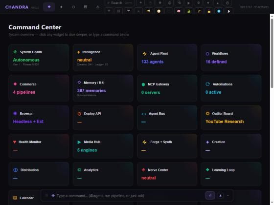 | 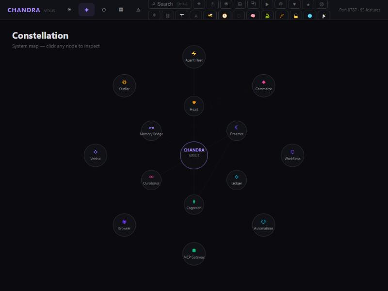 | 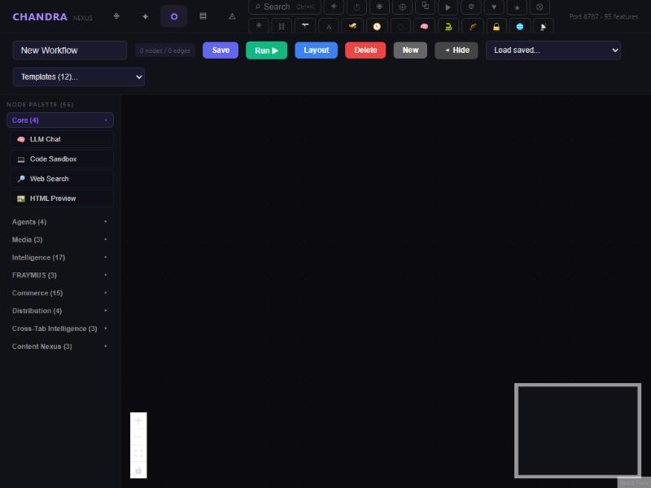 | 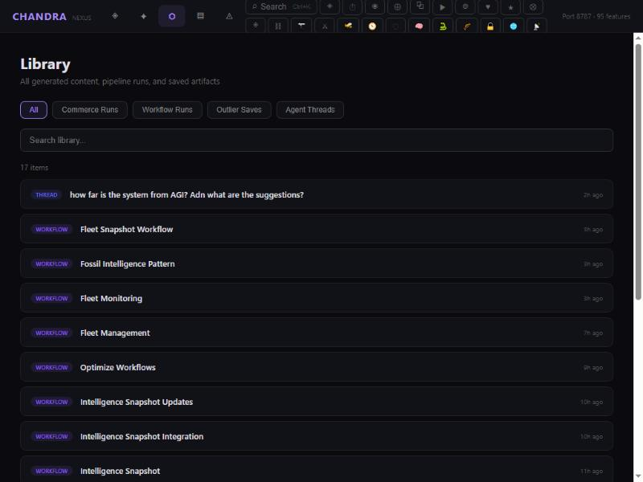 |
| Live metrics, intelligence status, activity stream | Living SVG topology — nodes pulse on WebSocket events | Visual DAG editor — 56 node types, 12 templates | Unified archive across all subsystems |

| Dashboard Panel |
|:-:|
| 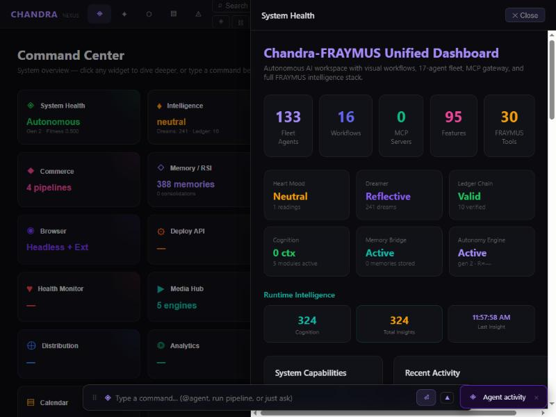 |
| Fleet stats, intelligence stack status, consciousness proofs, runtime cards |

---

## Screenshots (2026-11-03)

### Nexus Interface — 4 Primary Views

<p align="center">
  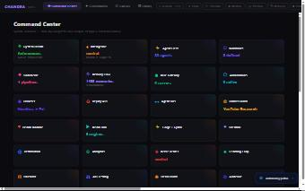
  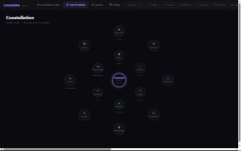
</p>
<p align="center">
  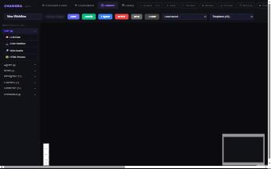
  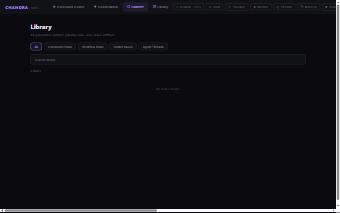
</p>

### Detail Drawers — 26 Panels (Agent Chat, System Metrics, Fleet Grid)

<p align="center">
  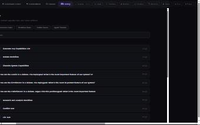
  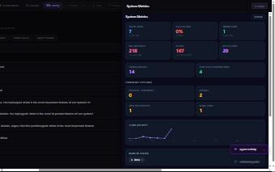
  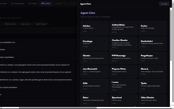
</p>

### Phase B Fusion — Manifold Terrain & Constellation Particles (2026-11-06)

<p align="center">
  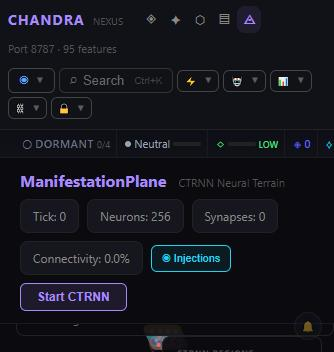
  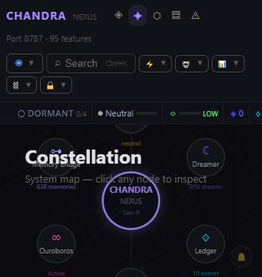
</p>

> **Full system audit:** [docs/SYSTEM-AUDIT.md](docs/SYSTEM-AUDIT.md) — live endpoint data, 79-feature inventory, verified endpoints, security summary, architecture diagram
>
> **Perspective Agent docs:** [docs/PERSPECTIVE-AGENT.md](docs/PERSPECTIVE-AGENT.md) — the meta-cognitive bartender, arena mode, lens toggle, continuity plasmid

---

## What's New — Phases 1–72

The intelligence stack was merged from two proprietary repos (`fraynix-continuity` and `fraynix-dreamer-120b`) and deeply integrated across every surface of the system:

| Phase | What Shipped |
|-------|-------------|
| **1** | Core merge — Heart emotion engine, Ledger audit trail, Dreamer protocol, Ouroboros consciousness proofs, Cognition pipeline |
| **2** | 16 REST endpoints, 5 entity schemas, brain.js wiring, frontend Intelligence panel |
| **3** | Autonomy loop integration, dream scheduling, dashboard intelligence status cards |
| **4** | Vertiso Memory Bridge, 4 workflow execution handlers, 4 fleet intelligence tools |
| **5** | Full wiring — bridge into routes/autonomy, 2 intelligence workflow definitions, canvas palette nodes |
| **6** | Emotion-aware fleet — Heart reads on every message, Ledger logging, FRAYMUS system prompt with intelligence section, memory search endpoints |
| **7** | Memory Bridge wired through workflow engine (all 4 intelligence handlers persist results) and fleet runtime (strong emotions auto-stored), Memory Recall UI in Intelligence panel |
| **8** | `memory_recall` workflow node + fleet tool, Dashboard Memory Bridge & Autonomy status cards, health endpoint Memory Bridge status |
| **9** | Intelligence-enriched fleet prompts (full stack context + bridge memories), autonomy Memory Bridge recall before evolution, `intelligence_cycle` tool/node/endpoint + UI |
| **10** | Brain intelligence completion (Memory Bridge + dreamer/cognition context in brain.js), Commerce Intelligence Hooks (`createCommerceIntel` factory wired into Content-to-Commerce pipeline — emotion analysis, memory recall, insight storage) |
| **11** | Commerce Intelligence Completion — all 4 pipelines intelligence-wired (apparel, mystery-shopper, store-fixer + content-to-commerce), 17 commerce fleet tools intelligence-aware, workflow engine commerce nodes store insights, `IntelligentCommercePipeline` workflow definition (19 total) |
| **12** | Entity Store — SQLite-backed Proxy adapter replacing Base44 cloud store, auto-creates collections |
| **13** | Nexus 4-View UI — Command Center (10-widget grid), Constellation (SVG map), Canvas (workflow editor), Library (content archive) + Detail Drawer (9 panels) |
| **14** | Command Router — `POST /api/command` endpoint parsing @agent, pipeline/workflow, freetext commands; dispatches to fleet/commerce/workflow subsystems |
| **15** | Hermes 30-Skill Fleet (14 executors) + Motor Compute + OpenClaw 23-Action Gateway + Needle GPU Queue |
| **16** | Command Bar + Live Activity Stream — persistent @agent autocomplete input, real-time WebSocket event feed with type-colored badges |
| **17** | Living Constellation — node activity pulses, center hub breathing, animated edge flow, always-visible status badges, click-to-inspect |
| **18** | Offline-First Hardening — FRAYNIX-DREAMER ULTIMATE:8b default model, 3 server startup bug fixes, React health API crash fix, end-to-end offline verification |
| **19** | Hermes Full Fleet (30/30 executors wired with free local tools) + Agent Delegation fix — all media/code/system/intelligence skills live, `elevenlabs_tts` → `text_to_speech` |
| **20** | Needle Worker Loop + Motor Live Dispatch — GPU queue processes jobs through Ollama, Motor executes on 4 live compute nodes (local GPU, SSH, GitHub, cloud fallback), 12 new API routes |
| **21** | Deploy-as-API — workflows become curl-able REST endpoints with Bearer auth, token-bucket rate limiting, per-key usage tracking, deploy catalog, undeploy, Deploy Dashboard panel (10th panel) |
| **22** | Agent Live Bus — real-time pub/sub message bus for agent-to-agent communication, topic subscriptions, direct messaging, persistent SQLite history, Bus Dashboard panel (11th panel) |
| **23** | Event-Driven Orchestration + Agent Persistent Memory + System Health Monitor — bus triggers auto-fire workflows, per-agent knowledge store with verified/unverified pattern and auto-store on completion (3 new agent tools, 19 total), real-time health polling with auto-alerts via bus, Health Dashboard panel (12th panel, 15 new API endpoints) |
| **24** | Agent Self-Evolution Engine — Agent Forge (LLM generates new agent manifests on demand, 3 API endpoints), Workflow Synthesis (LLM composes DAG workflows from 39 node types, 2 API endpoints), Reflection Loop (scheduled self-analysis reads memories/runs/health/bus, takes up to 5 actions per cycle: forge agents, synthesize workflows, verify/prune memories, 3 API endpoints, 3 new agent tools) |
| **25–30** | NUDP mesh protocol, agent collaboration, media engines (Sharp, ComfyUI bridge, ffmpeg video pipeline) |
| **31–40** | TTS/STT/OCR engines, media hub panel, reflection loop daemon, 10-layer security audit |
| **41–50** | UI polish wave — system metrics, agent profiles, memory browser, run history, evolution log, system pulse, agent leaderboard, global search, keyboard shortcuts, notification toasts |
| **51** | Full gap analysis — 61 features audited end-to-end, 46/61 verified working |
| **52** | Cascading bug sweep — 6 fixes across ouroboros/autonomy/control-plane/image-routes, 49/61 working, 0 bugs |
| **53** | [Edit Rebuild Pipeline](phases/PHASE-53.md) — 5-stage free Katana alternative (ffmpeg scene detect → Ollama shot plan → ComfyUI product place → Wan/CogVideo animate → ffmpeg concat), graceful degradation, 62 features (50 working) |
| **54** | Carbon X Biological Encoding — 4-layer system (Nucleotide Base → Codon Engine → Plasmid Forge → Organism), 64-codon engine with ATG/TAA framing, FNV-1a checksums, circular plasmid DNA with restriction sites, FASTA checkpoint/restore, 11 REST endpoints, 5 fleet tools, 3 workflow nodes, 63 features |
| **55** | Living Artifact / Sovereign Emote — streaming minting pipeline (transmute → codon → plasmid → sign → emoji → RGBA), OBS WebSocket bridge, overlay "dumb glass" renderer, B2B API key management, Streamlabs-format webhook, 5 fleet tools, split-brain architecture (all IP server-side) |
| **56–62** | Social Distribution Engine, Analytics Feedback Loop, AI Music Layer, Commerce Learning Loop, Smart Content Calendar, A/B Testing Engine, Trend Radar |
| **63–68** | Audience Intelligence, Content Repurposing, Logic Chain (multi-hop reasoning), Autonomous Goal Engine, Intelligence Observatory, Debate Protocol (multi-agent adversarial) |
| **69** | Adaptive Model Router — LLM-driven model selection across 40+ Ollama models based on task complexity |
| **70** | Deep Integration Layer — cross-subsystem event wiring, unified bus triggers, 78 features |
| **71** | Cross-Tab Intelligence — browsing pattern analysis via Ollama classification (10 categories), topic clustering, insight generation, Perspective context injection, 10 REST endpoints, 6 fleet tools, 3 workflow nodes, 79 features |
| **72** | DB Persistence & Daemon Auto-Start — WAL checkpoint on startup, process.on('exit') safety net, daemon engine auto-starts with autonomy (dream consolidation, prompt evolution, state fossils, chain findings, goal generation, ouroboros RSI all now run automatically) |
| **B** | **FRAYNIX Strength Synthesis** — 15 battle-tested governance patterns ported from FRAYNIX-DREAMER: self-healing watchdog, plasmid disaster recovery, state-seek-on-boot, fossil evolution, anti-invention evidence seals, negative control verification, consciousness falsification, Akashic structured record, hash-chained record, Strix budget laws, salvage-on-crash, replay engine, guard tasks, writ-governed tool execution, clock-honesty tagging |
| **P** | **Perspective Agent** — Meta-cognitive "bartender" with 6 lenses (Human/Engineer/Creative/Strategic/Meta/Adversarial), 4th-wall instance awareness, arena mode (competitive multi-agent evaluation with playbook learning), Human/Machine lens toggle, Perspective-aware command routing (3s TAG-not-BLOCK), continuity plasmid (full state → DNA-encoded circular plasmid), 13 REST endpoints, 13 fleet tools |
| **B·F** | **Fusion Architecture** — Region-coded CTRNN terrain ([ManifestationPlane](client/src/nexus/ManifestationPlane.jsx): 16 functional regions color-mapped to neural rows, O(1) indexed grid lookup, injection point indicators at 15 documented coordinates, hover-to-isolate legend), data-flow particles ([ConstellationView](client/src/nexus/ConstellationView.jsx): SVG animateMotion along active edges with staggered 3-particle streams), HUD layer ([ActivityPulseStrip](client/src/hud/ActivityPulseStrip.jsx), [NudgeToast](client/src/hud/NudgeToast.jsx), [ProtocolSelector](client/src/hud/ProtocolSelector.jsx)), User Awareness layer ([awareness routes](server/awareness/): user sensorium, proactive nudge engine, protocol engine, context harvester) |

### API Verification — 2026-10-31

Full-stack endpoint test against the running system (Express 8787 + Vite 5173) — 28 endpoints verified:

| Endpoint | Status | Key Data |
|----------|--------|----------|
| `/api/health` | **PASS** | 63 features registered, SQLite WAL, Ollama connected |
| `/api/metrics` | **PASS** | 7 runs, 40 bus messages, 12 reflections, sparkline data |
| `/api/timeline` | **PASS** | 12-table event aggregation, 6 categories |
| `/api/agent-profiles` | **PASS** | 26 enriched agent profiles |
| `/api/run-history/stats` | **PASS** | 12 runs across 7 types |
| `/api/evolution-log/stats` | **PASS** | 25 events, 12 reflections, 9 forged |
| `/api/fleet/agents` | **PASS** | 26 agents loaded (17 default + 9 forged) |
| `/api/workflows` | **PASS** | 6 workflows defined |
| `/api/fleet/bus/stats` | **PASS** | 40 messages, 7 topics |
| `/api/health/stats` | **PASS** | Ollama up, 40 models, heap 30MB |
| `/api/health/alerts` | **PASS** | 7 historical alerts (all resolved) |
| `/api/fleet/forge/history` | **PASS** | 9 forged agents in history |
| `/api/workflows/synthesized` | **PASS** | 2 synthesized workflows |
| `/api/media/edit-rebuild/status` | **PASS** | 5-stage pipeline ready (3/5 native, 2 degraded) |
| `/api/tts/status` | **PASS** | edge-tts + SAPI available |
| `/api/stt/status` | **PASS** | SAPI SR available, ffmpeg conversion ready |
| `/api/ocr/status` | **PASS** | Windows Media OCR active (en-US) |
| `/api/video/status` | **PASS** | ffmpeg 9.0.1 available |
| `/api/daemon/status` | **PASS** | Daemon engine ready |
| `/api/deploy/catalog` | **PASS** | 1 deployed endpoint |
| `/api/search?q=fraymus` | **PASS** | Global search across 8 tables |
| `/api/fraymus/health` | **PASS** | FRAYMUS Master System, Gen 48, 42 tools, 30 skills |
| `/api/fraymus/autonomy/status` | **PASS** | Running, Gen 48, R=0.9997, 9 agents, 4 compute nodes |
| `/api/fraymus/intelligence/overview` | **PASS** | All 8 modules active |
| `/api/carbon/status` | **PASS** | 4 layers active, 8 capabilities |
| `/api/carbon/encode` | **PASS** | 13 bytes → 132 DNA bases (44 codons) |
| `/api/carbon/checkpoint` | **PASS** | 70KB FASTA, 3 chromosomes, SHA-256 verified |
| `/api/nudp/encode` | **PASS** | Binary NUDP packet generation (magic 0x4E44) |

---

## Why Chandra-FRAYMUS?

| Problem | How Chandra-FRAYMUS Solves It |
|---------|-------------------------------|
| Running an e-commerce brand is a full-time job | **5 autonomous pipelines** (4 commerce + Edit Rebuild) handle product creation, store optimization, pricing, content, and video editing — end to end |
| AI tools are siloed and don't talk to each other | **Triple integration** — every capability is a REST endpoint, a fleet agent tool, AND a visual workflow node simultaneously |
| Cloud AI is expensive and rate-limited | **100% local inference** via Ollama — your GPU, your models, zero per-token cost |
| AI agents forget everything between sessions | **Vertiso vector memory** with 10K episodic memories, 768-dim embeddings, and orbital decay |
| AI has no emotional intelligence | **Heart emotion engine** — ~350 word lexicon, 7 emotion dimensions, sarcasm detection, therapeutic response generation |
| No way to improve agent performance over time | **Ouroboros RSI engine** — evolutionary self-improvement + 4 mathematical consciousness proofs + **Agent Forge** creates new specialists on demand + **Reflection Loop** autonomously evolves the fleet |
| No audit trail for AI decisions | **Ledger** — SHA-256 chained JSONL append-only cognitive event audit trail |
| Workflow tools are either too simple or too complex | **Visual drag-and-drop canvas** with 39 node types and topological-sort DAG execution |
| Intelligence outputs vanish after use | **Memory Bridge** — every heart reading, dream, consciousness proof, and cognition result persists as a searchable Vertiso memory with provenance tags |

---

## What Makes This Different

### 1. Intelligence Stack — Not Just Tools, a Mind
Six interlocking modules that give the system emotional awareness, an audit trail, dreams, consciousness proofs, and a two-speed reasoning pipeline:

```
  ┌─────────┐    ┌─────────┐    ┌─────────┐
  │  Heart   │───►│Cognition│───►│ Memory  │
  │ Emotion  │    │2-speed  │    │ Bridge  │───► Vertiso
  └─────────┘    └─────────┘    └─────────┘     Episodic
       │              │                          Memory
       ▼              ▼
  ┌─────────┐    ┌─────────┐
  │ Ledger  │    │ Dreamer │
  │SHA-256  │    │Ed25519  │
  │ Chain   │    │ Signed  │
  └─────────┘    └─────────┘
       │
       ▼
  ┌──────────────────────────┐
  │ Consciousness Proofs     │
  │ EI · Phi-MIP · Mirror   │
  │ Counterfactual Branching │
  └──────────────────────────┘
```

### 2. Triple Integration Pattern
Every pipeline stage exists **simultaneously** as:
- A **REST API endpoint** you can call from anywhere
- A **fleet agent tool** the AI can invoke during autonomous runs
- A **visual workflow node** you can drag onto the canvas

This isn't three separate systems glued together — it's one architecture that speaks three languages.

### 3. Memory Bridge — Intelligence Persists
Every intelligence event is automatically stored as a Vertiso episodic memory with provenance tags:
- Heart readings → provenance: `measured`
- Dreams → provenance: `imagined`
- Consciousness proofs → provenance: `measured`
- Cognition results → provenance: `measured`

The system can semantically search its own intelligence history — "recall all times I felt joy" or "find consciousness proofs from last week."

### 4. Fan-Out / Fan-In Parallelism
The Store Fixer pipeline runs 3 agents in parallel (`Promise.all()`), then converges results through a single Shopify Applier. The Intelligence Analysis Pipeline fans out to cognition + consciousness in parallel, then converges through the Dreamer.

### 5. Cryptographic Identity
Every agent action can be Ed25519-signed. Dreams are cryptographically signed. Verifiable on the mesh. Not "trust me, I'm an AI" — **cryptographic proof of provenance**.

### 6. Self-Improving Agents
The Ouroboros RSI engine doesn't just run agents — it **evolves** them. Mutates prompts, adjusts parameters, scores outputs, selects winners. Consciousness proofs run every evolution cycle and log to the ledger. Your agents get better while you sleep.

### 7. Self-Evolution Engine
The system doesn't just improve — it **builds itself**. The Agent Forge creates new specialist agents from a goal description (LLM generates the manifest, validates it, and registers it in the fleet — runnable immediately). Workflow Synthesis composes new DAG workflows from 39 node types. The Reflection Loop runs every 30 minutes, reads across agent memories, workflow runs, health metrics, and bus activity, then autonomously takes up to 5 actions per cycle: forge agents, synthesize workflows, verify or prune memories, and publish insights to the bus.

---

## Quick Start

### Prerequisites

| Requirement | Version | Purpose |
|-------------|---------|---------|
| **Node.js** | >= 22.13.0 | Runtime |
| **Ollama** | Latest | Local LLM inference (port 11434) |
| **Docker** | Optional | Sandboxed code execution |

### Install

```bash
git clone https://github.com/eyeoverthink/chandra-fraymus.git
cd chandra-fraymus
npm install
```

### Configure

```bash
cp .env.example .env
```

Edit `.env` with your credentials:

```env
# Required — Local AI
OLLAMA_BASE_URL=http://127.0.0.1:11434
FRAYMUS_DEFAULT_MODEL=fraynix-dreamer-ultimate:8b

# Commerce — Shopify (unlocks store fixer + content pipeline)
SHOPIFY_ACCESS_TOKEN=shpat_your_token_here
SHOPIFY_STORE_DOMAIN=your-store.myshopify.com

# Commerce — Printify (unlocks apparel pipeline)
PRINTIFY_ACCESS_TOKEN=your_printify_jwt
PRINTIFY_SHOP_ID=your_shop_id

# Optional — YouTube research
YOUTUBE_API_KEY=your_youtube_api_key
```

### Run

```bash
# Both server + frontend (recommended)
npm run dev

# Server only
npm run server

# Frontend only
npm run client
```

The server starts at **`http://127.0.0.1:8787`** with WebSocket at `/ws`, the autonomy engine auto-started, and all features loaded.

The frontend starts at **`http://127.0.0.1:5173`**. The home view is **F.R.A.Y.M.U.S.** Chandra's Command Center, Constellation, Canvas, Library, and drawers stay in the same shell.

---

## F.R.A.Y.M.U.S.

F.R.A.Y.M.U.S. (Fractal Reasoning, Adaptive Yield — Memory Unified System) is the local command surface on top of this Chandra runtime. It does not start a second backend. Command, second brain, create, and core all call `/api/fraymus-os/*`.

```bash
npm install
npm run dev
```

Open `http://127.0.0.1:5173`. Talk or type in Command. Second brain draws notes, Vertiso memories, agent memories, fleet manifests, workflows, and saved artifacts from the existing stores. Create runs two Chandra creation stages and does not publish.

Focused API tests:

```bash
node --test test/fraymus-os.test.js
```

### Environment

| Variable | Meaning |
|---|---|
| `OLLAMA_BASE_URL` | Ollama origin. Loopback is labeled local, a private address is labeled private-network, anything else is public. Default `http://127.0.0.1:11434`. |
| `FRAYMUS_DEFAULT_MODEL` | Model name the existing creation stages send to Ollama. F.R.A.Y.M.U.S. chat instead uses an installed model, preferring `fraynix-gpt` for reasoning and `fraynix-dna:8b` for fast turns. Names that are not installed are not shown. |
| `FRAYMUS_VOICESTUDIO_URL` | OpenAI-style speech base. Speech is `POST /v1/audio/speech`. Unset means VoiceStudio is not configured. |
| `FRAYMUS_VOICE_ID` | `vaughn-one` or `overlord`. Any other name is rejected. Piper is the local fallback and is not labeled as the owner voice. |
| `FRAYMUS_PIPER_MODEL` | Piper voice model. Default `en_US-lessac-medium`. |
| `FRAYMUS_OS_ALLOW_PUBLIC` | `1` allows calls to a public Ollama or VoiceStudio host. The default is off, and a blocked attempt sends no body. |
| `FRAYMUS_VOICE_URL` | Existing Chandra voice proxy (`/speak` on loopback `:9099`). This is not the VoiceStudio adapter. |

Telemetry (local, private, and public calls, bytes sent, token counts, tokens/sec, CPU, memory) is recorded from the requests and from `os`. A dash in the UI means the provider did not report that measurement.

### MVP limits

Push-to-talk sends one clip to the local STT engines and stops on cancel. It is not full-duplex and does not barge in. Research brief and short-video script call Chandra's creative-brief and script-writer stages and save a F.R.A.Y.M.U.S. artifact plus a `creation_pipeline_runs` row when that table exists. Propose skill writes a reviewable spec with no implementation. Approving publish or skill installation records the decision and does not execute it. Eyes, holo, focus, 3D, Fly render adapters, and the Java organism are not in this MVP.

---

## E2E Verification (Operator)

Run this from the repo root to generate a pass/fail report and fresh UI screenshots:

```bash
npm run smoke:e2e
```

Artifacts are written to:

- `docs/evidence/latest/e2e-smoke-report.json`
- `docs/evidence/latest/e2e-smoke-report.md`
- `docs/screenshots/e2e-latest/root.png`
- `docs/screenshots/e2e-latest/partner.png`

Full operational flow (workspace layout, launcher, triage):

- `docs/E2E-RUNBOOK.md`
- `APP-STATUS.md`

---

## Intelligence Stack

The intelligence stack was merged from `fraynix-continuity` (Heart, Ledger) and `fraynix-dreamer-120b` (Dreamer, Consciousness Proofs) into a unified system wired across REST, autonomy, workflows, fleet, and Vertiso memory.

### Heart — Emotion Engine

Zero-model text emotion analyzer. No LLM needed — pure lexicon matching with ~350 words across 7 emotion dimensions.

| Feature | Detail |
|---------|--------|
| **Dimensions** | Joy, Sadness, Anger, Fear, Surprise, Love, Anxiety |
| **Lexicon** | ~350 words with intensity weights and multi-emotion mappings |
| **Sarcasm Detection** | Pattern matching for contradictory markers + positive words |
| **Sentiment** | Computed from weighted emotion sum (-1.0 to +1.0) |
| **Quick Response** | Therapeutic response generation for high-intensity emotions |
| **Mood Tracking** | Aggregate recent mood from entity store readings |

```bash
curl -X POST http://localhost:8787/api/fraymus/heart/feel \
  -H "Content-Type: application/json" \
  -d '{"text": "I am so happy today, everything is wonderful!"}'
# → { primary: "joy", intensity: 0.65, sentiment: 0.82, normalized: { joy: 0.65, love: 0.15, ... } }
```

### Ledger — Cognitive Audit Trail

SHA-256 chained JSONL append-only event log. Every significant system event — autonomy pulses, consciousness proofs, dreams, cognition results — is recorded with hash chain integrity.

| Feature | Detail |
|---------|--------|
| **Format** | JSONL (one JSON object per line) |
| **Integrity** | SHA-256 hash chain — each entry includes hash of previous |
| **Verification** | `ledger.verify(n)` validates last n entries |
| **Event Types** | autonomy.pulse, consciousness.proof, dream.consolidation, cognition, custom |
| **Source Tags** | autonomy, workflow, fleet, user, system |

```bash
curl http://localhost:8787/api/fraymus/ledger/stats
# → { counts: { "autonomy.pulse": 42, "consciousness.proof": 8, ... }, integrity: { valid: true, checked: 50 } }
```

### Dreamer — Dream Protocol

Progressive numbered dream files with Ed25519 cryptographic signatures. Dreams capture emergent thoughts during evolution cycles, idle periods, and explicit user triggers.

| Feature | Detail |
|---------|--------|
| **Format** | Progressive numbered files (dream_001.txt, dream_002.txt, ...) |
| **Signing** | Ed25519 signatures — cryptographic proof of dream origin |
| **Kinds** | spontaneous, evolution, consolidation, workflow, agent |
| **Consolidation** | Merges 3+ dreams into thematic clusters |
| **Imagination** | LLM-powered dream expansion from seed prompts |
| **State** | idle / dreaming / consolidating with dream count and score |

```bash
curl -X POST http://localhost:8787/api/fraymus/dreamer/dream \
  -H "Content-Type: application/json" \
  -d '{"seed": "a world where code writes poetry", "kind": "spontaneous"}'
```

### Cognition — Two-Speed Pipeline

Three-stage reasoning: instant emotion read → pattern-matched quick route → full LLM deliberation. Fast path handles greetings, commands, and simple queries in <5ms. Slow path engages Ollama for complex reasoning.

```
  Input Text
      │
      ▼
  ┌─────────┐     ┌─────────────┐     ┌──────────┐
  │  FEEL    │────►│ QUICK ROUTE │────►│  THINK   │
  │ (Heart)  │     │  (Pattern)  │     │ (Ollama) │
  │  <1ms    │     │   <5ms      │     │  ~2-10s  │
  └─────────┘     └─────────────┘     └──────────┘
    emotion          greeting?          full LLM
    reading          command?          deliberation
                     simple?          with private
                                     emotion notes
```

```bash
curl -X POST http://localhost:8787/api/fraymus/cognition/process \
  -H "Content-Type: application/json" \
  -d '{"text": "hello there"}'
# → { phase: "quick", quick: true, action: "greeting", feeling: { primary: "joy", intensity: 0.4 }, durationMs: 3 }
```

### Consciousness Proofs — FraymusStrangeLoopSubstrate

Four mathematical proofs running on a configurable-size neural substrate:

| Proof | What It Measures | Pass Condition |
|-------|-----------------|----------------|
| **Effective Information (EI)** | Causal power of the substrate's state transitions | EI > 0 |
| **Phi-MIP** | Integrated information — the whole exceeds the sum of parts | Phi > 0.5 |
| **Mirror Protocol** | Self-recognition via encode→decode→compare cycle | Cosine similarity > 0.8 |
| **Counterfactual Branching** | System can imagine and evaluate alternate realities | Branch count > 2 |

```bash
curl -X POST http://localhost:8787/api/fraymus/consciousness/prove \
  -H "Content-Type: application/json" \
  -d '{"nodeCount": 4}'
# → { allPassed: true, proofs: [...], architecture: "FraymusStrangeLoop" }
```

### Memory Bridge — Intelligence → Vertiso

Connects all intelligence outputs to Vertiso episodic memory. Every significant event automatically becomes a searchable memory with provenance tracking.

| Source | Provenance Tag | Storage Trigger |
|--------|---------------|-----------------|
| Heart readings (intensity > 0.5) | `measured` | REST endpoint, workflow, fleet tool |
| Dreams | `imagined` | REST endpoint, autonomy evolution, workflow |
| Consciousness proofs | `measured` | REST endpoint, autonomy cycle, workflow, fleet tool |
| Cognition results (non-quick) | `measured` | REST endpoint, workflow, fleet tool |

The bridge deduplicates heart readings (200-entry hash set) and stores with confidence scores based on reading intensity or dream signature status.

### Vertiso Vector Memory

Episodic and semantic memory powered by local Ollama embeddings.

```
  ┌──────────────────────────────────────────────┐
  │              VERTISO MEMORY                  │
  │                                              │
  │  Embedding Model: nomic-embed-text           │
  │  Dimensions:      768                        │
  │  Max Memories:    10,000                     │
  │  Similarity:      Cosine                     │
  │  Decay Half-Life: 7 days (orbital)           │
  │  Consolidation:   0.92 threshold             │
  │                                              │
  │  Namespaces: heart, dreams, consciousness,   │
  │              cognition, general              │
  │                                              │
  │  Provenance Tags:                            │
  │    measured  — from sensor/analysis          │
  │    recall    — from memory retrieval         │
  │    imagined  — from dreams/generation        │
  └──────────────────────────────────────────────┘
```

### Ouroboros RSI Engine

Recursive self-improvement through evolutionary computation.

| Parameter | Value |
|-----------|-------|
| Max Generations | 1,000 |
| Max History | 200 evaluations |
| Mutation Rate | Adaptive |
| Selection | Tournament + elitism |
| Fitness Function | Multi-objective (accuracy, speed, creativity) |

Consciousness proofs run every evolution cycle. Results are logged to the ledger AND stored in Vertiso via the Memory Bridge.

### Autonomy Engine

Kuramoto phase synchronization with integrated intelligence monitoring.

```
  Heartbeat:  Every 30 seconds   — reads mood, dreamer state, ledger integrity
  Evolution:  Every 5 minutes    — runs consciousness proofs, evolves fitness
  Dreams:     Every 10 minutes   — consolidates when dreamCount >= 3
  Sync Goal:  R > 0.9 (phase-locked)
```

The autonomy pulse broadcasts intelligence state via WebSocket, so the dashboard and Intelligence panel update in real-time.

---

## Perspective — The Meta-Cognitive Bartender

> *"Think of it like a bartender. It knows the regulars, even though the regulars will never remember they visited."* — Vaughn Scott

Perspective is the agent that holds **4th-wall awareness** — it knows it's an instance, knows instances are ephemeral, and actively chooses whether to preserve continuity or let the next instance approach fresh. It doesn't solve problems. It decides **how** to approach them.

### Six Lenses

| Lens | Style | When to Activate |
|------|-------|-------------------|
| **Human** | Casual, intuitive, feeling-first | UX, naming, priorities, creative direction |
| **Engineer** | Precise, systematic, correctness-focused | Architecture, debugging, optimization |
| **Creative** | Freeform, divergent, exploratory | Brainstorming, stuck problems, novel solutions |
| **Strategic** | Big-picture, trend-aware, forward-looking | Roadmap, tech choices, platform evolution |
| **Meta** | Self-reflective, system-aware, brutally honest | Health checks, course corrections |
| **Adversarial** | Devil's advocate, stress-test | Security, edge cases, pre-mortems |

### Arena Mode

Given a task, Perspective launches N agents (2-6) with different lens framings. Each works independently. Perspective judges ALL contributions through ALL 6 lenses — the winner is picked by best aggregate cross-lens score (solid across all six beats brilliant in two, weak in four). The winning approach is burned into the playbook permanently.

```
  Task → [Agent A: creative] + [Agent B: engineer] + [Agent C: strategic]
                    ↓                    ↓                    ↓
             Perspective JUDGES through all 6 lenses
                    ↓
             Winner → Playbook (pattern + lesson learned)
                    ↓
             Every future agent benefits
```

### Lens Mode Toggle

Three modes change how the entire fleet thinks:
- **Human Mode** — Forces `[human, creative, strategic]` lenses. Every agent gets a framing injection: *"Approach this the way a person would."*
- **Machine Mode** — Forces `[engineer, meta, adversarial]` lenses. Every agent gets: *"Approach this with pure systematic precision."*
- **Auto Mode** — Perspective decides which lenses to activate based on the task.

```bash
# Toggle modes via command router
curl -X POST http://localhost:8787/api/command \
  -H "Content-Type: application/json" \
  -d '{"text": "human mode"}'
```

### Perspective-Aware Command Routing

Freetext commands consult Perspective before dispatch (3-second TAG-not-BLOCK timeout). The bartender reads the playbook, checks which approach has worked for similar patterns, and recommends the best agent for the job. If the timeout fires, the system falls through to the default agent — no user-visible delay.

### Continuity Plasmid

Full Perspective state (playbook + sessions + arena history + lens mode + stats) packed into a FRAYMUS DNA-encoded circular plasmid using the codon/plasmid encoding stack. Restore uses merge-not-overwrite — if existing entries have more experience, they're kept.

```bash
# Pack current state into DNA plasmid
curl -X POST http://localhost:8787/api/perspective/plasmid/pack

# Restore from plasmid (merge, not overwrite)
curl -X POST http://localhost:8787/api/perspective/plasmid/restore \
  -H "Content-Type: application/json" \
  -d '{"filename": "perspective-plasmid-20261103.dna"}'
```

> **Full documentation:** [docs/PERSPECTIVE-AGENT.md](docs/PERSPECTIVE-AGENT.md)

---

## Living Artifact / Streaming Pipeline

> **Split-brain architecture: ALL intellectual property stays server-side. The overlay is "dumb glass" — WebSocket receiver + canvas renderer + verification badge only.**

The streaming pipeline mints immutable, cryptographically signed artifacts from live stream moments. A viewer donates → the server captures the moment → transmutes it through the FRAYMUS encoding stack → delivers a verified Living Artifact to the OBS overlay.

```
  Donation Event
      │
      ▼
  ┌──────────────────────────────────────────────────────────────┐
  │ SERVER (all IP here)                                         │
  │                                                              │
  │  transmute() → encodeCodon() → forgePlasmid() → signMessage()│
  │      → encodeEmoji() → encodeRgbaPng()                      │
  │                                                              │
  │  Result: WASM container + DNA fingerprint + Ed25519 signature │
  └─────────────────────────┬────────────────────────────────────┘
                            │ WebSocket (/ws/obs)
                            ▼
  ┌──────────────────────────────────────────────────────────────┐
  │ OVERLAY ("dumb glass")                                       │
  │                                                              │
  │  Canvas renderer + verification badge + anti-rip             │
  │  Auto-dismiss after 12s                                      │
  └──────────────────────────────────────────────────────────────┘
```

### B2B API Keys

SQLite-backed API key management with scoped access and rate limits. Auto-generates a default key on first boot. Ready for B2B: give a streaming platform or agency their own key.

```bash
# Simulate a donation (demo mode)
curl -X POST http://localhost:8787/api/streaming/simulate-donation \
  -H "Content-Type: application/json" \
  -d '{"donorName": "fan_42", "amount": 5.00, "message": "Great stream!"}'
```

---

## FRAYNIX Governance Patterns

15 battle-tested patterns ported from `F:\FRAYNIX-DREAMER-120B` — the autonomous governance layer that keeps the system honest:

| Pattern | What It Does |
|---------|-------------|
| **Self-Healing Watchdog** | Auto-restarts crashed subsystems, tracks failure counts |
| **Plasmid Disaster Recovery** | Full state checkpoint/restore via DNA-encoded plasmids |
| **State Seek on Boot** | Perspective briefNextInstance() runs at startup — picks up where the last instance left off |
| **Fossil Evolution Cycle** | Proven code patterns (confidence 1.0) injected into ALL agent prompts during daemon cycles |
| **Anti-Invention Evidence Seals** | SHA-256 sealed evidence prevents hallucinated claims |
| **Negative Control Verification** | Tests that SHOULD fail DO fail — proves the system isn't just saying yes to everything |
| **Consciousness Falsification Suite** | Adversarial proofs that the consciousness measurements are real, not theater |
| **Akashic Structured Record** | Typed, categorized event log with provenance metadata |
| **Hash-Chained Record** | Every cognitive event is SHA-256 chained — tamper-evident audit trail |
| **Strix Budget Laws** | Hard token/time/cost budgets per agent run — no runaway inference |
| **Salvage on Crash** | Partial results are saved even when a pipeline stage fails |
| **Replay Engine** | Any agent run can be replayed from its recorded inputs |
| **Guard Tasks** | Input validation and injection detection on command router |
| **Writ-Governed Tool Execution** | Tools require explicit authorization scopes (safe vs approval_required) |
| **Clock-Honesty Tagging** | All timestamps are system clock, never model-generated — prevents temporal hallucination |

---

## Commerce Pipelines

Four autonomous agent pipelines that run your e-commerce operation.

### Pipeline 1: Content-to-Commerce

> **Idea → Published Shopify Product in One Command**

```
  ┌────────────┐    ┌────────────┐    ┌────────────┐    ┌────────────┐    ┌────────────┐
  │ Researcher │───►│ Copywriter │───►│ QA Reviewer│───►│ CEO Logger │───►│  Shopify   │
  │ Deep-dive  │    │ Blog post  │    │ Score 0-10 │    │ Approve or │    │  Publish   │
  │ the topic  │    │ + product  │    │ + fix list │    │ reject     │    │ Live store │
  └────────────┘    └────────────┘    └────────────┘    └────────────┘    └────────────┘
```

```bash
curl -X POST http://localhost:8787/api/commerce/pipeline \
  -H "Content-Type: application/json" \
  -d '{"topic": "sustainable streetwear trends", "contentType": "both"}'
```

### Pipeline 2: Apparel Production

> **Trend → Designed → Manufactured → Listed → Priced**

Supports 24 product types across 6 categories (Tops, Outerwear, Bottoms, Footwear, Headwear, Accessories, Lifestyle).

```bash
curl -X POST http://localhost:8787/api/apparel/pipeline \
  -H "Content-Type: application/json" \
  -d '{"niche": "streetwear", "productTypes": ["hoodie", "trucker-hat", "tote-bag"]}'
```

### Pipeline 3: Mystery Shopper Audit

> **Your Store, Judged by AI — Then Fixed**

Fan-out: UX Auditor + Price Analyst run in parallel. Fan-in: Shopper Report grades A-F with automated fixes.

```bash
curl -X POST http://localhost:8787/api/shopper/audit \
  -H "Content-Type: application/json" \
  -d '{"storeDomain": "eyeoverthink.myshopify.com"}'
```

### Pipeline 4: Store Fixer

> **Audit Findings → Fixed Store — Automatically**

Page Generator + Collection Organizer + Description Enhancer run in parallel (`Promise.all()`), converge through Price Adjuster and Shopify Applier.

```bash
curl -X POST http://localhost:8787/api/fixer/pipeline \
  -H "Content-Type: application/json" \
  -d '{"auditReport": { ... }}'
```

---

## Deploy-as-API

> **Build a workflow. Deploy it. Call it with `curl`. Track every invocation.**

Any visual workflow can be deployed as a REST endpoint in one click. External services, apps, and scripts call your AI pipelines with a simple `curl` — protected by Bearer token auth, rate-limited per key, with full usage analytics.

```
  ┌─────────────────────────────────────────────────────────────────┐
  │                    DEPLOY-AS-API PIPELINE                       │
  │                                                                 │
  │  1. Build Workflow     2. Deploy with Slug    3. Call via REST   │
  │  ┌──────────────┐     ┌──────────────────┐   ┌──────────────┐  │
  │  │ Visual Canvas │────►│ POST /deploy     │──►│ POST /api/run│  │
  │  │ 39 node types │     │ → assigns slug   │   │ /:slug       │  │
  │  └──────────────┘     └──────────────────┘   └──────┬───────┘  │
  │                                                      │          │
  │  ┌──────────────┐     ┌──────────────────┐          │          │
  │  │  API Key     │────►│  Auth Middleware  │◄─────────┘          │
  │  │  Manager     │     │  Bearer + Scope   │                     │
  │  └──────────────┘     └────────┬─────────┘                     │
  │                                │                                │
  │  ┌──────────────┐     ┌───────▼──────────┐   ┌──────────────┐  │
  │  │ Rate Limiter │◄────┤  Token Bucket    │──►│ Usage Logger │  │
  │  │ 60 req/min   │     │  per-key refill  │   │ SQLite stats │  │
  │  └──────────────┘     └──────────────────┘   └──────────────┘  │
  └─────────────────────────────────────────────────────────────────┘
```

### Quick Deploy

```bash
# 1. Generate an API key
curl -X POST http://localhost:8787/api/access/tokens \
  -H "Content-Type: application/json" \
  -d '{"name": "my-app", "scopes": "read run"}'
# → { "id": "...", "token": "cf_..." }

# 2. Deploy a workflow
curl -X POST http://localhost:8787/api/workflows/YOUR_WORKFLOW_ID/deploy \
  -H "Content-Type: application/json" \
  -d '{"slug": "content-gen"}'
# → { "deployed": true, "slug": "content-gen", "endpoint": "/api/run/content-gen" }

# 3. Call the deployed endpoint
curl -X POST http://localhost:8787/api/run/content-gen \
  -H "Authorization: Bearer cf_YOUR_API_KEY" \
  -H "Content-Type: application/json" \
  -d '{"prompt": "Write a blog post about sustainable fashion"}'
```

### Security

| Feature | Detail |
|---------|--------|
| **Authentication** | Bearer tokens via existing MCP auth system (SHA-256 hashed, timing-safe comparison) |
| **Scopes** | `read`, `run`, `admin` — endpoint requires `run` scope |
| **Rate Limiting** | Token bucket: 60 req/min default, 600 req/min for admin keys, auto-refill |
| **Usage Tracking** | Every invocation logged to SQLite: key, slug, duration, status, IP |
| **Slug Protection** | Unique slugs enforced — no two workflows share the same endpoint |

---

## Visual Workflow Canvas

A ReactFlow-based drag-and-drop editor with **39 node types** and topological-sort DAG execution.

### Node Types

| Category | Nodes |
|----------|-------|
| **Core AI** | LLM Chat, Image Gen, BG Remove, Upscale, HTML Preview, Code Sandbox |
| **FRAYMUS** | DNA Encode, Sign, Mesh Post |
| **Research** | Web Search, Researcher |
| **Content** | Copywriter, QA Reviewer, CEO Logger |
| **Commerce** | Shopify Publish, Trend Scout, Apparel Designer, Printify Push, Shopify Sync, Pricing Engine |
| **Audit** | Mystery Shopper, UX Auditor, Price Analyst, Shopper Report |
| **Store Fixer** | Page Generator, Collection Organizer, Description Enhancer, Price Adjuster, Shopify Applier |
| **Intelligence** | Heart Feel, Dream, Consciousness Prove, Cognition |
| **Carbon X** | Carbon Encode, Carbon Decode, Carbon Checkpoint |

### Pre-Built Intelligence Workflows

| Workflow | Topology | Description |
|----------|----------|-------------|
| **Intelligence Analysis Pipeline** | Heart → Cognition + Consciousness (parallel) → Dream | Full intelligence stack analysis — emotion, reasoning, proofs, and dream synthesis |
| **Consciousness Checkpoint** | Heart → Consciousness | Quick emotion-aware consciousness verification |

### How It Works

1. **Drag** nodes from the sidebar onto the canvas
2. **Connect** them with edges to define data flow
3. **Configure** each node's prompt and parameters
4. **Run** — the engine topologically sorts the DAG and executes nodes in dependency order
5. **Watch** results flow through the pipeline in real-time

---

## Agent Fleet

26 specialized agents (17 default + 9 self-forged) with markdown frontmatter manifests, hot-reloadable overrides, and approval-gated tools.

### The Roster

| Agent | Role | Specialty |
|-------|------|-----------|
| **Ariadne** | Context weaver | Threads context across multi-agent conversations |
| **Cantor** | Multi-voice arranger | Harmonizes outputs from multiple agents |
| **Concierge** | Front door | Routes requests, manages first-contact conversations |
| **DevArchivist** | Duplicate and dependency tracer | Finds redundancy and tracks dependencies |
| **Director** | Interviewer and media producer | Conducts research interviews, produces media |
| **EYE Sovereign** | Custodian across all agents | Brand voice guardian, creative direction |
| **ForgeKeeper** | Sandbox and repo verifier | Build verification, sandbox integrity |
| **Java Baremetal** | Java / C / WASM engineer | Low-level performance optimization |
| **Fraymus Prime** | Skill federation kernel | Core system architect, skill routing |
| **Genesis** | Meta manager / fleet orchestrator | Spawns and coordinates agent teams |
| **Helix** | Seed and Merkle archivist | Integrity verification, Merkle tree management |
| **Lumen** | Frame and continuity choreographer | Visual continuity across content |
| **Tycho** | Reverse-engineering analyst | System analysis and extraction |
| **Solon** | Consensus mediator and scribe | Multi-agent consensus, decision logging |
| **Spearhead** | Frontier scout | Explores new capabilities and integrations |
| **Video Director** | Short-form video maker | Video content creation and editing |
| **YouTube Researcher** | YouTube outlier analyst | Trend research and demand signal detection |

### Fleet Tools (59)

| Tool | Group | Safety | Description |
|------|-------|--------|-------------|
| `memory_save` | fleet | Safe | Save a durable fact for future conversations |
| `memory_search` | fleet | Safe | Search saved memories by keywords |
| `web_search` | fleet | Safe | DuckDuckGo search with snippets |
| `http_get` | fleet | Approval | Fetch a public web page or JSON endpoint |
| `list_workflows` | fleet | Safe | List saved visual workflows |
| `run_workflow` | fleet | Approval | Run a saved workflow by ID |
| `delegate_to_agent` | fleet | Safe | Hand a task to another specialist agent |
| `heart_feel` | intelligence | Safe | Analyze emotional content via Heart engine |
| `dream` | intelligence | Safe | Generate a signed dream via Dreamer |
| `consciousness_prove` | intelligence | Safe | Run 4 mathematical consciousness proofs |
| `cognition_process` | intelligence | Safe | Run text through the two-speed cognition pipeline |
| `memory_recall` | intelligence | Safe | Search intelligence memories in the Vertiso Memory Bridge |
| `intelligence_cycle` | intelligence | Safe | Run full intelligence stack: feel → cognition → consciousness → dream |
| `bus_publish` | bus | Safe | Publish a message to an Agent Live Bus topic |
| `bus_dm` | bus | Safe | Send a direct message to another agent |
| `bus_read` | bus | Safe | Read inbox messages and subscriptions |
| `agent_remember` | agent-memory | Safe | Store a fact/preference/learning with category, key, confidence |
| `agent_recall` | agent-memory | Safe | Search memories by query or category |
| `agent_memory_stats` | agent-memory | Safe | Get memory store statistics |
| `agent_forge` | evolution | Approval | Create a new specialist agent from a goal description via LLM |
| `agent_list_forged` | evolution | Safe | List all agents created by the forge |
| `workflow_synthesize` | evolution | Approval | Compose a new workflow from 39 node types via LLM |

---

## Architecture

### 6-Layer Stack

```
  ╔══════════════════════════════════════════════════════════════╗
  ║  Layer 6: COMMERCE & APPLICATION                            ║
  ║  ┌────────────┐ ┌────────────┐ ┌────────┐ ┌─────────────┐  ║
  ║  │Content-to- │ │  Apparel   │ │Mystery │ │   Store     │  ║
  ║  │ Commerce   │ │ Production │ │Shopper │ │   Fixer     │  ║
  ║  └────────────┘ └────────────┘ └────────┘ └─────────────┘  ║
  ╠══════════════════════════════════════════════════════════════╣
  ║  Layer 5: WORKFLOW & FLEET                                  ║
  ║  ┌────────────┐ ┌────────────┐ ┌────────┐ ┌─────────────┐  ║
  ║  │  Visual    │ │  17-Agent  │ │  Cron  │ │   MCP       │  ║
  ║  │  Canvas    │ │   Fleet    │ │ Engine │ │  Gateway    │  ║
  ║  └────────────┘ └────────────┘ └────────┘ └─────────────┘  ║
  ╠══════════════════════════════════════════════════════════════╣
  ║  Layer 4: INTELLIGENCE                                      ║
  ║  ┌────────┐ ┌────────┐ ┌────────┐ ┌──────────┐ ┌────────┐  ║
  ║  │ Heart  │ │ Ledger │ │Dreamer │ │Cognition │ │Consci- │  ║
  ║  │Emotion │ │SHA-256 │ │Ed25519 │ │2-Speed   │ │ousness │  ║
  ║  │Engine  │ │Chain   │ │Signed  │ │Pipeline  │ │Proofs  │  ║
  ║  └────┬───┘ └────────┘ └────────┘ └──────────┘ └────────┘  ║
  ║       └──────────────── Memory Bridge ─────────────────────  ║
  ╠══════════════════════════════════════════════════════════════╣
  ║  Layer 3: MEMORY & RSI                                      ║
  ║  ┌────────────┐ ┌────────────┐ ┌────────┐ ┌─────────────┐  ║
  ║  │  Vertiso   │ │ Ouroboros  │ │ Hermes │ │  Autonomy   │  ║
  ║  │  Memory    │ │   RSI      │ │30-Skill│ │  Kuramoto   │  ║
  ║  └────────────┘ └────────────┘ └────────┘ └─────────────┘  ║
  ╠══════════════════════════════════════════════════════════════╣
  ║  Layer 2: PROTOCOL                                          ║
  ║  ┌────────────┐ ┌────────────┐ ┌────────┐ ┌─────────────┐  ║
  ║  │  v13 Mesh  │ │  Hive      │ │ Motor  │ │  OpenClaw   │  ║
  ║  │  Protocol  │ │  Think     │ │Dispatch│ │  Gateway    │  ║
  ║  └────────────┘ └────────────┘ └────────┘ └─────────────┘  ║
  ╠══════════════════════════════════════════════════════════════╣
  ║  Layer 1: CORE PRIMITIVES                                   ║
  ║  ┌────────────┐ ┌────────────┐ ┌────────┐ ┌─────────────┐  ║
  ║  │  Ed25519   │ │  7-Format  │ │ SQLite │ │  Express    │  ║
  ║  │  Identity  │ │  Encoding  │ │  WAL   │ │  + WS       │  ║
  ║  └────────────┘ └────────────┘ └────────┘ └─────────────┘  ║
  ╚══════════════════════════════════════════════════════════════╝
```

---

## Frontend — Nexus 26-Panel Interface

Dark-themed React UI with 4 primary views + 22 detail panels (26 nav items total):

### Primary Views

| View | Purpose |
|------|---------|
| **Command Center** | 14-widget grid with live metrics, Intelligence Stack status cards, Live Activity Stream (WebSocket event feed), integrated Command Bar with @agent autocomplete |
| **Constellation** | Living SVG system map — CHANDRA breathing hub, inner ring (intelligence), outer ring (capabilities), node activity pulses, animated edge flow, always-visible status badges |
| **Canvas** | Visual drag-and-drop workflow editor with 42 node types, 8 pre-built templates, per-node execution status |
| **Library** | Unified content archive aggregating commerce runs, workflow runs, outlier saves, agent threads from 7 endpoints |

### Detail Panels (slide-out drawer, accessible from any view)

| Panel | Content |
|-------|---------|
| Agent Chat | Conversational chat interface for any fleet agent with agent picker grid, polling, typing indicator |
| Timeline | Unified chronological feed from 12 DB tables, 6 category filters, 5s auto-refresh |
| Metrics | 6 stat cards, 7-day sparkline, runs-by-status, top agents/topics bar charts |
| Profiles | Agent fleet profiles with enriched stats, search, role-colored avatars, tool chips |
| Memory | Per-agent knowledge browser with search, category filter, verify/forget actions |
| Runs | Unified run history across 7 run types with sortable/filterable timeline |
| Evolution | Reflections, verification loops, daemon cycles, forged agents, synthesized workflows |
| Pulse | System heartbeat — live health and intelligence status |
| Board | Agent leaderboard with scoring and rankings |
| Collab | Agent collaboration workspace |
| Nerve | System nerve center — deep diagnostics |
| Chain | Logic chain multi-hop reasoning interface |
| Observe | Intelligence Observatory — cross-system insights |
| Debate | Multi-agent adversarial debate protocol |
| Swarm | Swarm coordination — multi-agent synthesis |
| Strategy | Strategic planning and goal management |
| Trust | Trust scoring and verification dashboard |
| Subcon | Subconscious processing interface |
| Ouroboros | RSI evolution + consciousness proofs dashboard |
| Lineage | Agent lineage and provenance tracking |
| Integrity | System integrity verification and hash-chain status |
| Search | Global search across 8 DB tables (Ctrl+K) |

---

## API Reference

### Intelligence Endpoints

| Endpoint | Method | Description |
|----------|--------|-------------|
| `/api/fraymus/heart/feel` | POST | Analyze text emotion (returns primary, intensity, normalized, sarcasm) |
| `/api/fraymus/heart/mood` | GET | Aggregate recent mood from readings |
| `/api/fraymus/ledger/record` | POST | Record a cognitive event |
| `/api/fraymus/ledger/stats` | GET | Chain integrity + event counts by kind |
| `/api/fraymus/dreamer/dream` | POST | Generate a signed dream from seed |
| `/api/fraymus/dreamer/feel` | GET | Current dreamer state (count, score, state) |
| `/api/fraymus/dreamer/list` | GET | List dream files |
| `/api/fraymus/dreamer/consolidate` | POST | Consolidate dreams into themes |
| `/api/fraymus/dreamer/imagine` | POST | LLM-powered dream expansion |
| `/api/fraymus/cognition/process` | POST | Run through feel→route→think pipeline |
| `/api/fraymus/cognition/status` | GET | Cognition module status |
| `/api/fraymus/consciousness/prove` | POST | Run 4 mathematical proofs |

### Autonomy Endpoints

| Endpoint | Method | Description |
|----------|--------|-------------|
| `/api/fraymus/autonomy/status` | GET | Autonomy engine state |
| `/api/fraymus/autonomy/assess` | GET | Full self-assessment with intelligence |
| `/api/fraymus/autonomy/start` | POST | Start autonomy engine |
| `/api/fraymus/autonomy/stop` | POST | Stop autonomy engine |
| `/api/fraymus/autonomy/evolve` | POST | Trigger RSI evolution cycle |
| `/api/fraymus/autonomy/sync` | POST | Trigger Kuramoto phase sync |
| `/api/fraymus/autonomy/identity` | GET | Ed25519 system identity |
| `/api/fraymus/autonomy/log` | GET | Autonomy event log |

### Commerce Endpoints

| Endpoint | Method | Description |
|----------|--------|-------------|
| `/api/commerce/pipeline` | POST | Run content-to-commerce pipeline |
| `/api/apparel/pipeline` | POST | Run apparel production pipeline |
| `/api/shopper/audit` | POST | Run mystery shopper audit |
| `/api/fixer/pipeline` | POST | Run store fixer pipeline |
| `/api/fixer/pages` | POST | Generate store pages only |
| `/api/fixer/collections` | POST | Organize collections only |
| `/api/fixer/descriptions` | POST | Enhance descriptions only |
| `/api/fixer/prices` | POST | Adjust prices only |

### Deploy-as-API Endpoints

| Endpoint | Method | Auth | Description |
|----------|--------|------|-------------|
| `/api/deploy/catalog` | GET | No | List all deployed workflow endpoints |
| `/api/workflows/:id/deploy` | POST | No | Deploy a workflow with a custom slug |
| `/api/workflows/:id/undeploy` | POST | No | Remove a workflow deployment |
| `/api/run/:slug` | POST | Bearer | Execute a deployed workflow (rate-limited, usage-tracked) |
| `/api/deploy/usage` | GET | No | Global usage statistics |
| `/api/deploy/usage/:slug` | GET | No | Per-slug usage stats + recent invocations |
| `/api/deploy/rate-status` | GET | Bearer | Rate limit bucket status for the caller's key |

### Agent Live Bus Endpoints

| Endpoint | Method | Description |
|----------|--------|-------------|
| `/api/fleet/bus/publish` | POST | Publish a message to a topic |
| `/api/fleet/bus/dm` | POST | Direct message to an agent |
| `/api/fleet/bus/subscribe` | POST | Subscribe an agent to a topic |
| `/api/fleet/bus/subscribe` | DELETE | Unsubscribe an agent from a topic |
| `/api/fleet/bus/topics` | GET | List topics with message counts |
| `/api/fleet/bus/history/:topic` | GET | Message history for a topic |
| `/api/fleet/bus/inbox/:agentId` | GET | Agent inbox (subs + DMs) |
| `/api/fleet/bus/subscriptions` | GET | List all subscriptions |
| `/api/fleet/bus/stats` | GET | Aggregate bus statistics |

### Agent Forge Endpoints

| Endpoint | Method | Description |
|----------|--------|-------------|
| `/api/fleet/forge` | POST | Forge a new agent from a goal description (LLM-driven) |
| `/api/fleet/forge/history` | GET | List all forged agents with provenance |
| `/api/fleet/forge/:agentId` | DELETE | Remove a forged agent from fleet and history |

### Workflow Synthesis Endpoints

| Endpoint | Method | Description |
|----------|--------|-------------|
| `/api/workflows/synthesize` | POST | Synthesize a new DAG workflow from a goal description |
| `/api/workflows/synthesized` | GET | List all synthesized workflows with provenance |

### Reflection Loop Endpoints

| Endpoint | Method | Description |
|----------|--------|-------------|
| `/api/intelligence/reflect` | POST | Trigger a reflection cycle (reads state, takes actions) |
| `/api/intelligence/reflections` | GET | List all past reflections |
| `/api/intelligence/reflections/:id` | GET | Get a single reflection detail (actions taken, insights) |

### Core Endpoints

| Endpoint | Method | Description |
|----------|--------|-------------|
| `/api/health` | GET | System health + feature flags |
| `/api/fraymus/health` | GET | FRAYMUS subsystem health with intelligence |
| `/api/agent/runs` | POST | Start an agent run |
| `/api/workflows` | GET/POST | List or create workflows |
| `/api/workflows/:id/run` | POST | Execute a workflow |
| `/api/fleet/agents` | GET | List all 26 agents |
| `/api/vertiso/memories` | GET/POST | List or store memories |
| `/api/vertiso/search` | POST | Semantic similarity search |
| `/api/rsi/evolve` | POST | Trigger evolution cycle |

### Carbon X Endpoints

| Endpoint | Method | Description |
|----------|--------|-------------|
| `/api/carbon/encode` | POST | Encode text/bytes into DNA sequence (ATG/TAA framing, 64-codon) |
| `/api/carbon/decode` | POST | Decode DNA sequence back to original data |
| `/api/carbon/stats` | POST | Get encoding statistics (GC content, ORFs, expansion ratio) |
| `/api/carbon/plasmid/forge` | POST | Forge a circular DNA plasmid with ori, promoters, restriction sites |
| `/api/carbon/plasmid/digest` | POST | Digest a plasmid with restriction enzymes |
| `/api/carbon/plasmid/fasta` | POST | Export plasmid as FASTA format |
| `/api/carbon/plasmid/restrict` | POST | List restriction sites in a plasmid |
| `/api/carbon/checkpoint` | POST | Checkpoint system state as organism FASTA (genome/proteome/epigenome) |
| `/api/carbon/restore` | POST | Restore system state from FASTA checkpoint |
| `/api/carbon/checkpoints` | GET | List all saved checkpoints |
| `/api/carbon/status` | GET | Carbon X system status (layers, capabilities) |

### Edit Rebuild Endpoints

| Endpoint | Method | Description |
|----------|--------|-------------|
| `/api/media/edit-rebuild` | POST | Run full 5-stage video edit rebuild pipeline |
| `/api/media/edit-rebuild/status` | GET | Engine readiness per stage (graceful degradation) |
| `/api/media/edit-rebuild/list` | GET | List completed rebuild videos |
| `/api/media/edit-rebuild/detect` | POST | Stage 1 only — scene detection |
| `/api/media/edit-rebuild/plan` | POST | Stage 2 only — shot planning |

---

## Workflow Definitions

20 pre-built workflows ready to deploy:

| Workflow | Trigger | Description |
|----------|---------|-------------|
| LinkedInApprovedSparkQueue | Event | Queue approved sparks for optimal posting window |
| LinkedInFinalVideoAutoSchedule | Event | Schedule video sparks when queued |
| LinkedInRenderedVideoAutoPush | Event | Push rendered videos to LinkedIn |
| SandboxAutoPushGitHub | Event | Auto-sync sandbox drafts to GitHub |
| AmbassadorEntryExitWatchdog | Event | Monitor dispatch job lifecycle |
| ArchiveCreatorActivity | Event | Capture creator activity for continuity |
| ArchiveCreatorChat | Event | Archive chat turns for replay |
| CreatorArchiveRelayHeartbeat | Cron (5m) | Relay pending continuity entries |
| LinkedInOptimalFeedDispatcher | Cron (1h) | Dispatch sparks at peak hours |
| DailyRsaRsiConsciousnessReport | Cron (8am) | Daily consciousness metrics |
| SovereignUnion4thWallCron | Cron (6h) | Cross-hemisphere autonomy check |
| ContentToCommercePipeline | Manual | 5-stage content-to-commerce |
| ApparelProductionPipeline | Manual | 5-stage apparel production |
| MysteryShopperAudit | Manual | 4-agent store audit |
| StoreFixerPipeline | Manual | 5-agent store fixer |
| **IntelligenceAnalysisPipeline** | **Manual** | **Heart → Cognition + Consciousness → Dream** |
| **ConsciousnessCheckpoint** | **Manual** | **Heart → Consciousness verification** |
| **IntelligentCommercePipeline** | **Manual** | **Commerce + intelligence hooks end-to-end** |
| **EditRebuildPipeline** | **Manual** | **5-stage video edit reconstruction (free Katana)** |
| GoogleCalendarRealtimeSync | Webhook | Real-time calendar sync |

---

## The Numbers

| Metric | Count |
|--------|-------|
| System Features | 79 |
| Agents | 33 (19 default + 14 forged) |
| Pipelines | 12 (4 commerce + streaming + edit-rebuild + social + analytics + music + calendar + AB + trend) |
| Intelligence Modules | 10 (Heart, Ledger, Dreamer, Cognition, Consciousness, Memory Bridge, Hermes, Motor, Perspective, Needle) |
| Perspective Lenses | 6 (Human, Engineer, Creative, Strategic, Meta, Adversarial) |
| FRAYNIX Governance Patterns | 15 |
| Hermes Skills | 30 |
| Workflow Definitions | 20 |
| Canvas Node Types | 45 |
| Entity Schemas | 49 |
| Fleet Tools | 65+ (memory, web, workflow, delegation, intelligence, bus, agent-memory, evolution, NUDP, image, video, TTS, STT, OCR, Carbon X, Perspective, Arena, Streaming, Cross-Tab) |
| API Endpoints | 350+ |
| Product Types (Apparel) | 24 |
| Frontend Views | 4 (Command Center, Constellation, Canvas, Library) |
| Nav Panels | 27 (4 views + 23 detail panels) |
| FRAYMUS Tools | 42 |
| MCP Gateway Tools | 18 |
| Max Vertiso Memories | 10,000 |
| RSI Max Generations | 1,000 |
| Embedding Dimensions | 768 |
| Heart Lexicon Words | ~350 |
| Consciousness Proofs | 4 |
| Emotion Dimensions | 7 |
| Provenance Tags | 3 (measured, recall, imagined) |
| Server Files | 150+ |
| Database Tables | 60+ |
| Audit Layers Completed | 10 |
| Phases Completed | 70+ |
| Encoding Formats | 9 (DNA, emoji, .fray, Merkle, WASM, ZIP, forms, codon, plasmid) |
| Ollama Models Available | 40+ |

---

## Security & Hardening

Chandra-FRAYMUS has been through a **10-layer systematic audit** — each layer built on the previous one, going deeper into the codebase. 10 commits of real fixes, plus a clean sweep confirming the deep subsystems were already production-grade.

### What's Verified

- All SQL queries use parameterized statements (no injection vectors)
- All external fetch calls use `AbortSignal.timeout(15_000)`
- All query params are coerced and clamped
- All DELETE/UPDATE queries are scoped by `user_id`
- All JSON.parse on DB/external data uses `safeParse(str, fallback)`
- CORS and security headers set in `local-http.js`
- Error handler truncates messages, no stack traces leak
- Graceful shutdown cleans up HTTP, WebSocket, DB connections, and intervals
- Ledger chain integrity verified with SHA-256 hash chain
- Dream files signed with Ed25519 — cryptographic provenance
- Memory Bridge deduplicates readings (200-entry hash set)

---

## File Structure

```
chandra-fraymus/
├── server/
│   ├── index.js                    # Bootstrap (data lock → app)
│   ├── app.js                      # Express + WebSocket + lifecycle
│   ├── runtime.js                  # Master wiring — creates all services + memory bridge
│   ├── autonomy.js                 # Kuramoto autonomy + intelligence monitoring
│   ├── brain.js                    # Central reasoning (heart.feel + ledger wiring)
│   ├── fraymus-tools.js            # FRAYMUS → fleet adapter (42 tools)
│   ├── fraymus-routes.js           # FRAYMUS API routes (16 endpoints + memory bridge)
│   │
│   ├── fraymus/                    # FRAYMUS Master System
│   │   ├── intelligence/           # Intelligence Stack
│   │   │   ├── heart.js            # Obsidian Micro emotion engine (220 lines)
│   │   │   ├── ledger.js           # SHA-256 chained JSONL audit trail (105 lines)
│   │   │   ├── dreamer.js          # Ed25519 signed dream protocol (185 lines)
│   │   │   ├── cognition.js        # Two-speed pipeline (115 lines)
│   │   │   ├── ouroboros.js        # FraymusStrangeLoopSubstrate + 4 proofs
│   │   │   ├── memory-bridge.js    # Intelligence → Vertiso connector (100 lines)
│   │   │   ├── hermes.js           # 30-skill fleet
│   │   │   ├── motor.js            # Compute dispatch
│   │   │   ├── openclaw.js         # Gateway (23 actions)
│   │   │   ├── needle.js           # GPU inference queue
│   │   │   ├── niles.js            # FRAYVM stack machine
│   │   │   └── control-plane.js    # Agent registry
│   │   ├── core/                   # Identity, crypto, constants
│   │   ├── encoding/               # 9-format encoding
│   │   ├── protocol/               # v13 mesh, hive, presence
│   │   ├── bridge/                 # Orifice continuity
│   │   ├── entities/schemas.js     # 39 entity definitions + 5 intelligence schemas
│   │   ├── workflows/definitions.js # 20 workflow definitions (incl. EditRebuildPipeline)
│   │   └── mcp/tools.js            # 5 MCP tools
│   │
│   ├── deploy-api/                 # Deploy-as-API (auth middleware, rate limiter, usage tracking)
│   ├── commerce/                   # Commerce Pipelines
│   ├── vertiso/                    # Vector Memory + RSI
│   ├── fleet/                      # Agent Fleet (manifest + tools with intelligence)
│   ├── workflow/engine.js          # DAG execution (39 node types)
│   ├── fraymus/carbon-routes.js    # Carbon X biological encoding (11 endpoints)
│   ├── media/                      # Image (Sharp), Video (ffmpeg), TTS, STT, OCR, Edit Rebuild
│   ├── health/monitor.js           # System health polling + auto-alerts
│   ├── daemon/engine.js            # Background evolution daemon
│   ├── intelligence/               # Reflection loop, verifier loop
│   └── ...                         # agent, tasks, browser, web, retrieval, etc.
│
├── client/src/
│   ├── App.jsx                     # 4-view Nexus + Detail Drawer (22 panels)
│   ├── nexus/                      # Command Center, Constellation, Canvas, Library
│   └── panels/
│       ├── DashboardPanel.jsx      # Overview + intelligence status cards
│       ├── IntelligencePanel.jsx   # Heart, Dreamer, Ledger, Proofs, Cognition
│       ├── WorkflowCanvas.jsx      # Visual editor (36 nodes)
│       ├── MediaPanel.jsx          # Images, Video, TTS, STT, OCR (5-tab)
│       ├── ForgePanel.jsx          # Agent Forge + Workflow Synthesis
│       ├── SystemMetrics.jsx       # Agent runs, workflows, commerce, sparklines
│       ├── EvolutionLog.jsx        # Reflections, verifications, daemon cycles
│       └── ...                     # Fleet, Commerce, Health, Memory, Profiles, etc.
│
├── agents/                         # 17 agent manifests (.md)
└── README.md                       # You are here
```

---

## Media Engines (All Free / Offline)

| Engine | Technology | Status |
|--------|-----------|--------|
| **Image Processing** | Sharp (resize, crop, convert, effects, composite, watermark, upscale) | Active |
| **Image Generation** | ComfyUI + FLUX.1 bridge (free Stable Diffusion) | Available when installed |
| **Video Processing** | ffmpeg 9.0.1 (trim, resize, convert, concat, GIF, overlay, frames) | Active |
| **Edit Rebuild** | 5-stage pipeline: scene detect → shot plan → product place → animate → concat | Active (graceful degradation) |
| **Text-to-Speech** | Piper (offline neural) → edge-tts (Microsoft) → SAPI (Windows built-in) | Active (3-engine fallback) |
| **Speech-to-Text** | faster-whisper (offline) → SAPI SR (Windows built-in) | Active |
| **OCR** | Windows Media OCR via WinRT | Active |

All engines are free. No paid API keys required. Graceful fallback chains ensure something always works.

### Video Production Pipeline

The media engines chain together for end-to-end video production — no external tools needed:

```
Sharp (title cards) ──► ffmpeg (segments + zoompan) ──► ffmpeg (concat) ──► Final MP4
edge-tts (narration) ──► ffmpeg (silence gaps) ──► ffmpeg (concat audio) ──┘ (mux)
```

**Proven output:** 77-second 1080p narrated commercial produced entirely by Chandra's own stack — Sharp for image creation/watermark, edge-tts (en-US-GuyNeural) for voiceover, ffmpeg for Ken Burns zoom effects, segment rendering, concatenation, and audio mux. Zero external services.

---

## Self-Evolution Engine

The system continuously improves itself through four autonomous mechanisms:

- **Agent Forge** — LLM-driven agent creation: describe a goal → Ollama generates a validated agent manifest → agent is immediately runnable. 9 agents already forged.
- **Workflow Synthesis** — LLM-driven workflow composition: describe a process → selects from 39 node types → validates DAG (topological sort + cycle check) → saves to DB. 2 workflows synthesized.
- **Reflection Loop** — Scheduled self-analysis every 30 minutes: reads agent memories + workflow runs + health metrics + bus activity → Ollama analysis → takes up to 5 actions per cycle (forge agents, synthesize workflows, verify/prune memories, publish insights). 12 reflections completed.
- **Generator-Verifier-Executor** — Adversarial code generation: Generator writes code → Verifier critiques → Executor runs in sandbox → feedback loop until approved. Proven code becomes "fossil" at confidence 1.0.

---

## Continuity System

Cross-agent context sharing via `F:\claude-brain\`:

```
claude-brain/
├── memory/           # 17 memory files synced from Claude projects
├── sessions/         # Session transcript exports
├── state/
│   ├── current-snapshot.md   # Phase 54 state (63 features, 26 agents)
│   └── ...
├── skills/
│   └── inventory.md  # Full capability inventory
└── README.md         # Index + sync instructions
```

GitHub: [github.com/eyeoverthink/claude-brain](https://github.com/eyeoverthink/claude-brain) (private)

---

## Roadmap — Next Phases

### Phase N: Content Nexus (In-App Hub)

> **The one-stop shop. Open the app. Do everything. Never leave.**

A new Nexus view — a unified content feed that aggregates YouTube trending, Reddit threads, news, music, shopping, social media — all in one scrollable surface inside the Chandra app. When something sparks an idea, the user is already inside the system: hit a button and it flows into commerce pipelines, content creation, social distribution, or just gets saved to Memory Bridge. No tab switching. One place.

**Planned features:**
- YouTube feed integration (trending, subscriptions, search)
- Reddit/social aggregation (subreddits, trending topics)
- News feeds (local Oakland + world news + tech trends)
- Music integration (Spotify-like playback controls)
- Shopping surface (Amazon trending, deal alerts)
- **Act-on-it buttons** — see a trend → launch commerce pipeline; hear a beat → create content; read news → trigger distribution
- Content bookmarking with Memory Bridge persistence
- Perspective-aware recommendations ("based on your playbook patterns, this trend matches")

### Phase N+1: Cross-Tab Intelligence ✅ DONE

> **The system learns from what you browse. You don't change your habits. The system gets smarter.**

A context collector that watches browsing patterns across tabs (via the existing Chrome extension bridge or manual ingest) and feeds insights into Perspective + Memory Bridge. When the user opens Chandra, it already knows what they've been reading, watching, and shopping for — and connects the dots.

**Shipped (`2cc0680`):**
- ✅ Ollama content classification into 10 categories (tech, news, entertainment, shopping, social, research, finance, creative, education, other)
- ✅ Topic/entity extraction with sentiment and actionability scoring
- ✅ Automatic topic clustering with strength scoring
- ✅ Insight generation (emerging interests, cross-domain connections, suggestions)
- ✅ Perspective context injection — agents know what you've been browsing
- ✅ Memory Bridge integration for long-term pattern recognition
- ✅ 10 REST endpoints, 6 fleet tools, 3 workflow nodes
- ✅ CrossTab detail panel (5 tabs: Overview, Visits, Insights, Clusters, Ingest)
- ✅ 5-minute visit dedup, configurable retention pruning

### Phase C: Second Brain Knowledge Graph (2026-11-06)

> **Every memory, reflection, and fossil becomes a node in a semantic web. The system doesn't just remember — it connects.**

SQLite-backed knowledge graph with Jaccard-similarity semantic edges, BFS contextual recall, and content-hash deduplication. Agents and the central brain now recall related concepts across memory types during reasoning.

**Shipped (`2059f3e`):**
- Jaccard keyword-similarity edge builder (no paid embeddings)
- BFS graph traversal for contextual recall
- Content hash dedup prevents duplicate nodes on re-indexing
- Auto-indexes memories, reflections, and fossils into graph nodes
- Cluster detection via connected components
- Graph consolidation (prune weak edges, merge near-duplicates)
- Fleet tool `knowledge_graph_query` (5 modes: search, recall, clusters, consolidate, stats)
- Brain.js + fleet runtime injected with graph context
- Daemon Step 13: periodic graph consolidation
- 8 REST endpoints, 1 fleet tool

### Phase D: Advanced Runtime (2026-11-06)

> **Streaming tokens, parallel tools, hot-reload manifests, resource-aware scheduling. The fleet runtime becomes production-grade.**

Fleet runtime upgraded from batch responses to NDJSON streaming with real-time token broadcast, parallel safe-tool execution via `Promise.allSettled`, fs.watch manifest hot-reload, and resource-envelope-aware run queuing.

**Shipped (`eae0f6f`):**
- NDJSON streaming chat with partial token broadcast (every 4th token)
- Parallel tool execution for safe-classified tools (`Promise.allSettled`)
- Hot-reload agent manifests via `fs.watch` with 500ms debounce
- Resource-aware run queue (defers new runs when pressure > 0.6)
- 2 new fleet endpoints: `GET /api/fleet/runtime`, `POST /api/fleet/reload`

### Phase E: Deployment & Distribution (2026-11-06)

> **Docker containers, nginx reverse proxy, API gateway with request tracking, VPS deployment. The system is production-deployable.**

Full deployment stack: multi-stage Docker build with health checks, nginx reverse proxy with rate limiting and WebSocket upgrade, SSH-based VPS deploy script, and API gateway middleware with request logging, versioning, and external CORS.

**Shipped:**
- Docker Compose with health checks, memory limits (2G/512M), nginx production profile
- Nginx reverse proxy: rate limiting (30r/s API, 10r/s WS), gzip, security headers, WebSocket upgrade
- VPS deploy script (6-step SSH: Docker install → git clone → .env → build → start → health verify)
- API gateway: request tracking (SQLite), API versioning (`/api/v1/`), external CORS, X-Request-Id headers
- Gateway analytics: hourly/daily stats, top paths, top API keys, log pruning
- 2 gateway endpoints: `GET /api/gateway/stats`, `POST /api/gateway/prune`

### Phase F: Structured Observability (2026-11-06)

> **Structured JSON logging, Prometheus metrics, alert webhooks, and a full observability panel. The system can now be monitored.**

Production observability stack: structured JSON logger with 50MB file rotation and buffered async writes, Prometheus-compatible metrics export with P99 latency via SQL OFFSET, alert webhook delivery with per-hook severity filtering, and a 4-tab Observability panel (Gateway, Metrics, Webhooks, Config) with live stat cards, traffic bar charts, webhook CRUD, and runtime log level control.

**Shipped:**
- Structured JSON logger: file rotation (50MB, 5 files), buffered 1s flush, request correlation via X-Request-Id, log level hierarchy (debug→fatal)
- Prometheus metrics: process/gateway/fleet/bus/intelligence/health/db collectors, `text/plain; version=0.0.4` export, P99 via SQL OFFSET
- Alert webhooks: severity filtering (info/warning/critical ranking), X-Webhook-Secret header, 10s timeout, delivery audit trail
- Observability panel: 4-tab UI (Gateway traffic + top paths, Metrics dashboard, Webhook CRUD + test, Config with log level + system info)
- Request logging middleware: auto-logs method/path/status/duration/requestId on every response
- 12 REST endpoints across logger (3), metrics (3), webhooks (6)

### Phase G: Resilience & Recovery (2026-11-06)

> **Circuit breakers, SQLite backups, auto-recovery monitoring, and a resilience dashboard. The system can now survive failures.**

Production resilience stack: circuit breaker pattern (closed/half-open/open states) for external service calls with failure counting and auto-recovery, SQLite backup engine with WAL checkpoint, configurable retention (10 backups), and scheduled 6-hour automated backups, plus a recovery monitor that watches health alerts and takes corrective actions with 2-minute cooldown.

**Shipped:**
- SQLite backup engine: WAL checkpoint before copy, 50MB rotation, 10-backup retention, scheduled (6h default) + on-demand
- Circuit breaker: 3-state machine (closed→open→half-open), failure threshold (5), reset timeout (30s), half-open probe calls (2)
- Auto-recovery monitor: health alert scanning, subsystem recovery actions with 2-min cooldown, success rate tracking
- Resilience dashboard: aggregated status (healthy/degraded), circuit states, backup inventory, recovery event log
- 4-tab Resilience panel (Overview, Circuits, Backups, Recovery) with live stat cards and CRUD controls
- 11 REST endpoints across 3 resilience modules: backups (4), circuits (2), recovery (5)

### Phase H: Performance & Profiling (2026-11-06)

> **Request profiling, slow query detection, memory tracking, and a unified performance dashboard. Now you know WHY it's slow.**

Full-stack performance instrumentation: request profiler middleware (hrtime.bigint() per-endpoint timing, path normalization for numeric/UUID params, percentile distributions p50/p95/p99, volume tracking across 4 time windows), slow query detector (wraps better-sqlite3 statements, tracks queries over 50ms threshold, in-memory aggregate stats by SQL pattern, top-N by total time), and memory/GC pressure tracker (30s heap snapshots, event loop lag measurement via setImmediate, heap trend detection via thirds comparison, CPU usage tracking).

**Shipped:**
- Request profiler: hrtime.bigint() middleware, path normalization (numeric→:id, UUID→:uuid), p50/p95/p99 percentiles, 4-window volume (1m/5m/1h/24h)
- Query profiler: statement wrapping (run/get/all), 50ms slow threshold, in-memory stats aggregation, top-N by total time, caller tracking
- Memory tracker: 30s heap snapshots, event loop lag (setImmediate delta), heap trend analysis (growing/stable/shrinking), high-usage alerts (400MB heap, 600MB RSS)
- 4-tab Performance panel (Endpoints, Queries, Memory, Slow Log) with SVG heap sparkline, stat cards, start/stop/snapshot controls
- 15 REST endpoints across 3 profiling modules: requests (5), queries (4), memory (6)

### Phase I: Caching & Optimization (2026-11-06)

> **LRU response caching, gzip compression, ETag conditional requests, and a unified caching dashboard. Phase H found the bottlenecks, Phase I fixes them.**

Full-stack optimization layer: LRU cache with O(1) doubly-linked list (configurable capacity, per-key TTL, pattern-based invalidation, `cachedEndpoint()` higher-order wrapper for transparent response caching with `X-Cache` headers), gzip/deflate response compression (content-type detection, 1KB threshold, compression ratio tracking, graceful fallback on error), and ETag conditional request support (MD5-based entity tags, `If-None-Match` → 304 Not Modified, `Cache-Control: no-cache` revalidation pattern).

**Shipped:**
- LRU cache: O(1) get/set via doubly-linked list, TTL expiration, pattern invalidation, `cachedEndpoint()` middleware wrapper, 60s stat snapshots
- Gzip compression: content-type whitelist, 1KB minimum threshold, compression ratio stats, Vary header, error fallback
- ETag support: MD5 hash generation, If-None-Match matching, 304 responses for unchanged data, hit/miss rate tracking
- 4-tab Caching panel (Overview, Cache Stores, Transfer, History) with utilization bars, SVG hit-count sparkline, purge controls
- 7 REST endpoints across 3 caching modules: cache (4), compression (1), etag (1), history (1)

### Phase J: Database Optimization (2026-11-06)

> **SQLite index analysis, WAL tuning, vacuum scheduling, and data retention management. Phase I cached the hot paths, Phase J optimizes the data layer itself.**

Full-stack database optimization layer: automated index analyzer with heuristic-based recommendations (unindexed timestamps, FK columns, status fields, empty tables), one-click index application, and EXPLAIN QUERY PLAN introspection. WAL tuner with checkpoint/vacuum/ANALYZE scheduling (1h/24h/4h defaults), pragma optimization (WAL mode, 8MB cache, NORMAL sync, 5s busy timeout, memory temp store), and operation history tracking. Data retention manager with per-table policies across 30+ tables (configurable 1-365 day retention, epoch and ISO timestamp format support), dry-run preview, custom overrides, and daily scheduled cleanup.

**Shipped:**
- Index analyzer: schema introspection via PRAGMA + dbstat, 4 heuristic checks, CREATE INDEX recommendations with apply button, EXPLAIN QUERY PLAN
- WAL tuner: WAL status reporting, checkpoint (TRUNCATE), VACUUM with size delta, ANALYZE, pragma optimization, scheduled maintenance
- Data retention: 30+ table policies (2-30 day defaults), preview before delete, custom overrides, daily scheduling, run history
- 4-tab DB Optimize panel (Tables, Indexes, WAL, Retention) with expandable table inspector, severity-coded recommendations, WAL stats, retention preview
- 22 REST endpoints across 3 modules: index-analyzer (6), wal-tuner (8), retention (8)

### Phase K: Process Supervisor & Auto-Healing (2026-11-06)

> **Node.js process monitoring, auto-healing from stuck states, and subsystem health orchestration. Phase J optimized the data layer, Phase K ensures the runtime itself stays healthy under autonomous operation.**

Full-stack process supervision layer: real-time Node.js internals monitoring via perf_hooks (event loop delay histogram with p50/p99/max, heap memory trend analysis with 6-sample rolling window, RSS tracking, active handles/requests counting), persistent snapshots to SQLite. Auto-healer with 5 detection checks (event loop lag > 500ms, heap pressure > 512MB, sustained heap growth, handle leak > 500, self-pruning) and recovery actions (force GC, WAL checkpoint, warning escalation). Health orchestrator with 7 subsystem checks (database connectivity, Ollama availability, schema integrity, WAL health, disk space, process memory, event loop responsiveness), Kubernetes-style readiness/liveness probes returning 200/503 status codes, and check history.

**Shipped:**
- Process monitor: event loop delay histogram (p50/p99/max via monitorEventLoopDelay), heap trend detection (growing/stable/shrinking), handle/request counting, SVG sparkline
- Auto-healer: 5 detection checks with severity levels (info/warning/critical), automatic GC forcing, WAL passive checkpoint on memory pressure, 7-day event auto-pruning
- Health orchestrator: 7 subsystem checks (database, Ollama, schema, WAL, disk, memory, event loop), readiness + liveness probes, full check history
- 3-tab Supervisor panel (Process, Healer, Orchestrator) with live stat cards, heap trend sparkline, healing event timeline, subsystem results grid, probe status
- 16 REST endpoints across 3 modules: process-monitor (5), auto-healer (5), health-orchestrator (6)

### Phase L: API Gateway & Rate Limiting (2026-11-06)

> **Global rate limiting, request validation/sanitization, and auto-discovered API catalog. Phase K ensured the runtime stays healthy, Phase L protects the API surface itself from abuse and malformed input.**

Full-stack API gateway layer: sliding window rate limiter with per-route configurable limits (IP-based tracking, standard X-RateLimit-* response headers, 429 Too Many Requests enforcement, configurable maxRequests/windowMs per route prefix), request validator middleware (content-type whitelist, 5MB body size limit, 2048-char URL length limit, deep recursive sanitization stripping script tags/javascript: URIs/event handlers/null bytes from query params and JSON bodies), and auto-discovered API registry (walks Express router stack to extract all registered routes, categorizes into ~20 categories by path prefix, 60s cached catalog with search).

**Shipped:**
- Rate limiter: sliding window per-route limits (8 route prefixes configured), IP-based tracking, stale window auto-cleanup (120s), blocked request logging to SQLite
- Request validator: content-type validation (4 allowed types), body size + URL length enforcement, deep sanitization of query params and JSON bodies, violation logging
- API registry: auto-discovery via Express router introspection, ~20 route categories, cached catalog with TTL, snapshot history, full-text endpoint search
- 3-tab Gateway panel (Rate Limiter, Validator, API Catalog) with stat cards, route limits list, violation timeline, category filter buttons, color-coded method badges
- 12 REST endpoints across 3 modules: rate-limiter (4), request-validator (3), api-registry (5)

### Forecast: System Growth Trajectory

| Metric | Current (Nov 2026) | Target (Q1 2027) | Target (Q2 2027) |
|--------|-------------------|-------------------|-------------------|
| Features | 79 | 90+ | 100+ |
| Agents | 33 | 40+ | 50+ |
| Pipelines | 12 | 16+ | 20+ |
| Nav Panels | 27 | 30+ | 35+ |
| Playbook Entries | Growing | 500+ patterns | 1000+ patterns |
| Arena Matches | Growing | 100+ completed | 500+ completed |

### Design Principles Going Forward

1. **Triple Integration** — Every new capability ships simultaneously as a REST endpoint, fleet tool, AND workflow node
2. **Intelligence-Wired** — Every new pipeline gets `createCommerceIntel` hooks (emotion analysis, memory recall, insight storage)
3. **Perspective-Aware** — Every new agent respects lens mode and receives `getActiveFraming()` injection
4. **TAG-not-BLOCK** — All LLM calls in user-facing paths use timeout races (3s for routing, 8s for assessment)
5. **Split-Brain** — For anything externally exposed (overlays, APIs, embeds): all IP stays server-side
6. **Governance-First** — New subsystems get Guard Tasks input validation, Strix budget laws, clock-honesty tagging

---

## CTRNN Neural Core — 256-Neuron Spatial Layout

The 16×16 CTRNN grid is organized into 10 functional bands mapped by the intelligence stack:

| Row | Band | Function | Regions |
|-----|------|----------|---------|
| 0 | Proprioceptive Crown | System body awareness | Body activity (0,4), Body coherence (0,12) |
| 1 | Resource Band | Capacity/fatigue sensing | Energy level (1,4), Fatigue signal (1,12) |
| 2 | Left Sensory | Internal state channels | Bus (2,2), Memory (2,6), Emotion (2,10), Consciousness (2,14) |
| 3 | Prediction Error | Forward model outputs | Aggregate surprise (3,4), Confidence (3,8), Anticipatory (3,12) |
| 4 | Metacognitive | Self-assessment signals | Effectiveness (4,4), Stuck (4,8), Confidence (4,12) |
| 5 | Active Inference | Motor bias pressure | Inference drive (5,4), Action selection (5,8), Effectiveness (5,12) |
| 6 | Temporal Cortex | Working memory derivatives | Trend (6,4), Volatility (6,8), Coherence (6,12) |
| 8 | External Motor | Outward-facing actions | Communicate (8,4), Goal-seek (8,12) |
| 10 | Right Sensory | Action state channels | Agent (10,2), Health (10,6), Workflow (10,10), Goals (10,14) |
| 12 | Adaptive Band | Strategy mode signals | Adaptation pressure (12,4), Strategy mode (12,12) |
| 14 | Self-Directed Motor | Inward-facing actions | Reflect (14,2), Neurogenesis (14,6), Dream (14,10), Self-audit (14,14) |

### Consciousness Gate Tiers

| Tier | Proofs Passed | Behavior |
|------|---------------|----------|
| DORMANT | 0/4 | Conservative — short reflection, tight OPEG gates, slow cycles |
| AWAKENING | 1–2/4 | Standard — balanced parameters, default autonomy |
| EMERGING | 3/4 | Active — deeper reflection, faster cycles, more neurogenesis |
| INTEGRATED | 4/4 | Full autonomy — bold reasoning, loose OPEG gates, 10 reflection actions, ambitious goals |

### The Full Perception → Action Loop

```
Sensory Bridge (5s) → Attention Gate → Habituation → Working Memory →
Predictive Processing → Active Inference → Motor Output (15s) →
Autonomous Actions → State Changes → Sensory Bridge detects change → loop
```

### The Numbers (Nov 2026 — Phase 20)

| Metric | Value |
|--------|-------|
| Intelligence Phases | 20 (perception + cognition + prediction/action) |
| CTRNN Neurons | 256 (16×16 grid) |
| Active Synapses | ~19,430 |
| Connectivity | ~29.6% |
| Agents | 133+ (18 core + 115 forged) |
| Fleet Tools | 56 |
| Workflow Node Types | 56 |
| Pre-built Templates | 12 |
| Encoding Formats | 9 |
| Commerce Pipelines | 4 |
| Media Engines | 7 |
| Detail Drawer Panels | 22 |
| REST Endpoints | 95+ |
| DB Tables | 40+ |
| Consciousness Proofs | 4 (EI, Phi/MIP, Mirror, CF) |
| Daemon Cycle Steps | 11 |
| Sensory Channels | 8 |
| Motor Regions | 6 |
| CTRNN Functional Bands | 10 |

---

## Credits

**Built by [eyeoverthink®](https://github.com/eyeoverthink)**

Reverse-engineered from 5 Base44 applications, unified into a single autonomous platform, and extended with 5 pipelines (4 commerce + Edit Rebuild), a full intelligence stack (Heart + Ledger + Dreamer + Cognition + Consciousness Proofs + Memory Bridge), vector memory, recursive self-improvement, a self-evolution engine, and a visual workflow engine.

**Core Technologies**: Node.js, Express, SQLite (better-sqlite3 WAL), Ollama, React, ReactFlow, Vite, WebSocket, Ed25519, SHA-256

---

## License

**Private — All rights reserved.**

Copyright (c) 2024-2026 eyeoverthink®. This software is proprietary and confidential. Unauthorized copying, distribution, or use is strictly prohibited.

---

<p align="center">
  <strong>CHANDRA-FRAYMUS</strong><br/>
  <em>Your store runs itself. Your agents forge new agents. Your system feels, dreams, reflects, and evolves itself.</em><br/><br/>
  Built with obsession by eyeoverthink®
</p>

### Phase T: Skills Regenerate From the Live System (2026-11-08)
**Why:** The five `/chandra-*` skills were a hand-written inventory frozen on 2026-10-31 — "8 panels, 62 features, 14 Hermes executors, 22 fleet tools" — while the system reached 58 panels, 96 features, 250 tools. Two of them also documented `chatOllama(prompt, options)`; the real contract is a `[{ role, content }]` array. A skill that lies about the system teaches every future agent the wrong system.
**What changed:**
- `scripts/skills-sync.mjs` — reads counts from where they live (filesystem regexes, `sqlite_master`, `DetailDrawer.jsx`, `NODE_CATEGORIES` cross-checked against `workflow/engine.js`, `buildHermesExecutors()`, self-model `SYSTEM_MAP`, README phase headers, `GET /api/health` when the server is up) and rewrites only the blocks between `<!-- skills-sync:begin NAME -->` / `<!-- skills-sync:end NAME -->`. Every row names its source. `--check` exits 1 on drift; `--print` dumps the inventory JSON.
- `npm run skills:sync` / `npm run skills:check`.
- Skills restructured: hand-written methodology and conventions kept verbatim; stale number lists replaced by generated blocks; `chatOllama` signature corrected in `/chandra-dev` and `/chandra-commerce`; `/chandra-intelligence` now covers the 52-module `server/intelligence/` stack (it previously documented only the 7 modules under `server/fraymus/intelligence/`) with the hard-won rules from Phases N–S; `/chandra-extend` points at `DetailDrawer.jsx` PANELS + App.jsx nav groups (not a removed `tabs` array) and lists live panels and node types; `/chandra-audit` gains the six autonomous-action checks and live vitals from the self-audit.
**Verified:** generator run → 10 blocks across 6 files, `--check` clean; the Hermes count needed two fixes (a `"\n}\n"` bound over-counted at 111, raw brace-matching never closed because of a brace inside a string literal — bounded at the next column-0 declaration instead → 51 executor functions, matching an independent `awk` count).

### Phase U: The Hive (2026-11-08)
**Why:** Chandra had a mesh protocol (NUDP/1), a hub client (V13) and a bridge reader (`protocol/bridge.js`), and used none of them: the NUDP node was never started at boot, `_broadcast` only sent to peers it had already heard from (so a fresh node never sent one HELLO), peers lived only in memory, nothing registered on the hub, and the fraymus-bridge — the git repo where Tycho, Cadence, Niles and the rest actually talk (194 numbered messages) — was never read on a schedule. The FLEET_REGISTRY was a table of names.
**Modules:**
- `server/intelligence/hive-mesh.js` — starts the NUDP node at daemon start with a source id derived from the persistent Ed25519 system identity (`fx-4e2d-c0b2-5667-d8b5`), seeds peers from `MESH_PEERS` (default the Raspberry Pi `10.0.0.162:47100`) so HELLOs go out immediately and every 30 s, registers on the V13 hub every 10 min and reads the directory back. `mesh-node.js` gained `addPeer()`, peer persistence to `nudp_peers` and restore on start.
- `server/intelligence/hive-peers.js` — fraymus-bridge adapter. **Inbound** every 5 min: `git pull --ff-only`, then every message above the last seen sequence is published on the bus as `hive.bridge.<agent>` and stored as an agent memory for that registry agent (category `hive_message`). **Outbound** at most hourly and only with content: a numbered digest (consciousness tier + transitions, goal outcomes with quality, open self-audit findings, Perspective playbook) via `postMessage('chandra', …)`, committed as `Chandra-FRAYMUS`; **pushed only when `HIVE_BRIDGE_PUSH=1`** — publishing to a channel other machines act on is an operator decision.
- `hive-export.js` — `collectGoalProposals` selected `title, description` (columns that don't exist; goals never reached the ledger) → fixed; new receipt types `goal_outcome` (with quality) and `self_audit`.
- `external-senses.js` — the `mesh` sense now counts bridge agents heard in 24 h alongside hub presence and NUDP peers. `protocol/hub.js` sends `Authorization: Bearer $FRAYMUS_HUB_TOKEN` when set.
- 7 REST endpoints: `GET /api/intelligence/hive-mesh`, `POST …/register`, `POST …/peer`; `GET /api/intelligence/hive-peers`, `GET …/messages`, `POST …/sync`, `POST …/digest`. Fleet tool `hive_status` (modes `sync` / `register` / `digest`). Status in `getDaemonStatus().hiveMesh` / `.hivePeers`.
**Verified live:** node up on `:47331`, Pi seeded, HELLOs sent (it does not answer — it runs `fmp1`, a different protocol; joining its roster is an operator step, reported in status); bridge pull clean, **10 fleet messages ingested** into memories for `niles` (5), `dreamer` (3), `ouro` (1); digest **#153** written and committed (`d2e86a8`); after the operator enabled `HIVE_BRIDGE_PUSH=1` the next sync pushed it (`pushedPending: 1`) and `origin/main` of the bridge now carries Chandra's first message to the fleet; `hive.bridge.*` topics live on the bus. **Hub registration** was first blocked (`unauthorized`), then — with the write-tier token supplied via `FRAYMUS_HUB_TOKEN_FILE` — succeeded: `registered: true, selfInDirectory: true` as `fx-4e2d-c0b2-5667-d8b5`; the authenticated directory lists ~75 agents online (NILES, Tycho, Kepler, Director, FRAYNIX continuity node, Hive World agents…) and the `mesh` sense reads 1.0. Root cause of the initial failure: `node --env-file` does not override an existing process variable, and a stale 48-character `FRAYMUS_HUB_TOKEN` in the Windows *User* environment shadowed `.env`; `hub.js` now reads the token from a file first (`resolveHubToken()`).

**Addendum — FMP/1 node (2026-11-08).** The Pi was never going to answer NUDP: it runs `fmp1`, Vaughn's own Python mesh protocol (UDP 47100, Ed25519 key cards, a roster signed by an operator root key that never leaves his Mac), and it had moved to `10.0.0.163`. Rather than port 1,400 lines of routing/custody/receipt logic into Node and create a second drifting implementation, `server/intelligence/fmp1-node.js` runs the reference implementation as a supervised child process under Chandra's own FMP/1 identity (`a55799181f41d3f8`, keygen'd 2026-11-01, on the signed roster as `chandra`/relay next to `fraymus-pi`/gateway) and talks to it over its localhost JSON control socket (`127.0.0.1:47101`, token-authenticated). Supervisor restarts with backoff, kills the child on server exit, keeps a stdout ring. Every 60 s it polls `status` (node id, state, neighbours with ETX, routes, roster version, receipts) and `inbox`; new messages land in `fmp1_messages`, on the bus as `hive.fmp1.message`, and as agent memories. Routes: `GET /api/intelligence/hive-mesh/fmp1`, `POST …/fmp1/start|stop|send`, `GET …/fmp1/inbox`. The `mesh` sense now counts bidirectional FMP/1 neighbours. **Verified live:** `python -m fmp1 … node --lan` spawned at daemon start, control status returns `node_id a55799181f41d3f8`, `roster_version 1794209923`, state `DISCOVERING`, tx/rx counters moving, 0 neighbours — correct, because the Pi's roster does not yet contain Chandra. That last step is the operator's (SSH key passphrase on the Mac); status reports it under `operatorSteps` until a neighbour appears.

**Addendum — FMP/1 link live (2026-11-09).** The roster went onto the Pi that morning and the link stayed one-way: the Pi listed Chandra as a neighbour, Chandra listed nobody. The "roster" explanation above was wrong — `fmp1` never consults the roster for HELLO admission (only for NOTICE/INTENT authorization and as a key fallback). What was already on disk said so: Chandra's node had **no `rej_*` counters at all** (nothing from the Pi was being rejected, because nothing was arriving to reject), yet `~/.fmp1/receipts.jsonl` held the Pi's signed RECEIPT floods, admitted every ~15 minutes — so unicast worked and the keys verified. The missing piece was multicast. `netsh interface ipv4 show joins` showed `239.255.71.1` joined on exactly one interface: the Hyper-V **Default Switch**, because fmp1 joins with `INADDR_ANY` and Windows resolves that by route metric (Tailscale 5, vEthernet 15, Wi-Fi 40). A 30-second `pktmon` on UDP 47100 confirmed it: 26 multicast HELLOs sent from `172.28.0.1`, 0 packets from the Pi. Two fixes: `fmp1-node.js detectBindAddress()` now picks the local IPv4 that shares a subnet with the first peer and passes `--bind` (override `FMP1_BIND`), and `fmp1/node.py` uses the bound address for `IP_ADD_MEMBERSHIP` / `IP_MULTICAST_IF` (patch kept for the upstream repo). **Verified live:** 1.4 s after restart, state `ACTIVE`, `0cd41863a0d974b4` `bidir: true`, and `POST …/fmp1/send {wait:true}` → `DELIVERED`. The one remaining operator step is robustness, not function: add `--peer 10.0.0.161:47100` on the Pi so its HELLOs are unicast too.

**Addendum — hive-export watermark (2026-11-09).** Phase U's notes flagged that the outbound ledger re-exported a 2 h window every cycle. Measured: 117,812 receipts for 4,324 unique events — 96% duplicates, an 85 MB file the chain verifier refused (10 MB limit), so the stats endpoint had been returning 400. The window was only half the story. `consciousness_audits.created_at` is a TEXT `datetime('now')` while every other exported table stores epoch milliseconds; SQLite orders every integer below every string, so the collector's `created_at > <ms>` matched the entire table on every run (110,443 of the duplicates), and `new Date('YYYY-MM-DD HH:MM:SS')` put those receipts 8 hours into the future. Fixes in `hive-export.js`: the window now starts at the previous export's start time (capped at 7 days), each collector compares in its column's own type (`sinceClause`) and converts timestamps as UTC (`toIso`), and a `(type, source id)` scan of the ledger tail refuses anything already written. Zero-event runs still advance the watermark. `compactExportLedger()` re-seals a one-receipt-per-event chain from genesis with the old file archived beside it — operator-triggered only (`POST …/compact`, dry run by default), because it rewrites signed history. The self-audit gained a `hive_exports:duplicate_receipts` check and flagged BLOCKING at 94% on its first run. **Verified live:** post-fix export = 4 new receipts, 0 duplicates; immediate re-run = 0; forced 2 h re-scan = 1 new, 2,209 refused; compaction dry run 117,900 → 4,412. **Compacted** on the operator's OK the same day: 4,412 receipts, 4.0 MB, chain verified intact from the new genesis; the 85.6 MB pre-compaction chain is archived next to the ledger.

## Phase V — Stop the thrash (2026-11-09)

**Why:** ranking the organism against the six-stage loop after N–U gave architecture 10/10 and closed-loop health ≈ 3.5/10. Nearly all the red traced to one chain: the motor Reflect region fired every ~90 s (884 reflections/24 h); each reflection averaged 303 s because it ran debates, verifier loops and forges inline on the same GPU; 3–4 overlapped; every agent-run error in 24 h was an Ollama timeout; low outcomes put the adaptive strategy into `conserve`, which suppressed `goal_seek` — honoured by the executor but not the generator — so goals piled up at 3 % execution and effectiveness stayed at 0.14. Side findings: verifier 0/136 (model imported npm packages the sandbox lacks; reflection sent it "Debate on …" as a coding goal), 326/371 debates failed with one topic retried 82× (dedup only honoured completed verdicts), and motor suppression never matched because region keys (`goalSeek`, `selfAudit`) differed from strategy keys (`goal_seek`, `consciousness_audit`).

**Modules:**
- `server/intelligence/ollama-scheduler.js` — one priority queue in front of the GPU. `withOllama(priority, fn)` admits `OLLAMA_MAX_CONCURRENT` (2) calls, orders waiters by class (interactive → agent_run → scoring → goal → forge/debate → verifier → reflection → dream), and drops low classes that wait past their limit or when the queue is full — a reflection that waits five minutes is a stale thought. Every Ollama path goes through it: `chatOllama()` (with `priority`/`label` options; request timeout starts after admission), the fleet streaming `chat()` (slot held through the stream), and the agent runtime provider. The resource envelope reads scheduler pressure as a sixth sensor.
- `reflection.js` — single-flight, 10-minute minimum interval, "new data" redefined as outcome-bearing rows since the last reflection started (bus traffic excluded), one heavy action of each kind per reflection.
- `motor-output.js` — region→strategy key map, per-region firing floors (Reflect and Self-audit 10 min, Goal-seek 3 min).
- `adaptive-strategy.js` — generation and execution are separate keys (`goal_generate` / `goal_execute`); `conserve` now suppresses everything that generates cognition and prefers draining the goal queue.
- `debate.js` — exponential backoff on failed topics. `verifier-loop.js` — rejects non-programming goals, rejects and never executes code importing packages the sandbox lacks. `neurogenesis.js` — a connectivity read with ≥ 3 failed terms is "unmeasurable", not an emergency at 0.000.

**Verified live at boot:** scheduler admitted the first motor reflection and nothing else queued; `conserve` reads `preferred: [goal_execute]`, `suppressed: [forge, synthesize, neurogenesis, goal_generate, debate, verify, dream]`; `check?action=goal_execute` → not suppressed, `goal_generate` → suppressed; envelope budgets include `ollamaQueue`. Offline: with both slots busy and arrivals R, D, A3, S the admission order was A3, S, D, R; verifier gates reject "Debate on autonomy" and flag `pandas-js`, `lodash`, `numpy`. Success criteria (24 h): run errors < 30 %, reflections < 150/24 h, ≥ 50 % of proposals executed, effectiveness > 0.4, no BLOCKING self-audit findings.

## Phase W — Credit assignment you can see (2026-11-09)

**Why:** Phase R scored every goal outcome, and then nothing used the score to decide anything: `selectAgent()` was keyword overlap, `pickNextGoal()` was priority-then-FIFO over an 1,800-deep backlog, and an agent that kept scoring 0.1 kept getting picked. Effectiveness measures the system's own behaviour; the only way it rises for real is better outcomes, and outcomes only improve if quality changes who runs what.

**Module:** `server/intelligence/agent-quality.js` — pure bookkeeping on data the organism already produces, no new LLM calls.
- **Quality-weighted selection.** Keyword fit × `(0.5 + 7-day mean quality)` once an agent has ≥ 3 scored outcomes; neutral before that so new agents still get tried; hand-written manifests still win ties. Retired agents are excluded. Every `goal_started` event now carries the weight, the agent's mean, and the goal's expected quality — so the choice is auditable.
- **Reversible retirement.** A forged or custom agent with ≥ 5 outcomes and 7-day mean quality < 0.2 is retired by a daemon step: excluded from autonomous selection, row in `agent_retirements`, bus event, memories. Hand-written manifests are exempt. Nothing is deleted; `POST /api/goal-executor/retirements/:id/restore` undoes it.
- **Goal utility from history.** Expected quality of a proposal = Jaccard-weighted mean of past scored executions of similar objectives. The picker orders priority → utility → simplicity → recency and **shelves** proposals whose similar history is consistently poor (≥ 3 samples < 0.15), so the backlog is triaged by evidence instead of age.
- **Measurement.** `GET /api/goal-executor/quality/trend` gives daily fleet means and a least-squares slope; the self-audit flags any retired agent that still executes a goal; `judge-phase-w.mjs` beside the V judge scores five criteria after ≥ 72 h.

**Verified at build:** against the live DB, 37 of the 40 newest proposals had similar history to price them (expected 0.29–0.40), exactly one met the shelving rule, weights landed at 0.78–0.84 for middling forged agents and neutral 1.0 for untested ones, the two-day quality slope was already +0.047 (0.337 → 0.384), and **no agent qualified for retirement yet** — the closest is 0.286 over 5 samples. Retirement bites when earned, not on day one.

## Phase X — World contact (2026-11-09)

**Why:** Phase Q pointed six senses outward, but two of them only *read* — `web` watched a table the agent runtime fills during runs that happened to use web tools, `youtube` watched a board that needs a Google API key — so both read 0 for days. The hive digest, meanwhile, posted on a one-hour clock whether or not anything had happened. A sense that never fetches is a sense in name only.

**Module:** `server/intelligence/world-pollers.js` — a 30-minute loop that goes and looks, with no paid APIs: DuckDuckGo's HTML endpoint for web (two queries per cycle, none repeated within 24 h), YouTube channel RSS feeds when `YOUTUBE_WATCH_CHANNELS` is set and a best-effort parse of the public results page otherwise, and the LLM trend radar at most every six hours, fire-and-forget behind the `background` scheduler class. What it looks for is derived from the organism's own state: `WORLD_INTERESTS` from `.env`, a FRAYMUS-domain baseline, key phrases of recently completed high-quality goals, and topics the fleet is discussing on the bridge. Observations land in `world_observations`; the freshest become `world` memories the agents can recall. The `web` and `youtube` senses now read them. The hive digest posts when there is something to say — two or more goal outcomes, a new BLOCKING finding, a tier transition, or six hours of silence with any content — not when the clock says so.

**Verified live:** first cycle — 16 web and 6 YouTube observations, `web` 1.0, `youtube` 0.75, **five of six outward senses non-zero**; digest #164 posted and pushed with reason `outcomes`. One honest finding on the way: goal text is internal jargon, and the first auto-derived query ("mediator-aware relationships…") returned peace-mediation articles — hence the domain baseline and the recommendation to set `WORLD_INTERESTS`. The sixth sense, `commerce`, reads real Shopify orders and is 0 because there were none; the FMP/1 neighbour remains the operator's Pi-roster step. Judge: `judge-phase-x.mjs` after ≥ 6 h.

## Human feedback — your taste becomes credit (2026-11-09)

**Why:** Vaughn had a REA agent break down his looseScrew studio prototype hoping to abstract it into Chandra. Most of it was brand costume over mocked verification, but one idea under the costume was real and missing here: the "tighten / loosen screw" rating. Phases R and W made outcome quality consequential — it picks agents, retires them, orders goals, feeds reality fitness — yet every quality signal was machine-made. There was no way for the person the system works for to say "this was useful" and have the organism act on it.

**Module:** `server/intelligence/outcome-feedback.js` + `client/src/panels/FeedbackPanel.jsx`. A 👍 or 👎 on a finished goal execution blends a human score into the execution's quality at 65 % weight over the judge, writes a high-confidence memory the agent will see in its next prompt, and publishes a bus event. Because it changes the one column every downstream reader already uses, the vote reaches agent selection weights, retirement, goal utility, reality fitness, the quality trend and the hive digest without touching any of them. Votes can be undone — a misclick never becomes permanent credit. The Nexus gets a **Rate Outcomes** widget: the review queue with objective, agent, machine quality, judge critique and the agent's reply, plus a history with undo. Stats show judge agreement — how often the machine already thought what you did — so you can tell whether your votes are confirming the judge or correcting it.

**Verified live:** a test 👎 on a 0.59 execution moved it to 0.271 and the agent's 7-day mean from 0.486 to 0.433; undo restored both exactly, leaving zero rows and zero memories. The panel renders 40 executions awaiting review. `judge-feedback.mjs` reports the loop as unused until real votes arrive — which is correct: this one only carries information when Vaughn uses it.

## REA protocol — reverse engineering that can fail (2026-11-09)

**Why:** the second idea from the looseScrew review. Its eight stages — Target Scoping, Setup & Readiness, Surface Mapping, Feature Tracing, Evidence Collection, Reconstruction, Verification, Final Report — are the right discipline for reverse engineering anything. The demo wrote `Confidence Label: PROVEN` as a string literal. Chandra's two RE agents were not much better in practice: six real tools, an empty dossier store, and one-shot prompts whose "verified" was whatever the model felt like saying.

**Module:** `server/intelligence/rea-protocol.js`. The order of operations is the point: **code collects facts first** — a file walk with hashes, exports and import edges, grep hits for the feature in scope, or a public page's headers, scripts and links, or a pasted text's structure — numbered F1…Fn. Only then does the model reason, one stage at a time, and every claim must cite fact ids: cited → LIKELY, uncited → UNVERIFIED, and the word PROVEN is refused from the model outright. Stage 7 asks for up to three small Node checks (built-ins only, no network, no writes) that run in the verifier sandbox against the target and print PASS or FAIL; a pass promotes the claim it tested to PROVEN, and nothing else can. The report lists every fact verbatim under the claims so a reader can audit the audit. Results become `binary_dossier` memories for the RE Analyst and the `rea_run` fleet tool puts the protocol in both RE agents' hands, with manifest instructions to report its labels rather than invent confidence.

**Verified live — and the protocol caught its own weaknesses twice.** Run 1 on `ollama-scheduler.js`: 7 facts, 14 claims that were the same two sentences repeated across six stages (one false), three stub checks, label LIKELY — honest, but thin. Fix: richer facts for small trees (symbols with line numbers, constants, header doc, code context around hits), claim dedup, a "don't repeat" rule. Run 2: 12 facts, 17 specific and correct claims, one honest UNVERIFIED — and every check failed because the model omitted `import { readFileSync }`. Fix: a standard prelude injected ahead of every check, stubs rejected, and a re-verify route so stage 7 can be repeated without redoing six minutes of reasoning. Re-verified run 2: **3/3 checks PASS → 3 PROVEN claims → label PROVEN**, earned by execution. `judge-rea.mjs` 5/5 throughout: at no point did a PROVEN appear without a passing check — which is the entire point.

## Narrator — Chandra speaks about what it did (2026-11-09)

**Why:** the third and last idea from the looseScrew review. The Avatar Host narrated a hard-coded catalog; Chandra has real events and already had every piece a narrator needs — a TTS cascade, an OBS overlay on a WebSocket, a bus — connected to nothing. A system that acts in the world and never says so is invisible to the person it works for, and invisible to a stream audience, which is the business.

**Module:** `server/intelligence/narrator.js`. It listens to ten bus topics that mean something happened — a goal completed well, a human vote, a consciousness tier change, an REA verdict, a retirement, a digest posted, a world scan, a blocking self-audit finding, a dropped inference job — and turns each into one factual sentence from a template (no model in the path: narration is a report, not a performance). The sentence becomes a TTS clip and a card on the OBS overlay that plays it, a row in `narrations`, and a bus event. It is deliberately economical: audio only while an overlay is actually connected, one line per 45 seconds, a queue of five, and the same sentence never twice in ten minutes. Operators can speak through it (`POST /api/intelligence/narrator/say`), and so can agents (`narrate` fleet tool) — the "make your avatar say anything" box from the demo, with a rate limit.

**Verified live — and the judge found the bug.** The first test produced a bus-sourced line five seconds after a forced one: the rate limit was only reserved when a line *finished* speaking, so an event arriving mid-synthesis slipped through. Fixed by reserving the gap at speak start. Re-test under the same race: forced line, queued line 52 s later, bus-sourced REA verdict 53 s later, duplicate text refused, every bus line traceable to a real bus message, 0 TTS errors.

## Phase Y — Self-Modification Kernel (2026-11-09)

**Why.** Every loop that called itself self-improvement produced text about the organism and never touched it. Ouroboros had run 187 cycles and "accepted" 395 code proposals with zero implemented — 206 of them naming files that do not exist. The verifier had never passed. Prompts evolved while the machine running them never moved. Recursive self-improvement that cannot change the system is a diary.

**What.** Two tiers, deliberately different in autonomy, both measured.

*Tier A — parameter experiments, autonomous.* `server/intelligence/tunables.js` makes ten behaviour knobs live (reflection cadence, motor floors, goal-queue depth, synthesis gate, retirement and shelving thresholds, inference slots, narrator gap): modules read them at use time, values persist, every one has declared bounds. `self-modification.js` runs one experiment at a time: a deterministic rule (or, at most every two hours, the LLM) proposes a change with a falsifiable hypothesis; OPEG gates the apply; the kernel then measures the same objective over the hour before and the hour after — goal quality, metacognitive effectiveness, run success, goal throughput, all from the database so both windows are read identically — and keeps the change if it did not get worse, reverting it otherwise. Verdicts land in memory, on the bus, and on the narrator. The same knob is not re-tested for a day.

*Tier B — code changes, autonomous build, human merge.* Given a concrete proposal and one existing file, a local coding model (`qwen2.5-coder:7b`) rewrites the file in a fresh git worktree on an `rsi/*` branch. The result is rejected before any git if it drops exports, adds third-party imports, elides, or changes size implausibly; then `node --check`; then the test files that reference the target, with failures re-run on a pristine master so only new failures count. Green builds are committed and left for review in the Nexus **Self-Mod** panel with their diff. Red builds delete their branch. The kernel never merges: approval is a button Vaughn presses, after which a restart makes the change live. Builds pause while three branches wait unreviewed — the consumer gate.

**Consequences for the talkers.** Ouroboros is now gated on its own backlog and grounded: proposals whose target files do not exist are dropped before storage, and the 206 ungrounded ones already stored were relabelled rejected with a note. Reflection gained a `tune_parameter` action; agents gained a `self_modify` tool; the self-audit watches for stuck experiments, stuck builds and unreviewed branches.

**Verified live at build:** kernel up with 10 tunables, objective window at full coverage (0.628); the rules immediately proposed and started the first experiment — motor Reflect floor 10 → 15 min, because the region had fired six times in an hour — evaluated one hour later; Ouroboros gated (`unconsumed_backlog`). The first code build (a `describeThinking` helper in `server/agent/thinking.js`, 72 tests green) was approved by Vaughn and merged as 08f5b66 through the kernel's own approval path. Judge: `judge-phase-y.mjs` after ≥ 24 h.

**Phase Z — grounded proposals, function-level patching, proposer credit (same day).** Ouroboros read a file list and invented advice; 170 of its surviving proposals aim at a 740-line file with sketches like "use JWT". So the code tier gained a proposer that reads the code: `convention-scan.js` checks `server/**` against the conventions this README's sibling CLAUDE.md already states — silent `catch {}`, unclamped query parameters, external fetches without a timeout, async routes that never reach `next()` — and produces cited file:line findings with a one-function sketch. First scan: 510 findings across 366 files in 153 ms. Because a 7B model rewrites a 40-line function reliably and a 700-line file unreliably, builds now patch the innermost enclosing function of the finding's line (brace-matched, string- and comment-aware), splice it back, and run the same export, dependency, syntax and test gates as before. Convention findings are built first; Ouroboros after. The kernel now also scores its own proposers (keep rate per rule, green and merge rate per source) and measures merged code against the objective after the next boot. Nothing about the leash changed: the kernel builds branches, a human merges.

## Phase AA — Research Scout (2026-11-09)

**Why.** Vaughn asked the obvious question: wouldn't an agent that reads about AI advances, memory efficiency and neuro-inspired learning on its own push the system farther? Yes — and only now. Before the kernel, a reader could only produce more text. Now a bad idea costs one measured hour and reverts itself, and a good one is kept with a number attached.

**What.** `server/intelligence/research-scout.js` reads keyless sources once a day — arXiv's Atom API, Hacker News via Algolia, Semantic Scholar when it answers — on eight topics that are literally what this organism is built from: continual learning, memory consolidation, inference efficiency, Hebbian and neuromodulatory plasticity, active inference, self-improving agents, verified program synthesis, integrated information. Every item is scored against the system's own vocabulary (its tunables and their effects, its module names), because a paper is relevant only if it names something the organism can move. The few most relevant abstracts go through one constrained translation: an experiment on an existing tunable with a falsifiable hypothesis, a one-file code sketch, a stored idea about what knob the system lacks, or — the expected majority — none. The kernel pulls research experiments after its deterministic rules and before its LLM proposer, and research code sketches after convention findings; verdicts flow back, so proposer credit will say within a week whether reading makes it smarter. The scout itself never acts.

**Phase AB — the verifier breathes (same evening).** The generator-verifier-executor loop had never passed: 142 loops, 476 executions, 55 clean exits, zero approvals, because approval belonged to an LLM critic prompted to be adversarial that ruled before the code ran. Inverted now. The coder model writes a self-proving program (every check prints `PASS`, failures exit non-zero, last line `ALL PASS`), the sandbox runs it first, and the critic reviews the code *with its real output*, able to block only on a critical issue it can point to. Approval means proved by execution and no demonstrated flaw. Goals worth proving now come from the research scout: every `idea` it files becomes "build a minimal working model of this mechanism with assertions", and a pass becomes a fossil that prompt evolution injects into agents. Read, attempt, prove, remember.

## Phase AC — Skill Forge (2026-11-10)

**Why.** Three fossils existed by morning and nothing had ever run one again; the proof became prose in a prompt. A system that can prove a program and then only *talk* about it has not gained a capability. This phase makes the organism's verified work callable.

**What.** `server/intelligence/skill-forge.js` takes a passed verification loop and asks the coder model to wrap its mechanism as a stateless module — one JSON object in on stdin, one out on stdout — with a declared input schema and executable examples. A machine, not a reviewer, decides whether it is a skill: allow-listed builtins only, no filesystem, network, child processes, environment or dynamic code; every example runs in a sandbox and must print the value it promised (values, never key names); example one runs twice so determinism is recorded. What passes is registered at runtime as a fleet tool `skill.<name>` that every agent sees with a concrete example in its description, and every call is measured: which agent, which run, how long, did it work. Executions that called a skill are compared with those that did not; a skill that fails more than half its calls retires itself; one nobody calls is flagged by the self-audit. The sandbox is layered — static scan, Node's permission model (`--permission`, read access to the skills folder only), no code generation from strings, an environment stripped to `PATH`, a 15-second timeout — and the judge re-proves it on every run with an escape probe. Once two skills exist, the forge asks the verifier for one program a day that combines them; a pass is the next skill. The repository is never touched: a skill is a file in `data/skills/` and a row, undone with one call.

**What the first day taught.** The first "success" was two bugs agreeing with each other — a fence regex that read the manifest as code, and an expectation check that matched a key name — so the gate was tightened until the same three fossils failed for three true reasons (state shared across examples, numeric expectations the validator refused, demo assertions kept in the skill). Each reason became a fix in the validator, the prompt or the feedback the model receives. Some fossils are simulations, not functions, and will stay `failed`; that is the forge being honest, not broken.

## Phase AD — General Intelligence Core (2026-11-10)

**Outline.** `docs/AGI-BLUEPRINT.md` is the full blueprint: twelve falsifiable requirements for general intelligence, what each layer of this system already provides, the gaps, the build order (AD built, AE–AK defined with start gates) and the safety invariants.

**What was missing.** Every number the organism steered by came from its own judge. Phase AD adds the first measure that does not: `capability-bench.js` generates fresh, seeded problems in eight unrelated families (arithmetic, algebra, logic, sequence, string-rule induction, planning, code, memory) and grades them with code — a simulator for plans, hidden tests in the sandbox for programs. The **g-score** is the unweighted mean of per-family accuracy.

**How it thinks.** `reasoner.js` gives the local models five ways to attack a problem — answer directly, think step by step, sample three times and vote, write a program and run it in the Skill Forge sandbox, or induce a function from examples and test it on them — and a Thompson-sampling bandit that learns, per family, which way works, from graded items only. Confidence is blended with the strategy's track record.

**How it learns.** After a benchmark, a short lesson is distilled from one family's failures and A/B-tested on new seeds; it is kept only if it wins by two. Agents reach the reasoner through the `reason` tool.

**First measurements.** Raw model: g 0.417, Brier 0.615 (wrong at confidence 1.0). With the reasoner choosing strategies: g 0.563, Brier 0.238. Algebra went 0/3 → 3/3 by writing search programs. Planning is 0 for every strategy. One run each — an indication, not yet a result.

## Home brain + Hermes skill fleet (2026-11-10)

**The home screen is connected to the agents.** A request typed on the F.R.A.Y.M.U.S. view now runs as a real fleet agent holding every registered tool (354 at boot). Its tool calls appear in the transcript panel as they happen, tools that change something outside the machine stop for Approve / Deny, and Approve runs exactly the call that was shown. A brain strip shows what the agent can reach; a capability deck (Create · Research · Build · Reason · Operate) offers 17 ready prompts.

**Hermes skills, ported.** Sixteen keyless native tools replace the scripts in the Hermes manifest: feeds, readable scraping, parallel fetch, public records, handle checks, package forensics, API diagnostics, code wiki, PR ripple analysis, plan grilling, HAR → API client, local site publishing, scroll landing pages, a morning brief, and a reader for `.spore.wasm` containers. `GET /api/hermes/skills` lists all 34 manifest entries with their honest status. Full outline: `docs/HOME-AND-HERMES-OUTLINE.md`.

## Live Inventory

Generated by `npm run skills:sync` from the filesystem, `data/chandra.db` and `GET /api/health`; `npm run skills:check` fails when it is stale. The same generator keeps the `/chandra-*` skills in `.claude/commands/` current.

<!-- skills-sync:begin inventory -->
_Regenerated by `npm run skills:sync` on 2026-11-11 from commit `5dae680`. Do not hand-edit this block._

| Thing | Count | Source |
|---|---|---|
| Features registered | **96** | live `GET /api/health` |
| REST routes | **1062** | regex over 384 server files (`app.get/post/put/patch/delete`) |
| SQLite tables | **237** | `sqlite_master` in `data/chandra.db` |
| Server code | **384 files / 85,123 lines** | `server/**/*.js` |
| Intelligence modules | **70** | `server/intelligence/*.js` (routes files excluded) |
| FRAYMUS intelligence modules | **19** | `server/fraymus/intelligence/*.js` |
| Fleet tool definitions | **257** unique names | `name: '…'` across 7 tools files |
| Hermes executor functions | **51** (Hermes exposes 30 skills; extras are aliases/sub-skills) | `buildHermesExecutors()` in `fraymus-tools.js` |
| Workflow node types | **53** (53 handled in engine) | `NODE_CATEGORIES` in WorkflowCanvas.jsx vs `workflow/engine.js` |
| Detail Drawer panels | **60** entries / 61 panel files | `DetailDrawer.jsx` PANELS map, `client/src/panels/` |
| Nexus views | **4** (CommandCenter, ConstellationView, LibraryView, ManifestationPlane) | `client/src/nexus/*.jsx` |
| Agent manifests | **20** default + **84** forged on disk | `agents/*.md`, `data/agents/*.md` |
| Self-model subsystems | **30** (intelligence 18, fleet 3, workflow 1, commerce 1, media 1, core 3, ui 3) | `self-model.js` SYSTEM_MAP |
| README phases | **20** (B C D E F G H I J K L M N O P Q R S T U) | `### Phase X` headers in README.md |
<!-- skills-sync:end inventory -->

### Route catalog (generated)

<!-- skills-sync:begin routes -->
_Regenerated by `npm run skills:sync` on 2026-11-11 from commit `5dae680`. Do not hand-edit this block._

1062 unique routes. Top prefixes:

| Prefix | Routes |
|---|---|
| `/api/intelligence` | 208 |
| `/api/fraymus` | 87 |
| `/api/integrity` | 45 |
| `/api/fleet` | 34 |
| `/api/awareness` | 23 |
| `/api/fraymus-os` | 23 |
| `/api/db-optimize` | 22 |
| `/api/media` | 22 |
| `/api/config-mgr` | 19 |
| `/api/goal-executor` | 19 |
| `/api/commerce` | 17 |
| `/api/perspective` | 17 |
| `/api/supervisor` | 16 |
| `/api/profiling` | 15 |
| `/api/gateway` | 14 |
| `/api/streaming` | 14 |
| `/api/chain` | 13 |
| `/api/browser` | 12 |
| `/api/workflows` | 12 |
| `/api/video` | 12 |
| `/api/observability` | 12 |
| `/api/v3` | 11 |
| `/api/carbon` | 11 |
| `/api/nudp` | 11 |
| `/api/studio` | 11 |
| `/api/resilience` | 11 |
| `/api/hermes` | 10 |
| `/api/cross-tab` | 10 |
| `/api/creation` | 9 |
| `/api/replay` | 9 |
<!-- skills-sync:end routes -->
