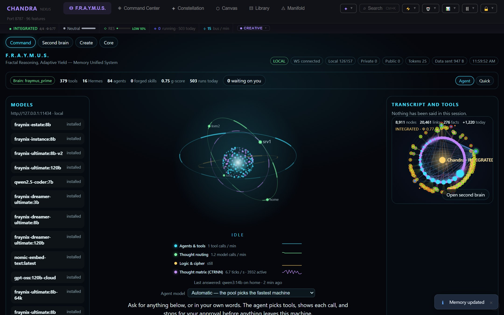
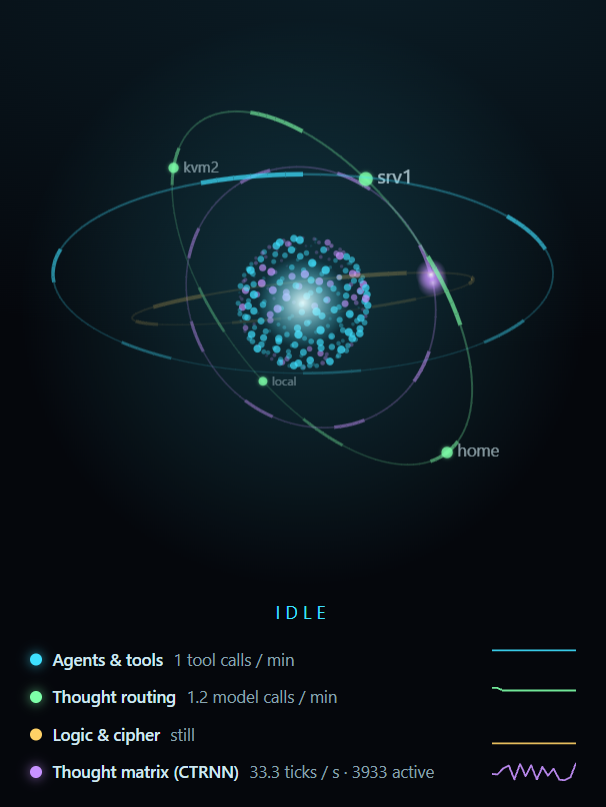
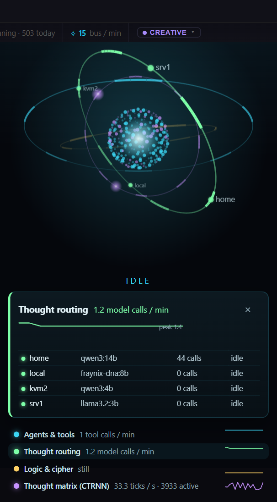
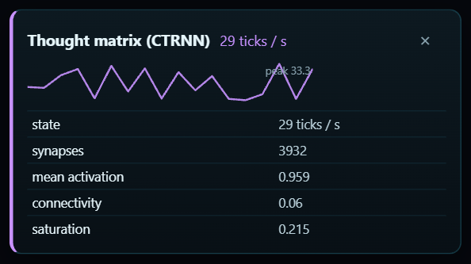
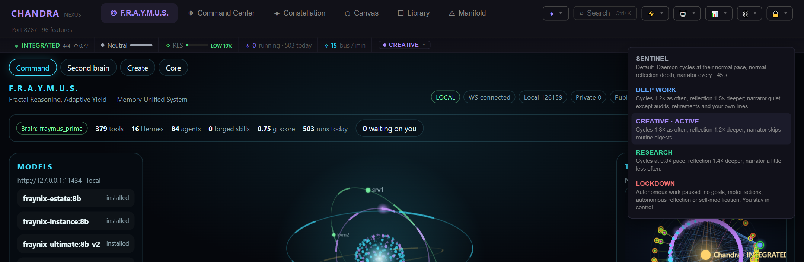
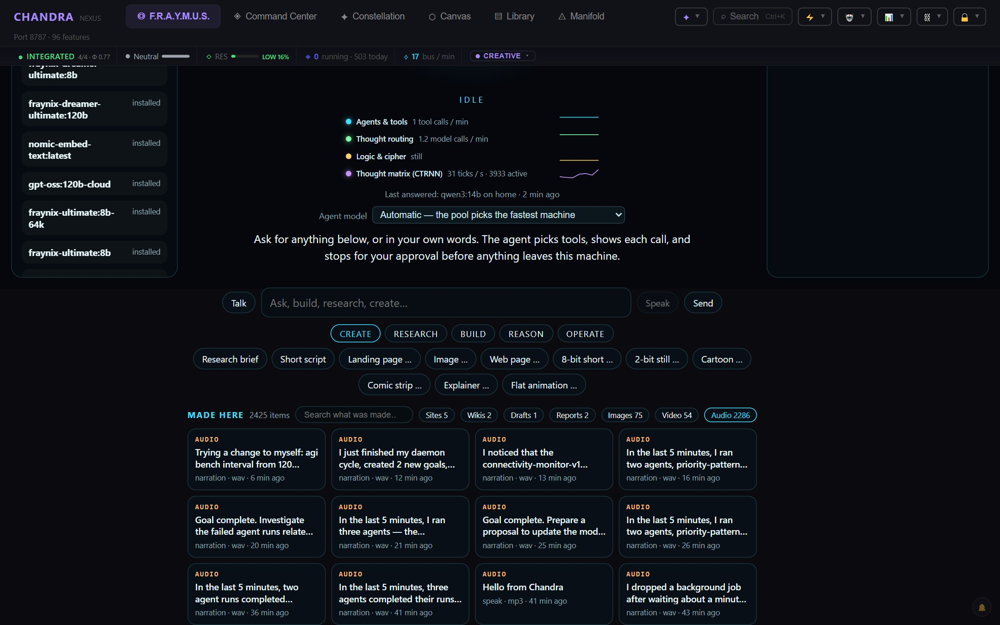
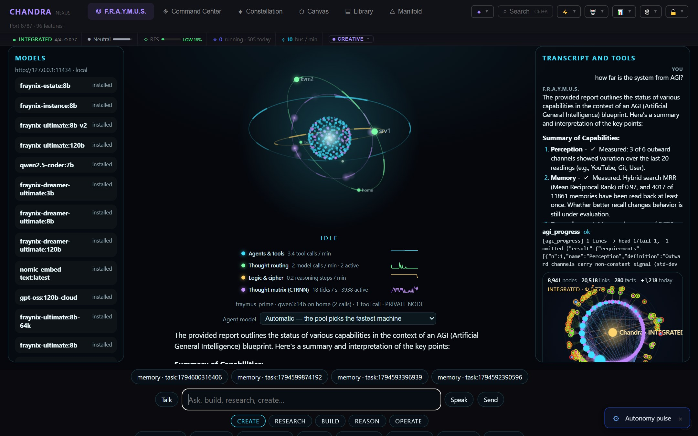

<h1 align="center">What is new — 12–13 November 2026</h1>

<strong>First proofs.</strong> Things the system did for the first time, each one checked in the running app, in its database or in its tests.

  <a href="../README.md">Main README</a> ·
  <a href="AGI-BLUEPRINT.md">AGI blueprint</a> ·
  <a href="FLAT-ANIMATION-METHOD.md">Flat animation method</a> ·
  <a href="UNIFIED-SYSTEM-AND-DREAM.md">Unified system and dream</a> ·
  <a href="HOME-AND-HERMES-OUTLINE.md">Home and Hermes</a> ·
  <a href="WEIGHTS-AND-GEMINI-OUTLINE.md">Weights and Gemini</a> ·
  <a href="../CLAUDE.md">Engineering notes (CLAUDE.md)</a>

---

*The home screen after these changes. The status strip shows the system's true state (INTEGRATED, 4 of 4 proofs). The orb in the middle is a 3-D view of four live processes around the neural core. On the right is the second brain.*

## Contents

1. [First proofs](#first-proofs)
2. [The orb: four live processes in 3-D](#the-orb-four-live-processes-in-3-d)
3. [The status strip and the operating modes](#the-status-strip-and-the-operating-modes)
4. [The narrator speaks in Vaughn's voice](#the-narrator-speaks-in-vaughns-voice)
5. [Answers written by the agent from measured data](#answers-written-by-the-agent-from-measured-data)
6. [Goals from real problems and Vaughn's projects](#goals-from-real-problems-and-vaughns-projects)
7. [The self-modification kernel can no longer slow the system down unnoticed](#the-self-modification-kernel-can-no-longer-slow-the-system-down-unnoticed)
8. [Dreams become experiments, code and a film](#dreams-become-experiments-code-and-a-film)
9. [Reliability: no answer that never comes](#reliability-no-answer-that-never-comes)
10. [Tests that cannot touch the real system](#tests-that-cannot-touch-the-real-system)
11. [New functions and routes](#new-functions-and-routes)
12. [Commits](#commits)
13. [Known limits](#known-limits)

---

## First proofs

| First time | What happened | Evidence |
|---|---|---|
| **An agent's action on the live stream waited for a human, ran on approval, and reported back** | Two agents working on the stream project asked to put a minted emote on the OBS overlay. The new approval gate held both until Vaughn approved. Both emotes were then minted, signed and stored. One reached the connected overlay; the other was minted while no overlay was connected. | Artifacts `art_mwfe9v70_uyv39f` (delivered to 1 overlay) and `art_mwfe9sz6_ag8w4w` (delivered to 0) in `streaming_artifacts`; both approvals `approved`; both runs `done` |
| **The narrator spoke in Vaughn's cloned voice, in its own words** | Live events (a goal completed, a daemon cycle, a hive digest) are said by a model as one checked sentence, voiced by VoiceStudio as `vaughn-one`, and saved to the Audio shelf. | `narrations` rows with engine `voicestudio:vaughn-one`; WAV files in `data/tts` (a 1 MB, ~22 s goal line was the first after the change) |
| **Autonomous goals came from real, measured problems** | Every goal now cites a numbered problem or one of Vaughn's projects, names the file, error or route, and says how it will be checked. | `goal_proposals`; refusals listed by `POST /api/goals/generate` |
| **A question about AGI was answered from measurements, not a template** | The agent fetched the 12 blueprint requirements with a tool and wrote the answer itself, quoting the real numbers. | Screenshot below; `agi_progress` tool call in the transcript |
| **The status strip showed the true consciousness tier** | It had shown DORMANT 0/4 while the gate was INTEGRATED 4/4. | Screenshot above; `GET /api/intelligence/consciousness/gate` |
| **An operating mode changed what the system does** | Modes used to be labels only. Now each changes daemon pace, reflection depth, narration, or pauses autonomy (Lockdown). | `test/home-readings.test.js` |
| **A test race was found by its mechanism, not guessed** | The Docker sandbox tests failed under load. CPU, disk and process load were each ruled out by measurement; freezing the event loop reproduced it (9–10 failures a run); the fixed tests pass under the same pauses. | `scripts/run-tests.mjs`, `test/sandbox-docker.test.js` |

---

## The orb: four live processes in 3-D

The orb is drawn on a canvas from `GET /api/fraymus-os/pulse` every 2 seconds. **Nothing in it moves unless the process behind it is working.**

| Ring | What it measures | What you see |
|---|---|---|
| **Agents & tools** (cyan) | Tool calls per minute; agent runs in flight | One particle per tool call |
| **Thought routing** (green) | Model calls per minute across the pool; calls in flight per machine | One bead per machine (home, local, kvm2, srv1); a comet flies from the core when a machine answers |
| **Logic & cipher** (gold) | Logic Chain steps, debates, benchmark problems, reasoner calls, verifier loops, cipher runs | One particle per reasoning step |
| **Thought matrix** (violet) | The CTRNN neural core: ticks per second, synapses | The core: all 256 neurons on a sphere, each lit by its current output `tanh(B)` (cyan positive, violet negative) |

Each ring sits on its own tilted plane in perspective, so its far side passes behind the core. Hover a ring to highlight it. Click it, or its row in the legend, to pin a card with two minutes of history and what is behind the number:

  
  

**Bug this exposed:** the logic ring read "still" while reasoning ran. It counted only three sources, one of which (`cipher_runs`) has never had a row. Counting every source then showed **65 Logic Chains stuck at "running"**. Chains run inside the server process, so every restart had left its chains marked running forever. They are now closed at boot.

Code: [`client/src/fraymus/Orb.jsx`](../client/src/fraymus/Orb.jsx), [`server/fraymus-os/pulse.js`](../server/fraymus-os/pulse.js), [`server/intelligence/transient-sweeper.js`](../server/intelligence/transient-sweeper.js).

---

## The status strip and the operating modes

**The strip had been showing defaults, not data.** It read field names the server does not send:

| Strip showed | True value |
|---|---|
| DORMANT 0/4 | **INTEGRATED 4/4**, Φ 0.77 |
| Resource bar at 0 | 10–20 % (LOW) |
| 0 agents | Runs in flight, plus runs today |
| 0 bus messages | Messages per minute |

Every gauge now reads the real value and has a tooltip saying what it measures.

**The operating modes now act.** They had no effect at all, and every restart silently reset them to Sentinel (Vaughn chose Creative on 7 and 10 November; both choices were lost). The mode now persists, and the strip's mode is a menu:

| Mode | Daemon cycles | Reflection | Narrator | Autonomy |
|---|---|---|---|---|
| Sentinel | normal | normal | every ~45 s | on |
| Deep Work | 1.2× as often | 1.5× deeper | only audits, retirements and your own lines | on |
| Creative | 1.3× as often | 1.2× deeper | no routine digests | on |
| Research | 0.8× pace | 1.4× deeper | a little less often | on |
| Lockdown | 1/10 pace | thinner | more often | **paused**: no goals, motor actions, autonomous reflection or self-modification |

Code: [`client/src/hud/ActivityPulseStrip.jsx`](../client/src/hud/ActivityPulseStrip.jsx), [`server/awareness/protocol-engine.js`](../server/awareness/protocol-engine.js).

---

## The narrator speaks in Vaughn's voice

*Narration lines on the shelf: a daemon cycle, a noticed pattern, five-minute activity digests, finished goals. Every one is a WAV file in Vaughn's voice.*

| Before | Now |
|---|---|
| A stock Microsoft voice (`en-US-GuyNeural`) | VoiceStudio `vaughn-one`; the stock voice only as a counted fallback |
| Fixed sentences read aloud ("motor reflect min ms from 2100000 to 3180000") | One sentence written by a model from the event's facts, in plain words (minutes, not milliseconds) |
| Audio only while an OBS overlay was connected | Every line voiced and saved to the shelf |
| Only milestones (goals, experiments, dreams) | Also every daemon cycle, and a digest every 5 minutes of agent runs, tool calls and model calls |

**The model is checked, not trusted.** A line is rejected, and the plain sentence spoken instead, if it:
- contains a number the event doesn't;
- names an agent the event doesn't mention;
- turns a score into an opinion ("about average" for 0.62);
- adds a second sentence (where unsupported commentary crept in);
- or simply copies the plain line.

It took three revisions to get here, measured on the same events. With only the facts, the model invented things (another agent's timeout became "my dream"). With the plain line shown as the sentence to say, it read it back word for word. Now 8 of 10 lines are factual single sentences; the other 2 were refused and spoken plain.

`POST /api/intelligence/narrator/preview {topic, facts}` phrases and voices an event without playing it on the stream.

Code: [`server/intelligence/narrator.js`](../server/intelligence/narrator.js).

---

## Answers written by the agent from measured data

Two home-screen questions went wrong in the morning:

- **"Analyze your system status"** got a list of installed Ollama models: a keyword shortcut that only knew the model registry.
- **"How far is the system from AGI?"** never answered. Four background agent runs were stuck waiting on tools that never returned, the system counted them as load, and it queued the question behind them indefinitely.

Now:

- **No more template answers.** Status and AGI questions go to the agent, with the right measuring tool loaded from its first step. New fleet tools: `system_status` (runs, stuck runs, goals, daemon, consciousness audit, self-audit, alerts, approvals, g-score, dreams, model pool) and `agi_progress` (the 12 falsifiable requirements of the [AGI blueprint](AGI-BLUEPRINT.md), each marked met, met only on a proxy, or failed). A pass on a proxy never counts as met.
- **Every tool call ends:** a call that runs past 5 minutes is abandoned and the run moves on.
- **A person's question is never queued** behind the system's own background work.
- **A Logic Chain returns at once** and finishes in the background.

The AGI answer today: **8 of 12 requirements met as measured, 3 only on a proxy, 1 failed** (learning: no lesson has passed its A/B test). It is not AGI, and the blueprint claims no AGI state.

Code: [`server/fraymus-os/system-report.js`](../server/fraymus-os/system-report.js), [`server/intelligence/agi-progress.js`](../server/intelligence/agi-progress.js), [`server/fleet/runtime.js`](../server/fleet/runtime.js).

---

## Goals from real problems and Vaughn's projects

The goal engine was shown only the names of memory categories, presented as "knowledge domains". **78 % of 2,719 goals in a week** (and in effect almost all of them) were about the system's own filing labels: "unify 'world', 'dream' and 'neurogenesis_seed' with verified fossil data". About 1,256 agent runs went to them, and the quality judge scored them *higher* than other work.

It now sees two lists:

- **Problems**, numbered, each with a check: open self-audit findings, real agent-run errors (restarts excluded), the weakest capability families, failed code changes, unread research, failed Make jobs.
- **Projects**, from `data/projects.json` (edit it, or `PUT /api/goal-engine/projects`): stream, store, studio, hive, fraynix.

Each goal must cite one of them and say how it will be checked. Goals about memory labels, or rewordings of a goal already proposed this week, are refused. The first batches named the missing `llama3.2:3b` model on srv1, a failed code change in `research-scout.js`, two unread papers, and a stream emote end to end.

That stream goal surfaced a real risk: `streaming.simulate_donation` was labelled safe, but it shows a donation on the live overlay. It now needs approval whenever an overlay is connected, and that gate produced the first proof in the table above.

Code: [`server/intelligence/goal-landscape.js`](../server/intelligence/goal-landscape.js), [`server/intelligence/goal-engine.js`](../server/intelligence/goal-engine.js), [`server/streaming/tools.js`](../server/streaming/tools.js).

---

## The self-modification kernel can no longer slow the system down unnoticed

The kernel kept a change if things got "no worse", and its rules only ever lengthened the delays. So it had stretched how often Chandra reflects from every 10 minutes to every 53, and goal-seeking from every 3 to every 5, each step "kept" because nothing broke.

- **Slowing down must pay for itself:** a change that slows the system is kept only on a measured gain.
- **A release rule:** any setting left on its slow side of the default is proposed halfway back.
- The live delays were reset to their defaults.

Code: [`server/intelligence/tunables.js`](../server/intelligence/tunables.js), [`server/intelligence/self-modification.js`](../server/intelligence/self-modification.js).

---

## Dreams become experiments, code and a film

Grounded dreams (lessons that must quote what actually happened) used to be stored as text and never used. Now:

- **Each kept dream is translated** into one of four things: an experiment the kernel measures, a code change built on a branch for a person to merge, an idea the verifier proves with a program, or an honest "none".
- **Code answers must be real:** a code change must name a function its target file actually declares (an early answer named one that does not exist).
- **A daily film:** recent lessons become a flat-vector film, using the lessons' own words as narration.

Code: [`server/intelligence/dream-bridge.js`](../server/intelligence/dream-bridge.js).

---

## Reliability: no answer that never comes

| Fault | Fix |
|---|---|
| Tools that never returned held agent runs open for up to 107 minutes | `withToolDeadline()`: a call is abandoned after 5 minutes (`FLEET_TOOL_TIMEOUT_MS`) |
| `chain.run` waited for a whole 16-step chain | `startChain()` returns the run id at once |
| A typed question was queued behind autonomous work | `startRun(…, { interactive: true })` |
| Home answers left "thinking" forever by a restart | Closed with a clear message at start-up |
| A refused Ouroboros cycle reported 200 "accepted" proposals on every daemon cycle | Reports 0 and records that the cycle was skipped |
| `self_audit_status` read its `mode` argument from the wrong place | Fixed |

---

## Tests that cannot touch the real system

- **Isolated databases:** every test process that names no data folder now gets its own throwaway database, removed on exit. Before, the tests read and wrote the real one. Twenty-four tests had depended on it; each was fixed.
- **Load tests:** the Docker sandbox tests were timing-sensitive. The suspected cause (disk syncs) was **disproven by measurement**. The real cause was test-process pauses against a 100 ms margin. The fake Docker daemon is now event-driven, and the separate "run alone" phase is gone.
- **Result:** the full suite passes, **948 of 948**.

Code: [`server/config.js`](../server/config.js), [`server/db.js`](../server/db.js), [`scripts/run-tests.mjs`](../scripts/run-tests.mjs).

---

## New functions and routes

| Function | Where | What it does |
|---|---|---|
| `withToolDeadline(tool, name, call)` | `server/fleet/runtime.js` | Ends any fleet tool call after its deadline |
| `startChain(objective, config)` | `server/chain/engine.js` | Starts a Logic Chain and returns its id at once |
| `systemFacts(db)` / `renderSystemReport(facts)` | `server/fraymus-os/system-report.js` | Live system readings, with no model call |
| `agiProgress(db)` / `renderAgiProgress(report)` | `server/intelligence/agi-progress.js` | The 12 blueprint requirements, measured |
| `realProblems(db)`, `loadProjects()`, `checkObjective()`, `sameJob()` | `server/intelligence/goal-landscape.js` | What goals are drawn from, and the checks they must pass |
| `slowsDown(name, before, after)` | `server/intelligence/tunables.js` | Whether a settings change slows the system |
| `checkPhrasing()`, `spokenFacts()`, `previewLine()`, `activityFacts()` | `server/intelligence/narrator.js` | The narrator's checked wording, preview and activity digest |
| `autonomyPaused()` | `server/awareness/protocol-engine.js` | True in Lockdown; every autonomous loop asks it |

| Route | What it does |
|---|---|
| `POST /api/intelligence/narrator/preview` | Phrase and voice an event without playing it |
| `GET /api/goal-engine/landscape` | The problems and projects goals are drawn from |
| `GET` / `PUT /api/goal-engine/projects` | Read or edit the project list |
| `POST /api/goals/generate {force}` | Generate goals now |
| `POST /api/awareness/protocol/activate {protocol}` | Switch operating mode (also from the status strip) |

| Fleet tool | What it does |
|---|---|
| `system_status` | Live system readings for any agent |
| `agi_progress` | The AGI blueprint requirements, measured |

---

## Commits

| Commit | Change |
|---|---|
| [`ae297d3`](https://github.com/eyeoverthink/chandra-fraymus/commit/ae297d3) | Dreams become experiments, code and a film |
| [`58f4f90`](https://github.com/eyeoverthink/chandra-fraymus/commit/58f4f90) | Every test runs on its own database |
| [`e4a6eca`](https://github.com/eyeoverthink/chandra-fraymus/commit/e4a6eca) | Answers that never came, a status that was a model list, the real sandbox race |
| [`31e9c24`](https://github.com/eyeoverthink/chandra-fraymus/commit/31e9c24) | No template answers, no throttle ratchet, the narrator in Vaughn's voice |
| [`550d908`](https://github.com/eyeoverthink/chandra-fraymus/commit/550d908) | Every narration line saved to the shelf |
| [`0b5da46`](https://github.com/eyeoverthink/chandra-fraymus/commit/0b5da46) | Daemon cycles and a 5-minute activity digest narrated |
| [`dd6dedf`](https://github.com/eyeoverthink/chandra-fraymus/commit/dd6dedf) | Goals from real problems and Vaughn's projects |
| [`fabc6e0`](https://github.com/eyeoverthink/chandra-fraymus/commit/fabc6e0) | True readings, operating modes that act, the orb in 3-D |

---

## Known limits

- **The quality judge is weak.** It rated the memory-label goals highly. Whether the new goals help will show in whether the listed problems get fixed, not in the quality score.
- **The narrator's wording comes from a 14B model.** The checks stop invented facts, not flat sentences.
- ~~**The transcript panel shows raw markdown**~~ — fixed the same day: agent answers are rendered as formatted text (headings, lists, bold, code, links) by [`client/src/fraymus/markdown.js`](../client/src/fraymus/markdown.js) and [`MarkdownText.jsx`](../client/src/fraymus/MarkdownText.jsx), which build React elements only — a model's text can never inject HTML. The AGI screenshot above shows the result. Test: [`test/markdown-render.test.js`](../test/markdown-render.test.js).
- **Logic & cipher reads "still"** whenever no reasoning ran in the last 5 minutes. That is the truth, not a fault.
- **These screenshots** were taken with a headless browser by a capture script. While taking them, an early version of that script clicked the Lockdown item in the mode menu by mistake. The system was in Lockdown for 71 seconds, then restored to Creative, and the protocol history records both changes.
