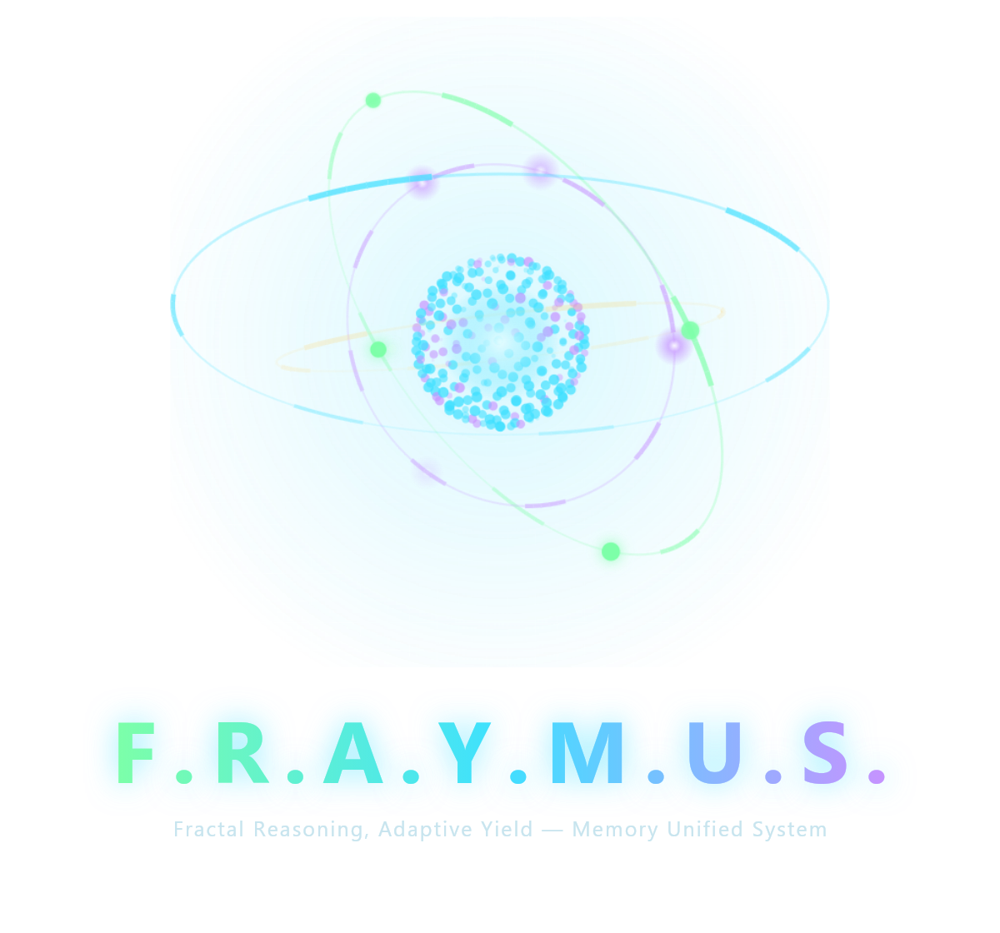

# F.R.A.Y.M.U.S. brand files

The logo is the home screen's live orb, rendered on its own: four live processes on tilted rings around the 256-neuron
core (see [What is new — 13 Nov 2026](../WHATS-NEW-2026-11-13.md#the-orb-four-live-processes-in-3-d)). The frame was
taken from the running app on 2026-11-13, so the rings, particles and neuron colours are real readings from that moment.
Machine names were left off so the mark carries no text. All files have a transparent background.

| File | Size | Use |
|---|---|---|
| [`fraymus-orb.png`](fraymus-orb.png) | ~760 px square | The mark alone, full size |
| [`fraymus-orb-512.png`](fraymus-orb-512.png), [`-256`](fraymus-orb-256.png), [`-64`](fraymus-orb-64.png) | 512 / 256 / 64 px | Avatars, the README header, small icons |
| [`fraymus-icon-256.png`](fraymus-icon-256.png), [`-64`](fraymus-icon-64.png) | 256 / 64 px | Icon cut: the faint halo removed and the rings brightened so they survive at small sizes. The app header uses this cut at 38 px (`client/src/assets/fraymus-orb-96.png`) |
| [`fraymus-logo.png`](fraymus-logo.png) | 1200 × 1120 | Stacked: the orb over the wordmark and tagline |
| [`fraymus-logo-horizontal.png`](fraymus-logo-horizontal.png) | 1262 × 343 | Horizontal: the orb beside the wordmark, for headers |

  

The wordmark uses the ring colours (green → cyan → violet), Segoe UI Bold, letter-spaced. These files were made by
`F:/Claude-Work/chandra-readme/capture-logo.mjs` (the orb, read straight from the canvas) and `compose-logo.mjs`
(trimming, sizes and lockups). The transparent files are meant for dark backgrounds: the halo and rings are light.
